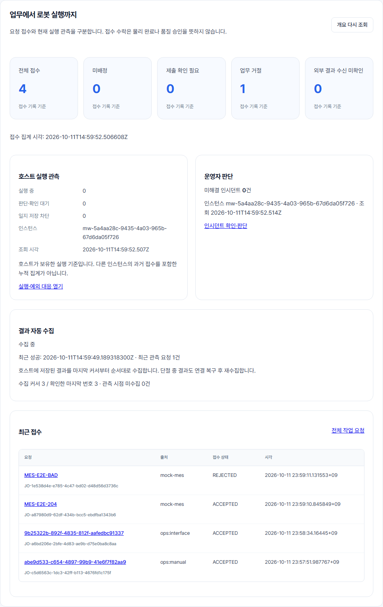
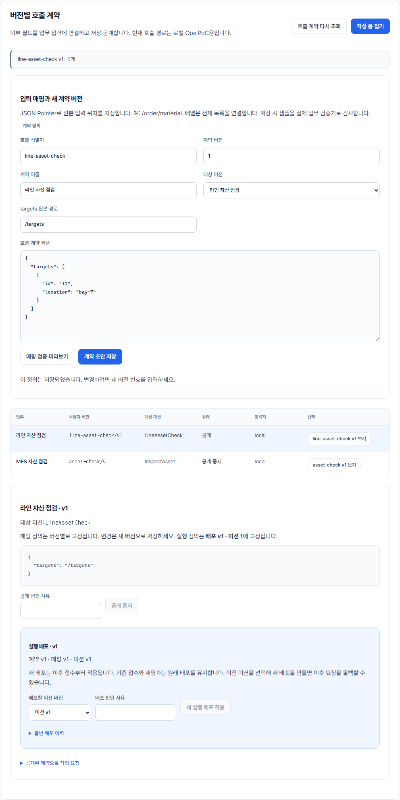
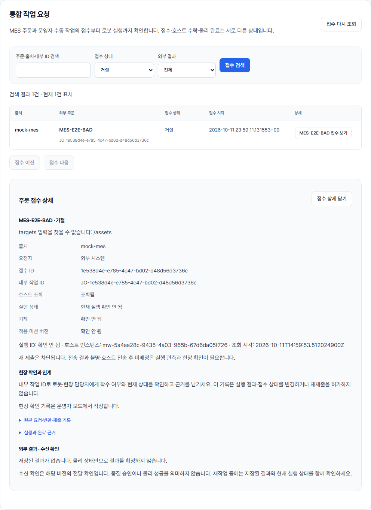
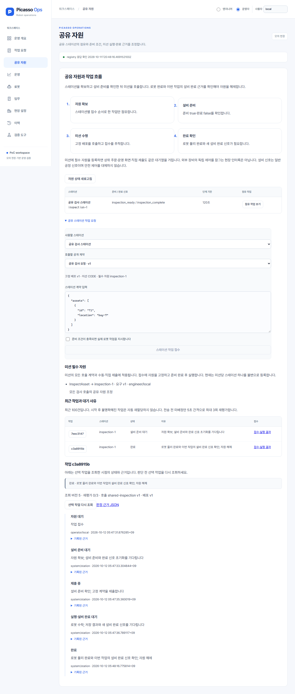
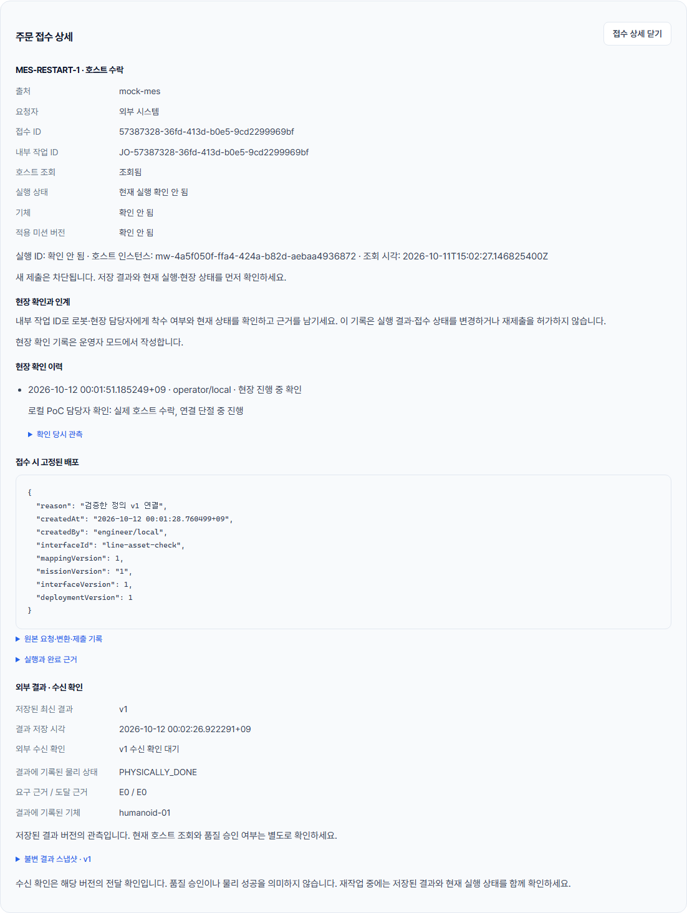

# picasso-ops

**상위 시스템의 주문을 로봇 미션에 연결하고, 접수부터 실행·결과 회신까지 운영하는 미들웨어 PoC입니다.**

MES·WMS 같은 상위 시스템은 주문을 전달하고, 로봇은 기종별 능력에 맞춰 작업을 수행합니다. 그 사이에는 입력 규격, 실행 버전, 배정 조건, 설비 사용 순서, 중복 요청 및 통신 단절을 처리하는 운영 계층이 필요합니다. picasso-ops는 이 흐름을 [picasso](https://github.com/LivingLikeKrillin/picasso) 기반으로 구현합니다.

현재 스택은 PostgreSQL, picasso registry·mimic, 셀 대역, 실행 호스트, 운영 API, React UI로 구성됩니다. **실물 로봇·PLC·상용 MES 연계는 검증하지 않았습니다.**



## 대표 시나리오: 상위 주문에서 작업 결과까지

설비 점검 임무를 정의해 상위 주문에 노출하는 전체 흐름입니다.

1. **임무 정의**: 입력 스키마, 샘플, 매핑 및 실행 초안을 작성합니다. 검증과 모의 실행을 거쳐 버전을 활성화합니다.
2. **인터페이스 배포**: 상위 입력을 임무 입력에 매핑하고, 실행 버전을 고정한 배포를 활성화합니다.
3. **주문 접수**: Mock MES가 주문 API를 호출합니다. 접수 번호를 영속 저장하며, 동일한 외부 주문이 재전송되면 기존 접수 결과를 반환합니다.
4. **실행 조정**: 로봇 배정 조건과 미션 필수 자원을 확인합니다. 공유 스테이션이 사용 중이면 대기열에 진입하고, 자원을 확보한 뒤 실행합니다.
5. **결과 확인**: 로봇 실행 근거와 설비 신호를 확인합니다. 완료 여부가 불확실하면 자원 소유권을 유지하고 운영자 확인을 요청합니다.
6. **상위 회신**: 결과 버전과 해시를 기준으로 수신 확인(ACK)을 기록합니다. 결과 전달 실패와 실제 작업 실패는 구분하여 관리합니다.

이 흐름이 범용 MES 커넥터 제공을 의미하지는 않습니다. 현재 상위 연계는 단일 Mock MES 식별자와 주문 계약으로 검증합니다.

## 핵심 가치와 검증 근거

| 운영에서 생기는 문제 | 구현한 대응 | 근거 |
|---|---|---|
| 미션이 바뀌면 상위 호출도 흔들림 | 입력 계약·매핑·실행 버전을 나누고 배포에 버전 고정 | [미션 완료 범위](docs/screens/mission-completion-2026-10-11.md) |
| 요청 재전송·재기동으로 중복 실행 위험 | 영속 접수, 요청 식별자, 재기동 복구·확인 절차 | [수동 접수](docs/screens/manual-receipts-2026-10-11.md), [신뢰성](docs/screens/reliability-implementation-2026-10-11.md) |
| 여러 호출 경로가 같은 설비를 사용 | 미션 필수 자원을 공통 대기열과 소유 관리에 연결 | [자원 실행 검증](docs/screens/mission-resource-enforcement-2026-10-12.md) |
| 실행 완료와 결과 전달 완료를 혼동 | 결과 버전·해시·ACK와 전달 이력을 별도 관리 | [상위 결과 회신](docs/screens/upstream-results-2026-10-11.md) |
| 새 로봇 도입 절차가 운영자에게 숨겨짐 | 어댑터·프로파일·바인딩·현장 명칭·배정 조건을 단계별 안내 | [로봇 도입 흐름](docs/screens/onboarding-refresh.md) |

## 주요 화면

아래 화면은 실제 로컬 API, PostgreSQL, mimic 환경의 브라우저 시나리오에서 캡처한 것으로, 실물 장비를 촬영한 결과는 아닙니다.

| 임무와 상위 계약 | 작업 접수와 결과 추적 |
|---|---|
|  |  |

| 필수 자원과 대기열 | 불확실한 요청의 확인과 복구 |
|---|---|
|  |  |

[전체 화면과 촬영 조건](docs/screens/style-preview/README.md)에서 모바일 화면과 각 검증 장면도 확인할 수 있습니다.

## 시스템 구성

| 구성 요소 | 책임 |
|---|---|
| `ui` | 운영 개요, 작업 요청, 공유 자원, 로봇 도입, 임무·인터페이스 관리 |
| `ops-service` | 운영 API, 상위 주문 계약, 영속 접수·결과·ACK, 공유 자원 조정 |
| `mission-host` | picasso를 사용하는 실행 호스트, 미션 검증·모의 실행·실행 복원 |
| `site` | registry·mimic·셀 대역을 띄우는 로컬 현장 런처 |
| `picasso/` | 고정 커밋의 읽기 전용 Core 서브모듈, Gradle composite build로 사용 |

[picasso-narrator](https://github.com/LivingLikeKrillin/picasso-narrator)는 내보낸 `ops.station.evidence/1` 파일을 해석해 설명할 수 있습니다. 설명은 Ops 상태를 변경하지 않으며, 현재 Ops UI와 자동으로 연결되어 있지 않습니다.

## 운영 흐름

| 사용자 목적 | 화면에서 이어지는 경로 |
|---|---|
| 새 로봇을 투입 | 로봇 추가 → 어댑터 등록 → 프로파일 시험·활성화 → 바인딩·현장 명칭 → 배정 조건 |
| 새 미션을 노출 | 임무 입력 계약 → 실행 초안 → 검증·모의 실행 → 활성화 → 인터페이스 매핑·배포 |
| 작업을 요청하고 추적 | 작업 요청 → 상위 주문 또는 수동 접수 → 접수 상세 → 실행·결과·수신 확인 |
| 설비 경합을 처리 | 공유 자원 → 대기열·소유자·신호 확인 → 불확실 상태 검토 |
| 변경 근거를 확인 | 이력 → 조작 주체·사유·결과 확인 |

새 미션은 지원하는 입력 스키마와 순차 실행 노드로 정의합니다. 자유로운 DAG, 분기, 임의 코드 실행이나 새로운 로봇 스킬 생성은 제공하지 않습니다.

## 상위 인터페이스

| 경로 | 용도와 경계 |
|---|---|
| `POST /integration/v1/job-orders` | Bearer 토큰으로 식별하는 Mock MES 주문 접수. 신규 202, 동일 주문 재접수 200 |
| `GET /integration/v1/job-orders/{id}` | 해당 상위 식별자가 접수한 주문 조회 |
| `POST /api/work-requests/manual` | 화면의 수동 작업 접수. `requestId`로 중복 접수 방지 |
| `POST /api/job-orders` | 기존 호출 경로. 영속 접수와 자원 조정에 연결되지만 요청 ID 기반 재전송 보장은 제공하지 않음 |

외부 주문 API는 `PICASSO_INTEGRATION_TOKEN`이 비어 있으면 비활성화됩니다. 현재 인증은 단일 서버 설정 식별자이며 다중 테넌트 IAM이 아닙니다. 상위 결과와 ACK의 전체 계약은 [구현 문서](docs/screens/upstream-results-2026-10-11.md)를 참고하세요. Mock MES 호출 도구는 `scripts/mock-mes.mjs`입니다.

## 선행 도구

스택 실행과 검증에 필요한 도구 목록입니다.

- Docker: 테스트(Testcontainers)와 Postgres 실행에 사용합니다.
- JDK 21 이상: Playwright와 `site/smoke.sh`의 배포본 실행에 필요하며, Gradle은 JDK 21 툴체인을 받아서 씁니다.
- Node 22
- `curl`: `site/smoke.sh` 실행에 사용합니다.
- bash: `site/smoke.sh`(`#!/usr/bin/env bash`), `set -a; . ./.env`, `env -u` 실행에 필요합니다. Windows 환경에서는 git-bash를 사용합니다(계획 실행 결과의 Windows 실측은 git bash 기준입니다).

## 저장소 받기

서브모듈을 포함하여 저장소를 복제합니다.

```bash
git clone --recurse-submodules https://github.com/LivingLikeKrillin/picasso-ops.git
cd picasso-ops
```

복제한 뒤 서브모듈을 초기화하고 갱신합니다.

```bash
git submodule update --init
```

서브모듈이 없으면 첫 빌드가 `picasso/gradle/libs.versions.toml` 위치에서 멈춥니다.

Windows 환경에서 `Filename too long` 오류가 발생하면 아래 설정을 적용하고 체크아웃합니다.

```bash
git -C picasso config core.longpaths true
```

체크아웃 복구 전에는 서브모듈의 로컬 변경 여부를 확인하세요.

환경 설정 파일인 `.env`는 저장소에 커밋되어 있습니다(`git ls-files`에 포함되어 있으며 첫 커밋은 `3a51f29`(S1a)입니다). 복사나 수정 없이 바로 사용합니다. 로컬 PoC 값(사이트 ID `SITE_ID=site-01`, DB 접속 정보, 포트 다섯 개, 토큰 두 개)이 지정되어 있으며, 첫 행 주석은 «이 기계 밖에서 쓰지 않는다»입니다. 런처, 실행 호스트, 운영 서비스, 테스트, CI가 이 설정을 읽습니다.

## 띄우기

전체 스택을 먼저 실행하는 방법과 smoke 스크립트로 부분 확인하는 방법을 안내합니다.

### 전체 스택

터미널 네 개를 열어 각 컴포넌트를 기동합니다.

1. Postgres 컨테이너를 실행합니다.

```bash
docker compose -f site/compose.yaml --env-file .env up -d --wait
```

2. 세 컴포넌트의 배포본을 빌드합니다.

```bash
./gradlew :site:installDist :mission-host:installDist :ops-service:installDist
```

3. 네 터미널 모두 각 저장소 루트에서 환경 변수를 적용합니다.

```bash
set -a; . ./.env; set +a
```

4. 터미널 1에서 런처를 실행합니다. 기동 출력에 registry 주소, mimic 기체와 gRPC 포트, 셀 대역 주소가 출력됩니다.

```bash
site/build/install/site/bin/site
```

5. 터미널 2에서 실행 호스트를 실행합니다. 모의 실행 프로파일과 스키마 경로가 작업 디렉터리 기준이므로 반드시 저장소 루트에서 실행합니다.

```bash
env -u PICASSO_INGEST_TOKEN -u PICASSO_OPERATOR_TOKEN mission-host/build/install/mission-host/bin/mission-host
```

6. 터미널 3에서 운영 서비스를 실행합니다. 실행 호스트는 운영 서비스가 `ops` 스키마를 올리기 전까지 미적용 상태를 유지하며 작업 지시를 거부합니다. 운영 서비스 기동 뒤 현장 설정의 적용 상태를 확인합니다.

```bash
env -u PICASSO_INGEST_TOKEN ops-service/build/install/ops-service/bin/ops-service
```

7. 터미널 4에서 화면 개발 서버를 실행합니다.

```bash
cd ui && npm ci && npm run dev
```

접속과 초기 상태 안내:

- 화면 주소는 `http://localhost:5173` 입니다. 해당 포트가 사용 중이면 Vite가 다음 포트를 엽니다.
- 운영 서비스 API 주소는 `http://127.0.0.1:8782/api/robots` 입니다.
- URL 해시가 없는 첫 접속은 로봇 화면, 엔지니어 모드, 사용자 `local`로 시작합니다. 운영 개요는 메뉴에서 선택합니다.
- 첫 조작은 상단 머리의 «엔지니어»와 «운영자» 라디오 버튼, «사용자» 입력 칸입니다.
- 사용자 이름은 정규식 `/^[A-Za-z0-9._-]{1,64}$/`을 따라야 하며, 어긋나면 직전 이름으로 요청합니다.
- 화면 영역은 URL 해시로 구분됩니다.
- Gradle run 작업 둘을 한 작업 트리에서 겹쳐 띄우지 않습니다.
- Postgres 볼륨은 보존되므로 다음 기동에도 데이터가 이어집니다. 처음부터 다시 시작하려면 정리 명령을 실행합니다.
- 주의: 정리 명령 실행 시 볼륨과 데이터가 삭제됩니다.

```bash
docker compose -f site/compose.yaml --env-file .env down -v
```

### 부분 확인: smoke 스크립트

핵심 동작을 빠르게 확인할 때 실행합니다.

```bash
bash site/smoke.sh
```

주의 사항과 범위:

- 주의: 종료할 때 같은 compose 프로젝트(`site`)를 `down -v` 처리하므로 직접 띄워 둔 스택의 볼륨과 데이터도 함께 삭제됩니다(`site/smoke.sh:3,9`).
- 확인 범위는 Postgres, 런처, 운영 서비스입니다. registry REST로 기체 하나를 선언하고 45초 안에 `CONFIRMED` 상태에 도달하는지 검증합니다.
- 실행 호스트를 띄우지 않으므로 임무나 운영 영역은 체험할 수 없습니다.
- 로그는 `build/site.log`와 `build/ops.log`에 남습니다.
- 실측 기준 기체 선언 16~17초 뒤 `CONFIRMED`에 도달하며, 종료 코드 0, 남은 컨테이너 0으로 종료합니다.

## 첫 체험 경로

전체 스택을 띄운 뒤 운영 개요에서 시작하세요. 새 기체는 로봇 추가 안내를 따라 준비하고, 임무에서 배정 조건을 확인합니다. 미션 입력 계약과 실행 버전을 만든 뒤 인터페이스를 배포하고, 작업 요청에서 수동 요청 또는 Mock MES 주문을 추적합니다. 공유 자원에서는 실행 중인 소유자와 대기열, 확인이 필요한 요청을 볼 수 있습니다.

정확한 입력값과 실행 순서는 [브라우저 생애주기 시나리오](ui/e2e/lifecycle.spec.ts)에 있습니다. 공유 자원 경합은 [별도 시나리오](ui/e2e/station.spec.ts)로 검증합니다.

## 시험

```bash
./gradlew build
cd ui
npm ci
npm test
npm run build
npm run lint
```

브라우저 검증은 전체 스택을 직접 띄웁니다. **종료 시 compose 프로젝트 `site`의 볼륨을 삭제하므로 보존할 데이터가 없는 시험 환경에서 실행하세요.** 기본 생애주기와 스테이션 시험은 각각 실행합니다.

```bash
cd ui
npx playwright install chromium
npx playwright test
npx playwright test --config=playwright.station.config.ts
```

2026-10-12 로컬 검증 기록은 다음 범위입니다. 전체 테스트 합계로 합산하지 않습니다.

| 검증 | 결과와 범위 |
|---|---|
| 운영 서비스 | 332개 통과 |
| 실행 호스트·현장 런처 | 각각 83개·38개, 해당 실행은 Gradle UP-TO-DATE |
| 전체 E2E | 13개 클래스·66개 통과 (마이그레이션 V15 적용 검증 포함) |
| UI | 23개 파일·213개 통과, 빌드·린트 통과 |
| Playwright | 생애주기 1개(7.2분), 별도 스테이션 1개(2.7분) 통과 |

이 기록은 해당 시점의 로컬 실행 결과입니다. 전체 E2E 재검증은 마이그레이션 목록의 오래된 기대값을 수정한 뒤 진행했습니다. 최신 CI 상태는 [Actions](https://github.com/LivingLikeKrillin/picasso-ops/actions)에서 확인하세요.

## 개발 방식

초기 단계별 설계·결함 주입·바이트 대조 기록은 [초기 개발 이력](docs/readme-history.md)에 보관합니다. 그 수치는 과거 단계의 기록이며 현재 전체 검증 수가 아닙니다. 최근 변경의 검증 범위와 한계는 각 구현 문서에 날짜와 함께 남깁니다.

## 중요한 한계

- 로컬 대역으로 운영 흐름을 검증합니다. 실물 로봇·PLC·산업 안전·벤더 호환성은 입증하지 않습니다.
- 미션 필수 자원은 현재 미션당 하나입니다. 소유 관리와 설비 신호 확인은 안전 PLC나 장비 측 fencing을 대신하지 않습니다. 실행 호스트를 직접 호출하는 외부 제어 경로까지 통제하지 않습니다.
- 로봇과 설비의 완료가 불확실하면 소유를 유지하고 확인을 요구합니다. 운영자가 현장을 확인해 자원을 해제한 사실을 물리 완료로 기록하지 않습니다.
- 실행 호스트 복원과 로봇 측 태스크 장부의 지속성은 다릅니다. 현장 런처·어댑터까지 재기동한 경우 같은 태스크 ID의 중복 물리 실행을 방지한다고 보장하지 않습니다.
- 외부 주문 토큰은 있으나 운영자 모드·사용자명은 제품 수준의 인증·권한 체계가 아닙니다. 실행 호스트와 셀 대역도 인증되지 않습니다.
- 모의 실행은 주어진 자재와 신호를 가정하고 실행 정의를 검사합니다. 실제 현장 상태나 모든 로봇 실패를 재현하지 않습니다.
- 결과 콜백은 localhost Mock MES 범위입니다. 상용 MES·WMS 커넥터, 로봇 교통 제어·경로 계획은 제공하지 않습니다.

## 문서

| 문서 | 내용 |
|---|---|
| [화면 설계서](docs/screens/screen-design.md) | 메뉴와 사용자 여정, 화면 책임 |
| [미션 완료 범위](docs/screens/mission-completion-2026-10-11.md) | 입력 계약·실행·인터페이스 배포 |
| [신뢰성 구현](docs/screens/reliability-implementation-2026-10-11.md) | 영속 접수·복원·확인 절차 |
| [미션 자원 실행](docs/screens/mission-resource-enforcement-2026-10-12.md) | 공통 접수·자원 소유·혼합 호출 검증 |
| [상위 결과 회신](docs/screens/upstream-results-2026-10-11.md) | 버전·해시·ACK와 전달 |
| [로봇 도입](docs/screens/onboarding-refresh.md) | 신규 유형과 기존 기체의 준비 절차 |
| [상세 참조](docs/reference.md) | 초기 구성·상태·운영 제약의 상세 기록 |
| [화면 자료](docs/screens/README.md) | 촬영 조건과 다시 찍는 방법 |
