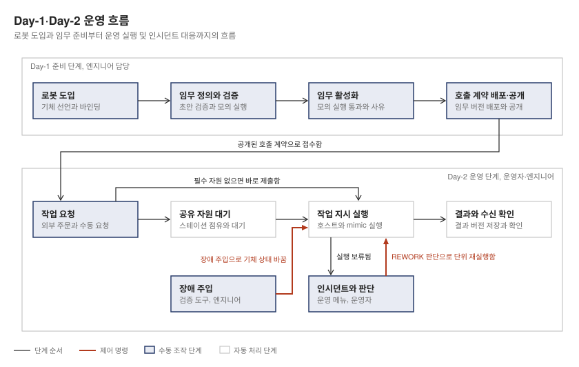
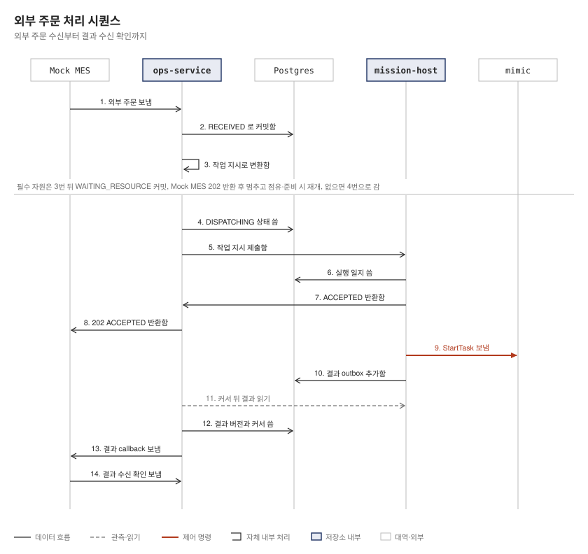
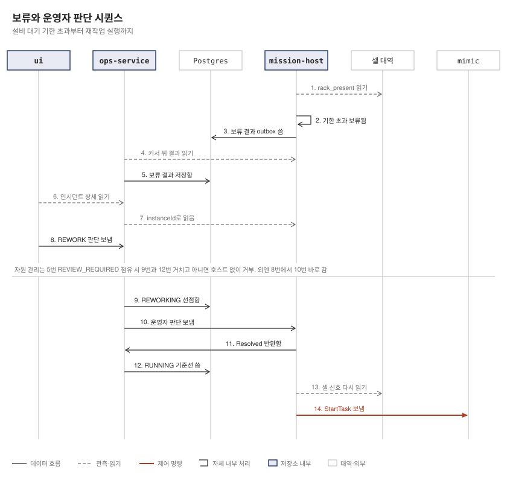
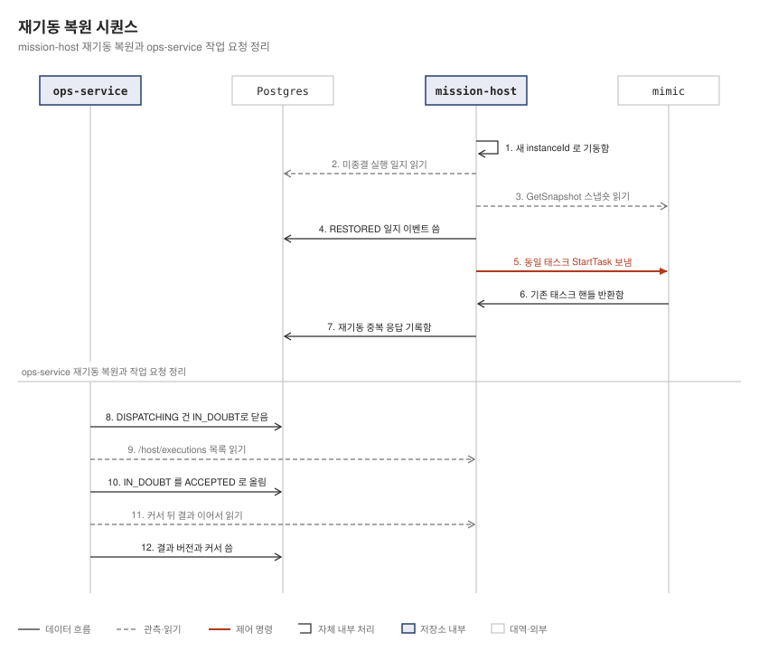

# 상세 참고 문서

## 단계 이력

현재 picasso-ops main 은 PR #24 가 머지된 `511d5bc`(2026-10-13 11:50 KST) 기준이며, 서브모듈 picasso 는 `74e4d3d` 에 고정되어 있습니다. S4b 와 화면 문서(#15) 뒤에 picasso-ops PR 아홉 개(#16~#24)가 추가 머지되었으며, 기능 변경인 #18 과 그 뒤 수정(#20·#21·#22), 문서(#16·#17·#19·#24), 화면과 응답 문구의 용어 정비(#23)를 포함합니다. 이 기간에 picasso 쪽 PR 은 없고 서브모듈 고정 커밋도 바뀌지 않았습니다.

P1 → S1a → S1b → S1c → P2a → P2b → S1d → 용어 → S2 → P3 → P4 → S3a → S3b → P5 → S3c → S4a → P6 → S4b → 화면 문서 → #16 → #17 → #18 → #20 → #21 → #19 → #22 → #23 → #24 (2026-10-07 13:47 ~ 2026-10-13 11:50 KST)

표는 머지 순서이며 P4(10/8 19:00)가 S3a(10/8 21:54)보다 먼저이고, #20(10/12 15:47:50), #21(15:48:08), #19(15:48:12)는 번호 순서가 아니라 이 순서로 머지되었습니다. P 는 picasso PR, S 는 picasso-ops PR 이며, #16 이후 행은 picasso-ops PR 번호로 적습니다. 용어 풀이는 [용어 풀이](#용어-풀이)를 참고합니다.

| 단계 | 더한 것 | PR(머지 커밋) |
|---|---|---|
| P1 | registry 어댑터 제품·빌드 등록·조회 운영자 REST 3개 | picasso #79 (`6b1a255`) |
| S1a | site·ops-service·ui·e2e 골격, 다섯 영역, 모드·사용자, 전체 상태 띠 | picasso-ops #1 (`b4fcc56`) |
| S1b | 로봇 선언·퇴역·복귀, 막힘·거부 판정, 기체 상세, Playwright CI | picasso-ops #2 (`d94a5e6`) |
| S1c | 어댑터 제품·빌드·인스턴스 등록과 화면 | picasso-ops #3 (`2a8c617`) |
| P2a | 리비전 시험 요청·집기·보고, 시험 실행기 | picasso #80 (`2370ed3`) |
| P2b | 리비전 제출·활성화·바인딩 REST, 기동 스킬 동기화 | picasso #81 (`41beedb`) |
| 문서 | P2·S1d 스펙, P2a·P2b 계획 | picasso-ops #4 (`3f00dfb`), #5 (`f84e095`) |
| S1d | 리비전·시험·활성화·바인딩·명칭 기록, 시운전 판정 | picasso-ops #6 (`694ea9e`) |
| 용어 | 용어집 대응표에 따른 문서·화면 문구 변경 | picasso-ops #7 (`7254521`) |
| S2 | 현장 설정 버전, 연결 기준 시간 변경, 막힘 근거 버전 | picasso-ops #8 (`16de942`) |
| P3 | 노드형 임무 정의·검증·버전 카탈로그, 실행의 임무 버전 고정 | picasso #82 (`8f0cc04`), 설계 picasso-ops #9 (`f7ca937`) |
| P4 | 기한에 닫힌 태스크 스트림 재부착, mimic 엔진 잠금 | picasso #83 (`1e3f4ae`) |
| S3a | 실행 호스트, 작업 지시·배정 가능·실행 목록·셀 대역 | picasso-ops #10 (`d16b19b`) |
| S3b | 임무 편집·검증·모의 실행·활성화, 셀 신호 조작 | picasso-ops #11 (`b2cce34`), 한계 문서 정정 picasso #84 (`2ca7cd6`) |
| P5 | 현장 시간값 소스 포트, 인시던트 의도의 설정 버전 | picasso #85 (`195c1ee`) |
| S3c | 시간값 넷, 실행 호스트 반영 표시 | picasso-ops #12 (`e482c33`) |
| S4a | 장애 주입, 인시던트, 보류 단위 운영자 판단 | picasso-ops #13 (`8ed1b91`) |
| P6 | 재기동 복원 입구 `Middleware.resume` | picasso #86 (`74e4d3d`) |
| S4b | 재기동 복원 보고, 이전 인스턴스 인시던트, 작업 응답 송신 기록 | picasso-ops #14 (`9606364`) |
| 화면 문서 | 스크린숏 65장, 화면 설계서·개발 내역, 촬영 설정 | picasso-ops #15 (`443a14c`) |
| 문서 | README 전면 재구성과 참고 문서(이 문서) 분리 | picasso-ops #16 (`2a8c94e`) |
| 문서 | 다이어그램 다크 버전(`.dark.svg`)과 테마별 전환 | picasso-ops #17 (`71345ac`) |
| 운영 확장 | 호출 계약과 배포, 외부 주문 API, 작업 요청 영속 저장, 결과 버전·수신 확인·콜백 전달, 호스트 결과 outbox, 공유 스테이션 조정과 임무 필수 자원, 화면 재구성 | picasso-ops #18 (`3bbcb9c`) |
| 수정 | 멈춘 작업 요청 정리(stale sweep), 자원 요구 등록 기준 조정, 현장 확인 해제와 작업 요청 종료 연동 | picasso-ops #20 (`efc578f`) |
| 수정 | 스테이션의 확인 필요 물리 상태 목록 정정, 재작업 관문과 `REWORKING`, 결과 버전 기준선(V16) | picasso-ops #21 (`3325a54`) |
| 문서 | README 의 첫 화면과 Mock MES 실행 절차 정정 | picasso-ops #19 (`88501ac`) |
| 수정 | 미배정 재평가와 자원 요구 등록의 경합을 임무 잠금으로 직렬화, 제출 직전 권한 거부의 `REJECTED` 종료 | picasso-ops #22 (`2ca84aa`) |
| 용어 | 층별 표준 이름(외부 주문, 호출 계약, 작업 요청, 임무, 작업 지시)으로 화면과 응답 문구 정비 | picasso-ops #23 (`bb1d8b5`) |
| 화면 문서 | 화면 설계서·개발 내역 개편, 대표 스크린숏 21장으로 교체, 촬영 스크립트 재작성 | picasso-ops #24 (`511d5bc`) |

단계별 결함 주입과 바이트 대조 수는 [초기 개발 이력](readme-history.md#개발-방식)에 있습니다.

## 구성 상세

### 구성 요소, 포트, 저장

| 구성 요소 | 역할 | 포트·바인딩 | 저장 |
|---|---|---|---|
| `ui/` | React·Vite·TypeScript 관리 화면, 운영 서비스만 호출, 메뉴 아홉(운영 개요, 작업 요청, 공유 자원, 운영, 로봇, 임무, 현장 설정, 이력, 검증 도구) | dev 5173, Playwright preview 4173 | 없음 |
| `ops-service/` | 화면의 유일한 백엔드, 외부 주문 API(`/integration/v1/...`), 작업 요청 영속 저장·결과 버전·수신 확인·콜백 전달, 공유 스테이션 조정, registry·실행 호스트 REST 호출, picasso 모듈 미사용(빌드가 `checkNoPicassoOnMain` 으로 집행) | `OPS_PORT=8782`, 루프백(`server.address=127.0.0.1`) | 스키마 `ops`, 마이그레이션 V1~V17, 표 15개와 뷰 1개 |
| `mission-host/` | picasso 미들웨어로 작업 지시 실행, 임무 정의 검증·모의 실행·활성화, 250ms 마다 셀 대역 읽기·pump, 내보낸 작업 응답을 결과 outbox 에 기록하고 `GET /host/result-events` 로 내줌, 호출자는 운영 서비스뿐 | `HOST_PORT=8785`, 루프백 | 스키마 `mission`, 마이그레이션 V1~V5, 표 13개 |
| `site/` | registry·mimic·`site-runner`·셀 대역을 한 프로세스에서 구동 | 아래 세부 구성 요소 참조 | registry 마이그레이션을 런처가 실행 |
| `registry` | 기체 원장, 어댑터·리비전·바인딩·명칭·생존 보고 | `REGISTRY_PORT=8781`, 루프백 | Postgres public |
| `mimic` | `humanoid-01`·`quadruped-01` 가상 기체, 가상 시계, seed 0 | `MIMIC_GRPC_PORT=8783`, 모든 인터페이스 | 메모리 |
| `site-runner` | 1초마다 리비전 시험 요청을 집어 별도 mimic 으로 시험, registry 에 결과 기록 | 없음 | registry |
| 셀 대역 | 셀 신호·자리·슬롯 관측, 신호 쓰기·장애 주입 입구, 신호 일곱(`inspection_ready`, `inspection_complete`, 텍스트 `inspection_job`, `inspection_job_done`, `rack_present`, 안전 신호 `guard_closed`, 텍스트 `lot_code`) | `SITE_CELL_PORT=8784`, 루프백 | 메모리 |
| Postgres | registry public, 운영 서비스 `ops`, 실행 호스트 `mission` | `127.0.0.1:55432` | `postgres:16-alpine`, DB `picasso`, `site/compose.yaml` |
| `picasso/` | 고정 커밋 `79e074d` 의 읽기 전용 서브모듈, Gradle `includeBuild` | 없음 | 없음 |
| `e2e/` | 한 JVM 에 Postgres·registry·mimic·실행 호스트·운영 서비스를 띄우는 통합 시험 | 시험 스택 | Testcontainers |
| `scripts/mock-mes.mjs` | Mock MES 역할로 외부 주문 API 를 부르는 로컬 도구 | 없음 | 없음 |

`ops` 스키마의 표는 다음과 같습니다.

- V1~V4: `operation_log`(조작 기록, 덧붙이기 전용), `site_settings`(현장 설정 버전, 덧붙이기 전용), 뷰 `site_timings_current`
- V5: `mission_interface`(호출 계약, 정의 칸은 변경 금지이고 상태만 바뀜)
- V6~V9: `work_request`(작업 요청), `work_result`(결과 버전), `work_request_recovery`(미배정 재평가 기록), `work_result_delivery`(콜백 전달 상태)
- V10~V13: `interface_deployment`(호출 계약 배포, 변경·삭제 금지), `mission_profile`(데이터 임무 입력 프로파일, 변경·삭제 금지), `result_cursor`(호스트 결과 피드 커서, 한 행), `work_request_review`(현장 확인 기록, 변경·삭제 금지)
- V14~V16: `rf_station`(공유 스테이션, 점유 작업 칸 `owner`), `station_run`(스테이션 작업), `station_event`(스테이션 작업 상태 이력, 변경·삭제·통째 비우기 금지), `mission_resource_requirement`(임무 필수 자원, 변경·삭제·통째 비우기 금지), V15 가 `work_request.required_station_id` 와 상태 `WAITING_RESOURCE` 를, V16 이 `station_run.result_baseline`·`baseline_review_only` 를 더함
- V17: 표를 새로 만들지 않고 `rf_station` 에 칸 넷(`job_signal`, `job_echo_signal`, `quarantined_by`, `quarantined_at`)과 제약 둘(`station_job_pair`, `station_quarantine_pair`, `job_signal`·`job_echo_signal` 은 각각 유일)을 더함

`mission` 스키마의 표는 다음과 같습니다.

- V1: `draft`, `mock_run`, `mission_version`(임무 버전)
- V2: `execution_journal`, `execution_journal_event`, `job_response_log`, `incident_copy`, `incident_copy_resolution`(S4b)
- V3: `draft.sample_order` 칸 추가
- V4: `result_producer`(생산자 id 와 마지막 순번을 든 한 행), `result_outbox`(순번이 붙은 결과 이벤트, 변경·삭제·통째 비우기 금지)
- V5: `execution_cancel`(운영자 실행 취소, 실행 호스트가 미들웨어 `cancel` 을 부르기 직전에 적음, `(instance_id, execution_id)` 유일), `robot_residual_hold`(잔여 파지 표시, `job_order_id` 유일), `robot_residual_hold_clearing`(표시 해소, `marker_id` 가 기본 키라 표시마다 많아야 하나). 셋 다 변경·삭제·통째 비우기 금지(V2 의 `mission_record_append_only()` 트리거), `approver_kind` 는 `'PERSON'` 만, 사유는 공백만이면 안 됨. 시각은 DB `clock_timestamp()`.

마이그레이션 수와 표 수는 `ops-service/src/main/resources/db/ops/` 와 `mission-host/src/main/resources/db/mission/` 의 SQL 파일을 세고 `CREATE TABLE`·`CREATE VIEW` 를 세어 얻은 값입니다.

### 핵심 경로

핵심 경로는 다음과 같습니다.

- 장애 주입: 화면 `/api/faults` → 운영 서비스 `/host/faults` → 실행 호스트 → 현장 루프백 `/faults` → 잠금 아래 mimic 엔진 직접 호출
- 신호 쓰기: 화면 `/api/cell/signals/{name}` → 운영 서비스 `/host/cell/signals/{name}` → 실행 호스트 → 현장 `/cell/signals/{name}`
- 외부 주문: Mock MES `POST /integration/v1/job-orders`(Bearer 토큰) → 운영 서비스가 `work_request` 를 먼저 커밋 → 입력 변환·배포 고정 → 임무에 필수 자원이 있으면 스테이션 대기열, 없으면 실행 호스트 `POST /host/job-orders`
- 화면 작업 요청: 운영 화면 `POST /api/work-requests/manual`, 호출 계약 `POST /api/mission-interfaces/{id}/{version}/invoke`, 기존 경로 `POST /api/job-orders` 가 모두 같은 작업 요청 경로를 지남
- 작업 지시 배정: 운영 서비스가 배정 가능 기체만 후보로 선정 → 실행 호스트의 picasso 미들웨어가 하나 선택 → mimic 기체에서 실행
- 결과 회신: 실행 호스트가 작업 응답을 `mission.result_outbox` 에 순번과 함께 기록 → 운영 서비스가 5초마다 `GET /host/result-events` 를 커서로 읽어 `ops.work_result` 버전으로 저장 → 콜백 설정이 있으면 2초마다 루프백 Mock MES 로 전달 → Mock MES 가 `POST /integration/v1/job-orders/{id}/results/{version}/ack` 로 수신 확인
- 공유 스테이션: 운영 서비스 스테이션 워커가 2초마다 `tick` → 대기열 맨 앞 작업이 스테이션을 점유 → 셀 대역의 준비·완료 신호를 실행 호스트 `GET /host/cell` 로 읽음 → 조건이 맞으면, 작업 번호 쌍이 있는 스테이션은 작업 번호를 `POST /host/cell/signals/{name}` 으로 먼저 쓴 뒤 작업 요청 제출

### 기타 구성 및 설정

- 모의 실행: 실행 호스트 내부의 별도 mimic과 가상 시계로 표본 작업 지시 하나를 실행합니다. 현장 기체, 셀 대역, registry 에는 접근하지 않으며 프로파일로 `mission-host/mock-run/humanoid-a.json` 을 사용합니다.
- 서브모듈: `picasso 79e074d` 커밋(picasso PR #91 머지, 2026-10-13)으로 고정된 읽기 전용 서브모듈입니다. 버전 카탈로그 `picasso/gradle/libs.versions.toml` 을 공유하며 picasso 라이브러리 측 수정은 picasso 저장소 PR 로 반영합니다. 고정 커밋은 picasso main `79e074d` 와 같습니다. 실행 호스트가 #91 의 `PhysicalState.occupiesRobot`(판정)·`pumps`(취소 대상)를 씁니다.
- 환경 변수(`.env`): `SITE_ID`, `PICASSO_DB_URL`, `PICASSO_DB_USER`, `PICASSO_DB_PASSWORD`, `REGISTRY_PORT`, `OPS_PORT`, `MIMIC_GRPC_PORT`, `SITE_CELL_PORT`, `HOST_PORT`, `PICASSO_OPERATOR_TOKEN`, `PICASSO_INGEST_TOKEN`. 실제 값은 커밋된 `.env` 를 따릅니다.
- `.env` 밖의 선택 환경 변수(운영 서비스): `PICASSO_INTEGRATION_TOKEN`(비면 외부 주문 API 꺼짐), `PICASSO_INTEGRATION_SOURCE`(기본 `mock-mes`), `PICASSO_LOCAL_CALLBACK_URL`(루프백 IP 리터럴 http 주소만, 비면 콜백 전달 꺼짐), `PICASSO_LOCAL_CALLBACK_TOKEN`
- 운영 서비스 주기 속성(`ops-service.properties`): `ops.results.poll-ms=5000`(결과 수집과 멈춘 작업 요청 정리), `ops.requests.stale-seconds=300`, `ops.results.delivery-ms=2000`, 스테이션 워커 `ops.stations.poll-ms` 는 속성 파일에 없고 코드 기본값 2000
- 기체 명부: `site/robots.json` 에 `humanoid-01`(HA-0001, `humanoid-a.json`)과 `quadruped-01`(QB-0001, `quadruped-b.json`)이 정의되어 있습니다.

## 운영 흐름 상세

<picture>
  <source media="(prefers-color-scheme: dark)" srcset="diagrams/operations-flow.dark.svg">
  
</picture>

운영 흐름의 전문은 [README 의 운영 흐름](../README.md#운영-흐름)에 기술되어 있습니다. 그림은 기체 도입(Day-1)과 운영(Day-2)의 화면 절차입니다. 외부 주문과 공유 스테이션을 포함한 작업 요청의 흐름은 이 문서의 [작업 요청과 결과 회신](#작업-요청과-결과-회신), [공유 스테이션 조정](#공유-스테이션-조정) 절에 있습니다.

설계 제안 §8.1에 따라 초안은 언제나 작성할 수 있으며, 활성화 단계에서만 강한 관문 검증을 적용합니다.

## 주요 시퀀스

### 작업 지시

<picture>
  <source media="(prefers-color-scheme: dark)" srcset="diagrams/sequence-job-order.dark.svg">
  
</picture>

- 배정 가능 판정 분담: 운영 서비스는 시운전과 연결 상태를 판정하고, 실행 호스트는 스킬 적합, 도는 실행(picasso `PhysicalState.occupiesRobot`, 정착하지 않은 실행과 부분 완료 `PARTIAL` 실행, 운영자 보류 포함), 복원 못 한 실행, 미해소 잔여 파지 표시, 현장 시간값 미적용, 실행 일지 차단을 판정합니다. 운영 서비스는 배정 가능한 기체만을 후보로 전달합니다. 같은 작업 지시 id 의 리비전도 그 기체의 부분 완료 실행이나 잔여 파지 표시에 걸려 `UNASSIGNED` 로 남습니다.
- 기록 시점: 화면의 작업 지시 폼은 `POST /api/work-requests/manual` 로 작업 요청을 만듭니다. 운영 서비스는 실행 호스트를 부르기 전에 `ops.work_request` 행을 `RECEIVED` 로 따로 커밋하고, 입력을 작업 지시로 변환해 저장한 뒤 `DISPATCHING` 으로 바꾸고 나서 `POST /host/job-orders` 를 부릅니다. 작업 지시 id 는 `JO-<작업 요청 id>` 로 작업 요청마다 고정됩니다. 실행 호스트는 새 실행 정보를 응답하기 전에 실행 일지에 먼저 기록합니다. 운영 서비스는 응답을 받은 뒤 조작 기록에 남기고 작업 요청 상태를 `ACCEPTED`, `UNASSIGNED`, `REJECTED`, `IN_DOUBT` 가운데 하나로 정합니다.
- 작업 응답 처리: 실행 호스트가 작업 지시를 받은 시점(`ACCEPTED`)에는 작업 응답을 만들지 않습니다. pump 가 mimic 에서 태스크를 시작하고, 실행이 정착하거나 보류될 때 작업 응답을 송신 기록(`job_response_log`)에 남깁니다. 처분이 송신인 작업 응답은 같은 트랜잭션에서 결과 outbox(`result_outbox`)에도 순번과 함께 기록됩니다.
- 재조회 동작: 응답이 없으면 운영 서비스가 1초 뒤 실행 목록을 한 번 재조회합니다. 목록에 그 작업 지시가 보이면 `ACCEPTED` 이고, 보이지 않아도 보내지 않았다는 증거로 보지 않아 `IN_DOUBT` 로 둡니다.

### 보류와 운영자 판단

<picture>
  <source media="(prefers-color-scheme: dark)" srcset="diagrams/sequence-hold-decision.dark.svg">
  
</picture>

- 운영자 보류 전환: 운영자 보류 대기 템플릿 `ARRIVAL_WAIT_HOLD`의 설비 대기 단위가 20초 기한을 초과하면 단위 운영자 보류로 전환되고 인시던트가 봉인됩니다.
- 상태 기록: 해당 pump 직후 인시던트 사본과 보류 작업 응답이 호스트 DB `mission`에 기록됩니다.
- 운영자 판단 전달: 운영자 판단(완료 확인 또는 재작업, 사유 필수 입력) 시 상세 정보의 `instanceId`를 실어 운영 서비스에서 실행 호스트로 전달합니다.
- 인스턴스 불일치 검증: 실행 호스트 재기동으로 인해 인스턴스가 다르면 409 `INSTANCE_MISMATCH`를 반환합니다.
- 사유 기록 위치: 입력된 사유는 실행 호스트로 전달되지 않으며, 조작 기록에만 남깁니다.
- 판단 기록 반영: 판단 행은 다음 pump 뒤 인시던트 사본에 반영됩니다. 그전에 재기동하면 판단은 조작 기록에만 남습니다.
- 장애 주입 처리: 진행 중 `pick_place` 스킬 실패와 같은 장애 주입은 대개 `GRASP_FAILED` 인시던트로 이어지며, 이는 운영자 판단 대상이 아닙니다.
- 재작업 관문: 재작업(`REWORK`) 판단만 관문을 지나고 완료 확인(`CONFIRM_DONE`)은 그대로 전달됩니다. 운영 서비스는 실행 호스트의 실행 목록에서 그 실행의 작업 지시를 찾아 작업 요청과 잇고, 그 작업 요청에 임무 필수 자원(`required_station_id`)이 있으면 공유 스테이션 조정을 거쳐서만 재작업을 전달합니다. 자세한 조건은 [재작업 관문](#재작업-관문) 링크로 안내합니다.

## 작업 요청과 결과 회신

이 절은 작업 요청의 상태 전이, 중복 방지와 배포 고정, 멈춘 작업 요청 정리, 그리고 실행 호스트의 결과 수집과 회신 메커니즘을 다룹니다. 관련 코드는 `ops-service/src/main/kotlin/dev/picasso/ops/service/requests/WorkRequests.kt` 에 있습니다.

### 작업 요청 상태

| 상태 | 뜻 | 다음 상태 |
|---|---|---|
| `RECEIVED` | 행을 막 커밋한 상태입니다. 호스트 호출 전에 반드시 `DISPATCHING` 을 먼저 기록하므로 `RECEIVED` 는 호스트에 보내지 않은 것이 확실합니다. | 입력 검증 거부나 내부 오류면 `REJECTED`(내부 오류 상세: 호스트에 보내지 않았으니 새 요청 ID 로 다시 보내라는 안내), 임무에 필수 자원이 있으면 `WAITING_RESOURCE`, 아니면 `DISPATCHING` 입니다. |
| `WAITING_RESOURCE` | 임무 필수 자원의 스테이션 대기열에 들어간 상태입니다. 스테이션 작업(`station_run`, 상태 `QUEUED`)과 같은 트랜잭션에서 기록합니다. | 스테이션이 준비되면 `DISPATCHING`, 스테이션 작업이 `TIMED_OUT`·`CANCELLED`·`REJECTED` 가 되거나 운영자가 현장 확인 후 해제(`CONFIRM_CLEAR`)하면 `REJECTED` 입니다. |
| `DISPATCHING` | 실행 호스트에 제출하는 중입니다. 이 뒤의 중단은 보냈는지 알 수 없습니다. | 제출 결과에 따라 `ACCEPTED`·`UNASSIGNED`·`REJECTED`·`IN_DOUBT` 입니다. 제출 직전 자원 권한 확인이 거부되면 `REJECTED`(호스트 호출 전이라 보내지 않은 것이 확실)입니다. 현장 확인 후 해제되면 `IN_DOUBT` 입니다. 오래 멈추면 정리가 `IN_DOUBT` 로 닫습니다. |
| `ACCEPTED` | 실행 호스트가 작업 지시를 받은 상태입니다(제출 응답이나 관측으로 확인). `ACCEPTED`·`IN_DOUBT` 는 `detail` 을 바꾸지 않아 제출 전 문장(«공통 작업 요청 검증 완료», «필수 자원 확보 및 설비 준비 확인», «운영자 미배정 재평가: <사유>»)이 남습니다. | 종료 상태입니다. 결과는 결과 버전으로 따로 쌓입니다. |
| `REJECTED` | 보내지 않았거나 실행 호스트가 거부한 상태입니다. 실행 호스트가 거부(호스트 200 `REJECTED` 또는 호스트 4xx)하면 `detail` 을 «호스트 제출 거부: <rejectionReason>»(사유가 비면 «호스트 제출 거부: 사유 없음», 2000자에서 자름)로 바꿉니다(전에는 제출 전 문장이 남음). 구조는 `submission.outcome` 에 그대로 남고, 상세 API `GET /api/work-requests/{id}` 가 `rejection {reason, remedy, remedyWithheld, alternativeLocations, sourceMissing}` 으로 싣습니다(호스트가 거부한 `REJECTED` 일 때만 있고 입력 검증, 제출 직전 권한, 배포 변경, 멈춤 정리, 스테이션 종료로 닫힌 `REJECTED` 와 다른 상태는 null, 이들은 제 `detail` 그대로). | 종료 상태입니다. |
| `UNASSIGNED` | 배정 가능 기체가 없어 제출하지 못한 상태입니다. 두 갈래로 나뉩니다. 전송 전 미배정(운영 서비스 판정에 배정 가능 기체 없음, 호스트 안 부름, 제출 기록 없음)은 `detail` 이 전과 같은 판정 문장(`humanoid-01: 이유; 이유 / quadruped-01: 이유` 꼴)입니다. 호스트 미배정(호스트가 200 `UNASSIGNED`)은 `detail` 을 «호스트 미배정: <robotId>: <reason> / <robotId>: <reason>; <reason>» 로 바꿉니다(앞은 `refusals` 가 기체마다 낸 사유, 뒤는 `excluded` 로 호스트가 판정에서 뺀 기체 이유를 `; ` 로 이음. 둘 다 없으면 «호스트 미배정: 기체별 사유 없음», 2000자에서 자름). 제출 기록이 있으므로 미배정 재평가 대상이 아닙니다. | 제출 기록과 실행 관측이 없는 `UNASSIGNED` 만 운영자 미배정 재평가(`POST /api/work-requests/{id}/recover`)로 `DISPATCHING` 이 됩니다. 필수 자원이 있는 작업 요청은 이 API 가 409 `RESOURCE_MANAGED` 로 막고 공유 스테이션 조정만 재평가합니다. |
| `IN_DOUBT` | 제출 결과를 확정할 수 없는 상태입니다(응답 없음, 재조회에도 안 보임, 예외, 제출 중 중단). | 자동 재제출은 없습니다. 결과 피드 이벤트나 상세 조회에서 호스트 실행 목록에 그 작업 지시가 보이면 `ACCEPTED` 로 올라갑니다. 미배정 재평가는 409 `RECOVERY_NOT_SAFE` 입니다. |

운영자는 `POST /api/work-requests/{id}/reviews` 로 현장 확인을 기록할 수 있습니다. 관측 값은 `NOT_CONFIRMED`·`NOT_STARTED`·`IN_PROGRESS`·`COMPLETED` 넷이고 사유와 조회한 `updatedAt` 이 필요합니다(바뀌었으면 409 `STALE_REVIEW`). 기록은 `work_request_review` 에 남고 변경·삭제가 금지되며, 작업 요청 상태를 바꾸거나 제출하거나 완료로 만들지 않습니다.

### 중복 방지와 배포 고정

- `work_request` 는 `(source_system_id, external_order_id)` 가 유일합니다. 출처는 외부 주문이면 설정 식별자(기본 `mock-mes`), 운영 화면 수동 요청이면 `ops:manual`, 호출 계약 호출이면 `ops:interface` 이고, 키는 외부 주문이면 `externalOrderId`, 화면이면 요청 본문의 `requestId`(정규 UUID)입니다.
- 본문은 키 순서를 정렬한 JSON 의 SHA-256(`payload_hash`)으로 비교합니다. 같은 키에 같은 본문이면 기존 작업 요청을 돌려주고(외부 주문 API 는 새 요청 202, 재전송 200), 다른 본문이면 409 `ORDER_CONFLICT` 입니다. 화면 요청은 본문에 요청자(`requestedBy`)가 들어가므로 같은 요청 ID 를 다른 사용자가 보내도 409 입니다.
- 재전송은 상태와 상관없이 다시 제출하지 않습니다. `IN_DOUBT` 도 마찬가지입니다.
- 기존 경로 `POST /api/job-orders` 는 호출마다 새 `requestId` 를 만들어 같은 작업 요청 경로를 지나므로, 호출자 쪽 재전송의 중복 방지는 제공하지 않습니다.
- 변환한 작업 지시(`normalized_order`)에는 작업 요청을 받은 시점의 배포(`deploymentVersion`, `missionVersion`)가 들어갑니다. 대기열에서 나와 제출할 때는 저장한 작업 지시를 그대로 쓰고, 미배정 재평가는 원래 입력을 다시 변환해 저장본과 다르면 409 `RECOVERY_INPUT_CHANGED` 로 막습니다. 호출 계약 호출에 `expectedDeploymentVersion` 을 주면 현재 배포와 다를 때 409 `STALE_DEPLOYMENT` 입니다.

### 멈춘 작업 요청 정리

- 결과 수집 워커(`WorkResultCollector`)가 `ops.results.poll-ms`(5000ms)마다 결과를 모으기 전에 `sweepStale` 을 먼저 돌립니다.
- `updated_at` 이 `ops.requests.stale-seconds`(기본 300초)보다 오래된 `RECEIVED` 는 `REJECTED`(상세: 처리 중단, 호스트에 보내지 않았으니 새 요청 ID 로 다시 보내라)로, `DISPATCHING` 은 `IN_DOUBT`(상세: 제출 도중 중단, 실행 관측과 현장 확인 필요)로 닫습니다. `WAITING_RESOURCE` 는 스테이션 조정의 몫이라 건드리지 않습니다.
- 정리를 먼저 돌리는 까닭은 멈춘 제출이 `IN_DOUBT` 가 된 뒤에 관측이 `ACCEPTED` 로 올릴 수 있게 하기 위해서입니다(코드 주석). 정리가 실패해도 결과 수집은 계속합니다.
- 작업 요청 경로의 상태 전이는 «현재 상태가 `RECEIVED` 일 때만» 같은 조건부 갱신이라, 정리가 먼저 닫은 행을 덮어쓰지 않습니다.

### 결과 버전과 회신

- 실행 호스트는 처분이 송신인 작업 응답을 `mission.result_outbox` 에 기록합니다. 순번은 `mission.result_producer` 한 행을 잠그고 같은 트랜잭션에서 하나씩 올리므로 커밋 순서와 같고 빈 번호가 없습니다. 재기동 중복으로 판정한 응답은 기록하지 않습니다. `GET /host/result-events?after=&limit=`(limit 1~200)이 생산자 id(`producerId`), 마지막 순번(`highWatermark`), 이벤트 목록을 줍니다.
- 운영 서비스 수집은 `ops.result_cursor` 의 순번 다음부터 100건씩 읽습니다. 순번이 이어지지 않거나 이벤트 하나라도 형식이 틀리면 그 쪽 전체를 저장하지 않고, 생산자 id 가 바뀌면 멈춥니다. 커밋 직전에 커서가 그대로인지 확인해 두 수집기가 같은 쪽을 두 번 저장하지 않게 합니다.
- 결과 버전(`ops.work_result`)은 작업 요청마다 1부터 올라가는 버전이고, 한 버전은 호스트 인스턴스·실행·작업 응답 id 조합 하나입니다. 스냅숏을 키 정렬 JSON 으로 만든 SHA-256 을 `result_hash` 로 둡니다. 코드는 버전 행을 덧붙이기만 하고 `acknowledged_at` 만 한 번 채웁니다. 이 표에는 변경을 막는 DB 트리거가 없으므로 불변은 코드 관례입니다.
- 외부 결과 API 는 `GET /integration/v1/job-orders/{id}/results/latest`, `GET .../results/{version}`, 수신 확인 `POST .../results/{version}/ack` 를 제공합니다. 본문은 정확히 `{"resultHash": "<64자리 16진>"}` 이고, 해시가 다르면 409 `RESULT_CONFLICT`, 같은 수신 확인을 다시 보내면 처음 기록한 `acknowledgedAt` 을 그대로 돌려줍니다. 다른 출처의 작업 요청은 404 입니다.
- 콜백 전달(`WorkResultDelivery`)은 `PICASSO_LOCAL_CALLBACK_URL` 이 있을 때만 켜지고 주소는 루프백 IP 리터럴 http 만 받습니다. `ops.results.delivery-ms`(2000ms)마다 설정 출처의 결과 버전을 `work_result_delivery` 에 넣고, 한 번에 최대 10건을 `FOR UPDATE SKIP LOCKED` 와 30초 임대로 집어 보냅니다. 본문은 `receiptId`·`version`·`resultHash`·`snapshot`, 헤더는 `Idempotency-Key: <작업 요청 id>/v<버전>` 입니다. 2xx 면 `DELIVERED`, 아니면 `RETRY` 이고 다음 시도까지 2의 min(시도 수, 8)제곱 초를 기다립니다(최대 256초, 코드의 300초 상한에는 닿지 않음). 시도 수 상한이나 영구 실패 상태가 없어 4xx 도 계속 다시 보냅니다. HTTP 성공은 전달 성공일 뿐 수신 확인이 아닙니다.

## 공유 스테이션 조정

공유 스테이션(`ops.rf_station`)은 엔지니어가 등록합니다(`POST /api/stations`). 준비 신호와 완료 신호는 셀 대역에 선언된 안전 신호가 아닌 일반 BOOLEAN 신호여야 하고 서로 달라야 하며, 단계 기한 `timeout_seconds` 는 5~3600초입니다. 등록 뒤 바꿀 수 없습니다. 선택 칸인 작업 번호 송신 신호 `jobSignal` 와 작업 번호 반환 신호 `jobEchoSignal`(DB 칸 `job_signal`, `job_echo_signal`)은 둘 다 있거나 둘 다 없어야 하고(DB 제약 `station_job_pair`), 서로 달라야 하며, 셀 대역에 선언된 안전 아닌 TEXT 신호여야 합니다(거부 문구 «작업 번호 송신·반환 신호는 둘 다 연결하거나 둘 다 비워야 합니다.», «현장에 선언된 TEXT 신호가 필요합니다.»). 격리 칸은 `rf_station.quarantined_by`(격리를 건 스테이션 작업 id, `station_run` 참조)와 `quarantined_at`(둘 다 있거나 둘 다 없음, 제약 `station_quarantine_pair`)입니다. `GET /api/stations` 의 스테이션 행에 `jobSignal`, `jobEchoSignal`, `quarantinedBy`, `quarantinedAt` 이 실립니다. 설비 쪽 요구 사양은 [공유 스테이션 설비 연동 요구 사양](station-equipment-requirements.md) 에 있습니다. 스테이션은 한 번에 한 작업만 점유합니다(`rf_station.owner`, 부분 유일 색인 `station_one_owner`). 스테이션 작업(`ops.station_run`)은 두 길로 생깁니다. 운영자가 `POST /api/stations/runs` 로 직접 요청하거나(요청 ID, 스테이션, 호출 계약과 버전, 조회한 배포 버전, 입력), 임무에 필수 자원(`ops.mission_resource_requirement`, 임무당 스테이션 하나, 엔지니어 등록, 변경·삭제 금지)이 있으면 모든 작업 요청 경로가 작업 요청을 `WAITING_RESOURCE` 로 두고 같은 id 의 스테이션 작업을 대기열에 넣습니다. 스테이션 워커(`StationWorker`)가 `ops.stations.poll-ms`(기본 2000ms)마다 `StationCoordinator.tick` 을 부릅니다. 상태나 대기 사유가 바뀔 때마다 `revision` 이 오르고 `ops.station_event` 에 한 행이 남습니다. 근거는 `GET /api/stations/runs/{id}/evidence`(스키마 `ops.station.evidence/1`)로 읽습니다.

### 스테이션 작업 상태

| 상태 | 뜻 | 다음 상태 |
| --- | --- | --- |
| `QUEUED` | 대기열에서 차례를 기다림 | 스테이션에 점유 작업이 없으면 가장 먼저 들어온 작업(`created_at`, `run_id` 순)이 점유해 `WAITING_READY`. 운영자 `CANCEL_QUEUED` 면 `CANCELLED` |
| `WAITING_READY` | 스테이션을 점유하고 설비 준비를 기다림. 로봇에는 아직 보내지 않음 | 준비 신호가 true 이고 완료 신호가 false 면 `DISPATCHING`(이때 `dispatched_at` 기록). 단계 기한이 지나면 `TIMED_OUT`. 격리 중이면 운영자 `CONFIRM_STATION_IDLE` 전까지 보내지 않으며(사유 «스테이션 격리; 현장 확인과 격리 해제 판단을 기다립니다») 단계 기한은 멈춤. 작업 번호 쌍이 있는 스테이션은 작업 번호 쓰기 성공 뒤 `DISPATCHING`(근거 `jobSignal`·`jobToken`·`signals`), 쓰기 실패면 `WAITING_READY` 에 남음(사유 «작업 번호 쓰기 실패; 설비 신호 기록을 기다립니다») |
| `DISPATCHING` | 고정한 호출 계약으로 작업 요청을 제출함 | 제출 결과가 `ACCEPTED` 면 `RUNNING`, 전송 전 미배정이면 `WAITING_ROBOT`, `REJECTED` 면 `REJECTED`(사유는 «계약 제출 거부: <작업 요청 detail>; 자원 해제», `detail` 이 없거나 비면 «계약 제출 거부; 자원 해제»), 그 밖이거나 호출 결과를 모르면 `REVIEW_REQUIRED`. 프로세스가 이 상태에서 멈췄다면 다음 `tick` 이 같은 키로 작업 요청을 다시 찾아볼 뿐 새로 보내지 않음 |
| `RUNNING` | 로봇이 받아 실행 중. 저장된 결과와 새 설비 완료 신호를 기다림 | 완료 조건(아래 기준선 절)이 맞으면 `COMPLETED`. 기준선보다 새 결과의 물리 상태가 `OPERATOR_HOLD`·`IN_DOUBT`·`UNVERIFIED`·`FAILED`·`ABORTED`·`PARTIAL` 이면 `REVIEW_REQUIRED`. 셀 신호를 읽을 수 없거나 단계 기한이 지나도 `REVIEW_REQUIRED`. 작업 번호 쌍이 있는 스테이션은 완료 신호가 true 이고 반환 번호가 다르면 «설비 완료 신호 수신, 작업 번호 불일치; 현장 확인이 필요합니다» 로 `REVIEW_REQUIRED`(근거 `expected`·`echoed`·`signals`), 반환 신호가 읽기에 없어도 `REVIEW_REQUIRED` |
| `WAITING_ROBOT` | 호스트에 보내기 전 배정 가능 기체가 없었음 | 설비가 여전히 준비 상태이고 이 상태에 들어온 지 5초가 지났으며 재평가가 3번 미만이면 `RETRYING` 으로 선점한 뒤 미배정 재평가. 작업 요청이 더는 전송 전 미배정이 아니면 그 상태에 따라 전이. 단계 기한이 지나면 `REVIEW_REQUIRED` |
| `RETRYING` | 미배정 재평가를 호스트에 보내는 중 | 결과에 따라 `RUNNING`·`WAITING_ROBOT`·`REJECTED`·`REVIEW_REQUIRED`, 결과를 모르면 `REVIEW_REQUIRED`. `tick` 이 이 상태를 처음 보면 앞 프로세스가 멈춘 것으로 읽고 `REVIEW_REQUIRED` |
| `REWORKING` | 운영자 재작업을 실행 호스트에 전달하는 중. 다른 판단을 막음 | 아래 재작업 관문 절. `tick` 이 이 상태를 보면 앞 프로세스가 멈춘 것으로 읽고 `REVIEW_REQUIRED` |
| `REVIEW_REQUIRED` | 자동으로 판단하지 않고 점유를 유지한 채 현장 확인을 기다림 | 운영자 `RESUME_OBSERVATION` 이면 `RUNNING`, `CONFIRM_CLEAR` 면 `MANUALLY_CLEARED`, 재작업 관문을 지나면 `REWORKING`. 작업 번호 쌍이 없고 보낸 적(`dispatched_at`)이 있는 작업은 `CONFIRM_CLEAR` 시 스테이션 격리도 걸림 |
| `COMPLETED` | 로봇 물리 완료와 이번 작업의 설비 완료 신호를 확인하고 점유를 풂 | 종료 |
| `TIMED_OUT` | 설비 준비 단계 기한 초과, 로봇에 보내기 전에 점유를 풂 | 종료. 묶인 작업 요청이 `WAITING_RESOURCE` 면 `REJECTED` |
| `CANCELLED` | 운영자가 대기열에서 취소 | 종료. 묶인 작업 요청이 `WAITING_RESOURCE` 면 `REJECTED` |
| `REJECTED` | 작업 요청 제출이 거부되어 점유를 풂(묶인 작업 요청이 `REJECTED` 면 사유 «계약 제출 거부: <작업 요청 detail>; 자원 해제», detail 이 없거나 비면 «계약 제출 거부; 자원 해제») | 종료 |
| `MANUALLY_CLEARED` | 운영자가 현장 확인 뒤 점유를 풂. 물리 완료 판정이 아님 | 종료. 묶인 작업 요청이 `WAITING_RESOURCE`·`UNASSIGNED` 면 `REJECTED`(실행하지 않음), `DISPATCHING` 이면 `IN_DOUBT`(실행 관측으로 확인), `IN_DOUBT`·`ACCEPTED`·`REJECTED` 는 그대로. 작업 번호 쌍이 없는 스테이션에서 `dispatched_at` 이 있는 스테이션 작업을 `CONFIRM_CLEAR` 로 해제하면 같은 트랜잭션에서 스테이션을 격리함(이력에 «자원 해제에 따른 스테이션 격리» 기록) |

단계 기한은 그 상태에 들어온 시각(`phase_at`)부터 스테이션의 `timeout_seconds` 로 잽니다. 실행 중 기한 초과는 점유를 유지하고 자동으로 다시 실행하지 않습니다. 대기 사유만 바뀌는 경우(작업 번호 쓰기 실패, 격리)는 `phase_at` 을 바꾸지 않으며, 격리 중 설비 준비 기한은 멈추고 `CONFIRM_STATION_IDLE` 판단 시각부터 다시 셉니다. 미배정 재평가 요청 ID 는 스테이션 작업 id 와 시도 번호로 정해지는 UUID 이고, 재평가는 최대 3번입니다.

### 운영자 판단

`POST /api/stations/runs/{id}/decision`(운영자 모드만, 본문 `expectedRevision`·`decision`·`reason`, 조회한 버전과 지금 버전이 다르면 409)으로 요청합니다.

- `CANCEL_QUEUED`: `QUEUED` 만 `CANCELLED` 로 바꿉니다.
- `RESUME_OBSERVATION`: 작업 요청이 묶인 `REVIEW_REQUIRED` 만 대상으로 합니다. 셀 신호를 스테이션 잠금 전에 읽고, 읽지 못하면 503, 설비 완료 신호가 켜져 있으면 409(신호를 초기화한 뒤 다시 하라)를 반환합니다. 통과하면 `RUNNING` 으로 돌리고 `dispatched_at` 을 지금으로 다시 정합니다. 로봇에 아무것도 다시 보내지 않습니다.
- `CONFIRM_CLEAR`: `REVIEW_REQUIRED` 만 `MANUALLY_CLEARED` 로 바꿉니다. 점유를 풀고 같은 트랜잭션에서 묶인 작업 요청을 위 표처럼 닫습니다. 해제는 실행 호스트의 실행을 멈추지 않습니다. 판단 전(잠금 밖)에 셀 신호와 해제할 작업의 작업 요청을 읽어 이력 근거에 `signals`, `receiptId`, `physicalState`, `resultVersion`, `quarantined` 를 남기며, 셀 신호를 읽지 못해도 해제는 막지 않습니다(근거의 `signals` 는 null). 작업 번호 쌍이 없는 스테이션에서 `dispatched_at` 이 있는 스테이션 작업을 해제하면 같은 트랜잭션에서 스테이션을 격리하고, 해제한 작업의 이력에 «자원 해제에 따른 스테이션 격리» 한 행을 더 남깁니다(정상 완료, 대기 취소, 전송 전 시간 초과, 제출 거부는 격리하지 않음).
- `CONFIRM_STATION_IDLE`: 격리된 스테이션을 점유해 `WAITING_READY` 인 스테이션 작업에만 씁니다(아니면 409 «격리된 스테이션을 점유해 설비 준비를 기다리는 작업만 격리를 해제합니다»). 셀 신호를 스테이션 잠금 전에 읽고, 읽지 못하면 503 «현장 신호를 확인할 수 없어 격리를 해제하지 않습니다», 완료 신호가 켜져 있으면 409 «설비 완료 신호가 켜져 있습니다. 신호가 꺼진 것을 확인한 뒤 격리를 해제하십시오». 통과하면 격리 칸을 비우고 상태는 `WAITING_READY` 그대로 새 단계로 다시 들어가며(단계 기한이 그 판단 시각부터 다시 시작), 이력에 «현장 확인 후 격리 해제: {사유}» 와 근거 `releasedRunId`·`quarantinedAt`·`signals` 를 남깁니다. 로봇에 아무것도 보내지 않습니다.

### 재작업 관문

인시던트 화면의 보류 해소 가운데 재작업(`REWORK`)만 관문 `StationReworkGuard` 를 지납니다. 재작업은 보류한 단위를 다시 돌려 로봇이 다시 움직이기 때문입니다. 운영 서비스가 실행 호스트의 실행 목록에서 실행 id 로 작업 지시를 찾고 작업 요청과 잇습니다. 실행 목록을 읽지 못하면 503 `HOST_SILENT`, 그 실행이 목록에 없으면 409 `EXECUTION_NOT_FOUND` 로 막습니다(자원 관리 여부를 알 수 없으니 막음). 요청한 인스턴스가 호스트의 현재 인스턴스가 아니면 그대로 넘기고 호스트가 `INSTANCE_MISMATCH` 로 거부합니다. 작업 요청이 없거나 필수 자원이 없는 작업 요청이면 그대로 넘깁니다. 필수 자원이 있는 작업 요청이면 그 스테이션 작업이 지금 스테이션의 점유 작업이고 상태가 `REVIEW_REQUIRED` 일 때만 허용합니다. 아니면 409(«자원 관리 작업의 재작업은 스테이션 점유를 유지한 확인 필요 상태에서만 할 수 있습니다»)를 반환합니다. 허용하면 먼저 `REWORKING` 으로 선점하고, DB 잠금 밖에서 호스트에 전달한 뒤 다시 잠금 안에서 결과를 반영합니다. 반영 시 호스트가 거부하거나 결과를 모르거나, 셀 신호를 모르거나, 설비 완료 신호가 켜져 있으면 사유를 남기고 `REVIEW_REQUIRED` 로 돌립니다(점유 유지). 반영되었고 완료 신호가 꺼져 있으면 `RUNNING` 으로 가고 `dispatched_at` 을 지금으로 다시 정합니다. 관문이 막은 요청은 사전 거부라 조작 기록에 남지 않습니다.

### 결과 버전 기준선

V16 이 `station_run.result_baseline` 과 `baseline_review_only` 를 더했습니다. `RUNNING` 에 들어갈 때마다(제출 수락, 미배정 재평가 수락, 관측 재개, 재작업 반영) 같은 잠금 트랜잭션에서 그 작업 요청의 최신 결과 버전을 `result_baseline` 으로 적습니다. 그보다 새 결과만 이번 시도의 근거로 씁니다. 그래서 재작업이나 관측 재개 직후 이미 저장된 이전 보류 결과로 곧바로 `REVIEW_REQUIRED` 로 되돌아가지 않습니다. 관측 재개는 같은 실행을 다시 보는 것이므로 `baseline_review_only` 를 true 로 둡니다. 이때는 확인 대기 중 저장된 `PHYSICALLY_DONE` 도 완료 근거로 인정하되, `REVIEW_REQUIRED` 로 넘기는 판단에는 기준선보다 새 결과만 씁니다. 재작업은 재작업 전에 저장된 물리 완료를 완료 근거로 쓰지 않습니다. `COMPLETED` 조건 전체는 (가) 저장된 최신 결과의 물리 상태가 `PHYSICALLY_DONE`이고 기준선보다 새 결과이거나 관측 재개여야 하며, (나) 설비 완료 신호가 true이고, (다) 그 읽기가 이번 `RUNNING` 진입 뒤의 것이어야 하며, (라) 작업 번호 쌍이 있는 스테이션은 같은 읽기의 반환 번호가 이번 작업 번호여야 합니다. `tick`은 셀 신호를 읽기 직전에 운영 서비스 시계로 `readAt`을 적고, `readAt`이 `phase_at`(이번 `RUNNING` 진입 시각, 운영 서비스 시계)보다 앞이면 그 읽기의 완료 true는 판단하지 않습니다. 현장 시계와 운영 서비스 시계가 다르므로 신호의 `observedAt`(현장 시계)은 비교하지 않고 근거에만 남깁니다. `RUNNING`에 들어가는 길(제출 수락 전 준비 확인, 미배정 재평가 전, 관측 재개, 재작업 반영)은 모두 그 직전에 완료 신호 false를 확인합니다.

### 작업 번호 신호와 스테이션 격리

작업 번호 쌍이 있는 스테이션은 등록 칸 `jobSignal`·`jobEchoSignal`(TEXT)을 씁니다. 작업 번호는 스테이션 작업 id(UUID 문자열)입니다. 운영 서비스가 `WAITING_READY`에서 준비 true·완료 false를 읽으면 잠금 밖에서 `jobSignal`에 번호를 씁니다(`OpsStationPort.write`, `CellSignalOperations.write` 경유로 운영 서비스 → 실행 호스트 → 현장, 조작 기록 `WRITE_CELL_SIGNAL`, 행위자는 그 스테이션 작업의 요청자). 현장이 받아들였거나 응답 없음 뒤 다시 읽은 값이 같으면 성공입니다. 그 뒤 다시 스테이션 잠금 안에서 상태·`revision`·점유·격리 여부가 그대로인지 확인하고 `DISPATCHING`으로 넘깁니다. 바뀌었으면 넘기지 않고, 실패면 «작업 번호 쓰기 실패; 설비 신호 기록을 기다립니다»로 남깁니다. 설비는 시작 때 번호를 붙들고, 완료 신호를 올리기 전에 반환 신호에 그 번호를 써야 합니다. 완료 true인데 반환 번호가 다르면 «설비 완료 신호 수신, 작업 번호 불일치; 현장 확인이 필요합니다»로 `REVIEW_REQUIRED`가 되며 점유를 유지합니다. 운영자가 신호를 내리고 `RESUME_OBSERVATION`을 하면 이번 번호로 완료할 수 있습니다. 설비 세부 요구는 [공유 스테이션 설비 연동 요구 사양](station-equipment-requirements.md)을 봅니다.

외부 검토 실험 A1에서 확인되었듯, 스테이션 작업 X를 보낸 뒤 로봇이 끝나지 않아 실행 기한 초과로 `REVIEW_REQUIRED`가 되었을 때 운영자가 `CONFIRM_CLEAR`로 해제해도 실행 호스트에서 X의 실행이 멈추지 않습니다. 해제는 실행을 멈추지 않으므로, 다음 작업 Y가 보내진 뒤 X 쪽 설비가 늦게 완료 신호를 올리면 Y의 완료로 잘못 받아들일 위험이 있습니다. 따라서 작업 번호 쌍이 없는 스테이션은 보낸 적이 있는 스테이션 작업을 `CONFIRM_CLEAR`로 해제하면 스테이션을 격리합니다. 격리되면 다음 작업은 `WAITING_READY`에서 보내지 않고 기한이 멈추며, `CONFIRM_STATION_IDLE`로 풉니다. 해제 조건과 구체적인 거부 사유는 운영자 판단 절을 봅니다.

이 격리 방식에도 한계는 남습니다. 작업 번호 쌍이 없는 스테이션에서 X가 정상 완료한 뒤 X 쪽 설비가 완료 신호를 다시 true로 쓰면, 실행 중인 Y의 로봇이 물리 완료일 때 Y의 완료로 받아들일 수 있습니다(정상 완료는 격리하지 않습니다). 둘을 가를 수 있는 것은 작업 번호 쌍뿐입니다.

### 잠금과 실행 단위

DB 잠금(스테이션 행 `FOR UPDATE`, 임무별 advisory 잠금 `pg_advisory_xact_lock(hashtext(임무 id))`)은 판단에만 쓰고 호스트 호출 동안에는 잡지 않습니다. 작업 번호 쓰기도 호스트 호출이라 잠금 밖에서 하고 그 뒤 잠금 안에서 상태·`revision`·점유·격리를 다시 확인한 뒤에만 `DISPATCHING`으로 넘깁니다. `tick` 과 `rework` 는 JVM 의 `@Synchronized` 로 한 프로세스 안에서 서로 겹치지 않습니다. `tick` 이 `RETRYING`·`REWORKING` 을 보면 앞 프로세스가 멈췄다고 읽는 것은 조정기가 하나뿐일 때만 맞습니다. 배포 전제는 [보장 범위](guarantees.md) 링크를 봅니다.

## 시스템 동작 및 운영 상세

### 데이터와 재기동

<picture>
  <source media="(prefers-color-scheme: dark)" srcset="diagrams/sequence-restart.dark.svg">
  
</picture>

운영 서비스는 실행 호스트를 부르기 전에 작업 요청을 먼저 커밋하므로, 운영 서비스가 재기동해도 같은 키의 재전송은 기존 작업 요청을 돌려주고 다시 제출하지 않습니다. 새로운 실행이 시작되면 응답을 반환하기 전에 작업 지시와 배정 기체를 실행 일지에 먼저 기록합니다.

복원은 pump 호출 전에 진행됩니다. 아직 정착하지 않은 일지 행을 수신 순서와 수신 당시의 임무 버전 그대로 복원하며, 동일한 태스크 id로 다시 연결되므로 새로운 명령은 생성되지 않습니다.

스냅숏 읽기에 실패하면 해당 행의 처리를 미루고 매 pump마다 재시도를 수행합니다. 해당 기체는 «복원 못 한 실행이 있다» 상태로 분류되어 배정 대상에서 제외됩니다.

미해소 잔여 파지 표시는 기동 복원 때 `mission.robot_residual_hold` 에서 해소 행이 없는 것을 다시 읽어 판정에 씁니다(재기동 뒤에도 그 기체를 빼고, 해소도 재기동 뒤까지 남습니다). 운영자 취소는 이 인스턴스의 실행 id 에 묶여 있어, 취소를 적은 뒤 다음 pump 가 `ABORTED` 로 정착시키기 전에 재기동하면 다시 지은 실행(새 실행 id)에 다시 걸지 않습니다. 그 취소 행은 기록으로만 남고 새 인스턴스 실행 목록의 `cancel` 칸에도 실리지 않습니다(이전 인스턴스 취소는 싣지 않습니다). 사람이 새 실행 id 로 다시 취소해야 합니다.

재기동 후에도 활성 임무 버전은 그대로 유지되며, 이전 인스턴스의 인시던트는 사본을 통해 조회합니다.

실행 호스트는 작업 응답마다 처분을 송신 기록(`job_response_log`)에 남깁니다. 새 인스턴스에서 어떤 작업 지시의 첫 작업 응답이 그 작업 지시의 가장 최근 송신 기록과 내용이 같으면 재기동 중복(`RESTART_DUPLICATE`)으로 적고 결과 outbox에 넣지 않습니다. 처분이 송신(`SENT`)인 응답만 `result_outbox`를 거쳐 운영 서비스의 결과 버전이 되고, 콜백이 설정되어 있으면 Mock MES로 전달됩니다. 상위 시스템 연계는 로컬 Mock MES 하나로만 검증했습니다.

사본 기록 시점은 pump 뒤입니다. 운영자 판단 직후 다음 사본 기록 전에 재기동되면 해당 판단은 조작 기록에만 남게 됩니다.

판단은 자동으로 재주입되지 않습니다. 다시 구성된 단위가 보류되면 사람이 직접 다시 판단해야 합니다.

복원 시 앞선 단위는 이번 인스턴스에서 관측하지 못했으므로 근거 등급 E0가 부여되며, 해당 실행의 작업 응답 역시 도달 근거 등급 E0가 됩니다.

기한 보류는 재기동 후 기한만큼 지연되어 다시 발생하며, 그동안 화면에는 도는 것으로 표시됩니다.

실행 일지, 송신 기록, 사본, 운영자 취소(`execution_cancel`), 잔여 파지 표시와 그 해소(`robot_residual_hold`, `robot_residual_hold_clearing`)에는 별도의 보존 기한이 없습니다. 결과 outbox와 운영 서비스의 작업 요청·결과 버전·스테이션 작업 기록에도 보존 기한이나 삭제 코드가 없습니다.

`mission` 스키마의 표는 이제 13개입니다(임무 버전 표 3, S4b 표 5, V4의 `result_producer`·`result_outbox`, V5의 `execution_cancel`·`robot_residual_hold`·`robot_residual_hold_clearing`). 이 가운데 `result_producer`는 마지막 순번을 올리는 한 행짜리 카운터라 UPDATE를 하고, 나머지 12개는 트리거가 UPDATE·DELETE·TRUNCATE를 막습니다. 데이터를 지우려면 스키마째 지웁니다.

셀 신호 값은 런처 재기동 시 처음 값으로 재설정됩니다.

운영 서비스가 멈췄다 다시 뜨면 스테이션 점유, 대기열, 상태 이력은 DB에 남아 그대로 이어집니다. 결과 수집은 `ops.result_cursor`의 순번부터 이어 읽습니다. 멈춘 시점에 `DISPATCHING`·`RETRYING`·`REWORKING`이던 것의 처리는 «작업 요청과 결과 회신»·«공유 스테이션 조정» 절에 있습니다.

### 현장 대역의 한계

런처 시계는 기동 직후 mimic 가상 시계를 실제 시각까지 맞춘 뒤, 이후 실제 시간 1초마다 따라잡도록 동작합니다. 가상 시각은 실제 시각보다 앞서지 않으며, 두 시각의 차이는 1초 이내로 유지됩니다.

자재 제시 자리인 `SEQ-IN-02.BIN-A`에는 항상 `ENGINE-COVER-A`가 배치되며, `RACK-204.S01`부터 `S04`까지의 슬롯은 초기에 비어 있습니다.

슬롯은 `pick_place` 작업이 성공할 때 제시 자리의 자재로 채워지며, 자동으로 비워지지 않습니다. 이는 기체의 보고를 근거로 한 것이며 독립된 설비 센서 등을 통한 확인은 아닙니다.

근거 윈도우의 앞 폭 안에 채워진 슬롯을 재사용할 경우, 스킬 실패가 발생했을 때 단위 실패 대신 운영자 보류로 처리될 수 있습니다.

`quadruped-01` 기체는 `pick_place` 케이퍼빌리티가 없으므로 연결 상태 장애만 발생할 수 있습니다.

신호는 일곱입니다. 공유 검사 스테이션의 일반 공정 신호 `inspection_ready`(처음 true)와 `inspection_complete`(처음 false), 작업 번호 송신·반환 텍스트 신호 `inspection_job`·`inspection_job_done`(처음 빈 문자열), 랙 자리 `RACK-204`의 `rack_present`(처음 false), 안전 신호 `guard_closed`(처음 true), 텍스트 신호 `lot_code`(처음 `LOT-0001`)로 구성됩니다. 운영 서비스가 전송 전에 `inspection_job`에 번호를 쓰고 설비 역할이 `inspection_job_done`에 반환합니다. 시간이 지나도 스스로 바뀌지 않고 `POST /cell/signals/{name}`로만 바뀌며, 안전 신호 쓰기는 거부됩니다. 셀 대역 화면의 신호 표는 TEXT 신호에 조작 버튼을 두지 않습니다. 신호의 `observedAt`은 마지막으로 값을 쓴 시각이고, 한 번도 쓰지 않은 처음 값은 `observedAt`이 비어 있습니다.

신호 사양은 셀 대역 픽스처 코드에 상수로 정의되어 있으며, 화면 편집이나 버전 관리를 지원하지 않습니다.

신호 품질은 값, 관측 시각, «모름» 상태로만 구분되며, 응답 없음, 단절, 불확실 등의 품질 상태는 표시하지 않습니다.

`pick_place` 단위는 기체별 시드 추첨에 따라 약 6%의 확률로 자연 실패가 발생합니다. 슬롯 4개를 처리하는 `PrepareSequencedRack` 임무에서는 전체 과정 중 어딘가에서 실패할 확률이 약 22%이며, 실패 내역은 실행 목록에 표시됩니다.

화면 시험에서는 현장의 두 `pick_place` 단위 중 첫 번째가 강제로 실패하도록 설정되어 있습니다. 따라서 완주 추첨을 거치지 않으며, seed 0 환경에서 자연 실패가 섞이지 않습니다.

장애 주입 시 현장에서 진행 중인 태스크를 탐색하며, 대상이 없으면 «진행 중 태스크 없음» 오류로 거부됩니다. 작업 지시 직후에는 상태가 `ACCEPTED`이므로 다음 시계 진행이 이루어진 뒤에 장애를 주입해야 합니다.

스킬 실패 주입은 진행 중인 `pick_place`에 `SKILL_EXECUTION_FAILED`(`GRASP_FAILED`)를 전달하는 방식으로 수행됩니다.

연결 상태 장애 주입은 `OFFLINE` 또는 `CONNECTION_BROKEN`을 통해 단절을 유도하고 `ONLINE`으로 복구합니다. 동작 중인 로봇 단위는 단절 시 `IN_DOUBT` 상태로 전환되며, 복구 시 `RUNNING` 상태로 돌아옵니다.

mimic 제어 채널은 열지 않으므로 시계 밀기, 시계 모드, 시드 노출 기능이 제공되지 않습니다.

`PAYLOAD_LOST`, `LOCALIZATION_LOST`, 제어권 상실과 같은 지속 결함은 주입하지 않습니다. picasso 내에 해당 결함을 제거하는 호출이 없어 이를 주입하면 현장을 재기동할 때까지 기체 동작이 차단됩니다.

어댑터 적합성은 기록 기능이 개방되지 않아 빌드와 인스턴스 모두 `UNTESTED` 상태로 유지됩니다.

기체 선언 전에 registry로 전송된 mimic 생존 보고는 거부되며, 거부된 보고는 어디에도 기록되지 않습니다. 기체 선언이 완료된 이후부터 정상적으로 보고가 연결됩니다.

`site/robots.json` 파일에서 `humanoid-01`에는 `dock-3`과 `bay-7`이라는 티칭 명칭이 지정되어 있고 `quadruped-01`에는 명칭이 없습니다. 런처 기동 시 이 정보가 주입되며, `quadruped-01`의 명칭을 기록하려 하면 «기체가 아는 명칭 없음»으로 처리됩니다.

registry는 티칭 명칭의 개수만 대조하며, 명칭 자체의 문자열은 검증하지 않습니다.

### 임무 편집의 한계

임무 편집기는 textarea 형태로 제공되며, 편집기 전용 JSON Schema 파일은 없습니다. 임무 정의에 대한 유효성 검증은 실행 호스트에서 직접 수행합니다.

기본 템플릿 세트는 데이터 정의, 랙 도착 대기, 운영자 보류 대기 세 가지로 구성되며, `mission-host/src/main/resources/mission-templates/` 경로에 위치합니다.

랙 도착 대기 템플릿은 120초 기한이 지나면 실행을 중단하고 `ABORTED` 상태로 전환합니다.

운영자 보류 대기 템플릿인 `ARRIVAL_WAIT_HOLD`는 20초 기한이 경과했을 때 중단하는 대신 대기 단위를 운영자 보류 상태로 전환합니다.

운영자 보류 대기를 활성화하면 이후 발행되는 모든 `PrepareSequencedRack` 작업 지시가 20초 대기로 시작됩니다. 이 상태에서도 기체는 다른 작업에 다시 배정될 수 있습니다.

런처 시계가 실제 시각을 따르므로, 랙 도착 대기 작업 지시가 내려진 뒤 2분 안에 `rack_present` 신호를 켜야 작업이 다음 단계로 진행됩니다.

셀 대역은 한 번 변경된 신호를 이전 상태로 되돌리지 않습니다. 따라서 신호를 한 번 켜 두면 이후의 대기 단위는 즉시 해제됩니다.

모의 실행 프로파일은 실패 모드를 제외한 사본을 사용하며, 무작위 추첨을 수행하지 않습니다.

임무 활성화 근거로는 해당 초안의 마지막 모의 실행 결과만 사용하며, 이전 버전의 모의 실행을 재실행하지 않습니다.

모의 실행 시에는 현장 시간값 대신 케이퍼빌리티 기본값을 사용합니다. 이로 인해 임무 검증 결과의 `basisVersion` 항목은 항상 비어 있습니다.

#18부터 엔지니어는 기본 두 임무 밖의 새 임무를 입력 프로파일(`POST /api/mission-profiles`, 입력 스키마와 선언형 매핑, 실행 식이나 스크립트 없음)로 등록할 수 있고, 등록한 프로파일은 바꾸거나 지울 수 없으며(`ops.mission_profile`), 예제는 `docs/examples/`에 있습니다.

### 판정과 권한

site는 적재 토큰과 운영자 토큰을 둘 다 받고, 운영 서비스는 운영자 토큰만 받고, 실행 호스트는 둘 다 받지 않습니다(실행 명령의 `env -u`). 브라우저에는 토큰을 보내지 않습니다.

운영 서비스는 선택으로 외부 주문 토큰 `PICASSO_INTEGRATION_TOKEN`을 받습니다. 하나의 공유 Bearer 토큰이 하나의 설정 출처(기본 `mock-mes`)를 뜻하며, 비교는 SHA-256 다이제스트의 상수 시간 비교입니다. 비어 있으면 `/integration/v1/...`는 모두 401입니다. 테넌트별 권한 체계는 아닙니다.

화면 API의 `X-Ops-Mode`·`X-Ops-User` 헤더는 모드와 사용자 이름을 고르는 값이지 인증이 아닙니다. 운영 서비스 API에 닿을 수 있으면 누구나 이 헤더를 붙일 수 있습니다. 헤더가 없거나 틀리면 400, 모드가 맞지 않으면 403으로 호출 전에 막습니다.

registry, 실행 호스트, 운영 서비스, 셀 대역은 모두 `127.0.0.1`에만 바인딩됩니다.

mimic gRPC 서비스는 picasso가 지정한 주소에 따라 모든 인터페이스에 바인딩됩니다. 인증 체계가 없는 기체 제어 API를 제공하며, 포트 번호는 `.env` 파일에 고정되어 있습니다.

배정 가능 판정에서 물어보지 못한 칸은 «모름»이고, «모름»이 하나라도 있으면 그 기체는 배정 불가입니다.

단위가 보류되면 운영자가 인시던트 상세 화면에서 직접 판단(완료 확인·재작업)을 내리거나 운영자 실행 취소로도 닫을 수 있습니다(운영자 보류 `OPERATOR_HOLD` 도 취소 대상, 다음 pump 에 `ABORTED` 로 정착). 둘 다 하지 않으면 실행이 정착되지 않으며 기체도 배정에서 빠집니다. 정착할 때 마지막 로봇 단위가 든 채였으면 잔여 파지 표시가 서서 사람이 빈손을 확인할 때까지 계속 빠집니다.

재작업을 선택하면 해당 단위를 다시 계획하며, 대기 단위의 경우 새로운 기한이 적용됩니다.

완료 확인을 선택하면 추가 근거 없이 해당 단위를 완료 처리하고 다음 단위로 진행합니다.

판단은 현재 실행 중인 인스턴스의 인시던트에 대해서만 수행할 수 있습니다. 요청 시 인시던트 상세의 `instanceId`를 전달하며, 요청 도중 실행 호스트가 재기동되면 «실행 호스트가 재기동해 인스턴스가 다름» 오류로 거부됩니다.

판단 요청에 대한 응답이 없으면 운영 서비스가 1초 뒤 인시던트 목록을 한 번 조회하여, 동일한 행위자와 동일한 결정이 요청 시점 이후에 등록되었는지 대조합니다.

실행 호스트가 요청 id를 저장하지 않으므로 처리 중인 상태를 구분하지 못합니다. 잠금 대기로 인해 뒤늦게 반영된 판단은 «반영 안 됨»으로 잘못 판정될 수 있으며, 운영 서비스와 실행 호스트가 동일한 머신에서 동작한다는 전제를 두고 있습니다.

장애 주입은 `INJECT_FAULT` 조작 기록으로 남으며 재조회를 수행하지 않습니다. 따라서 응답을 받지 못하면 실제로 장애가 주입되었는지 여부를 끝내 알 수 없습니다.

registry가 응답하지 않을 경우 기존 목록을 비우지 않고 직전 값에 «모름» 상태를 병합하여 유지합니다.

리비전 시험 실행기(`site-runner`)는 리비전 시험마다 자기 mimic을 따로 띄우므로 현장 기체의 보고와 상태를 바꾸지 않습니다.

- 부분 완료와 운영자 실행 취소: 판정의 «도는 실행» 은 picasso `PhysicalState.occupiesRobot` 이라 부분 완료(`PARTIAL`) 실행의 기체도 뺍니다(리비전으로 남은 단위가 다시 돌 수 있어 기체가 비지 않음). 운영 서비스는 작업 지시 id 를 다시 쓰지 않아 리비전으로 닫지 못하므로, 운영자가 `POST /api/executions/{executionId}/cancel`(운영자 모드만, 본문 `{instanceId, reason}`, `instanceId` 는 실행 목록의 것)로 취소합니다. 운영 서비스가 실행 호스트 `POST /host/executions/{executionId}/cancel` 에 `{approverId(=X-Ops-User), reason, instanceId, requestId}` 를 보냅니다. 실행 호스트는 잠금 아래에서 판정한 뒤 취소 행(`mission.execution_cancel`)을 먼저 적고 미들웨어 `cancel` 을 부릅니다(못 적으면 500 `RECORD_WRITE_FAILED`, 취소하지 않음). 실제 중단은 다음 pump 가 하류를 읽고 확정: `ABORTED`, 일지 `SETTLED` 이벤트(사유 `ABORTED`), `ABORTED` 작업 응답이 송신 기록과 결과 outbox 로 갑니다(그래서 운영 서비스에 새 결과 버전). 결과는 200 본문 `result`: `CANCELED`(조작 기록 `SUCCEEDED`), `NOT_CANCELABLE`(정착한 실행, 이미 취소를 건 실행(`CANCELING` 또는 이 인스턴스 취소 행 있음), 실행 일지에 없는 실행), `NOT_FOUND`(지금 인스턴스에 없음), `REFUSED`(에이전트 승인자, REST 로는 안 남), 셋 다 `REJECTED`. 다른 인스턴스는 409 `INSTANCE_MISMATCH`. 조작 기록 `op` = `CANCEL_EXECUTION`, 대상 = 실행 id, 사유 = 입력 사유(호스트 표에도 남음). 실행 목록의 실행마다 `cancel` 칸 `{approverId, approverKind, reason, physicalState(취소를 건 때), recordedAt}`(없으면 null).
- 응답 없음 뒤 재조회(취소): 1초 뒤 `GET /host/executions` 한 번. 인스턴스가 같고 그 실행의 `cancel.approverId` 가 행위자이며 `recordedAt` 이 보내기 직전 운영 서비스 시계 이후면 `CONFIRMED_APPLIED`, 실행이 없거나 그런 `cancel` 이 없으면 `CONFIRMED_NOT_APPLIED`, 인스턴스가 바뀌었거나 못 읽으면 확인 행 없음. 운영 서비스 시계와 DB 시계를 비교하므로 같은 머신 전제.
- 잔여 파지 표시와 기체 빈손 확인: 정착할 때 마지막 로봇 단위(계획 순서)의 파지 관측이 `HOLDING` 이면 표시가 서고, 해소할 때까지 판정 이유 «잔여 파지 확인 필요: <jobOrderId> <unitId>» 로 그 기체를 뺍니다(같은 작업 지시의 리비전도). 운영자가 현장에서 빈손을 확인한 뒤 `POST /api/robots/{robotId}/residual-holds/{markerId}/clear`(운영자 모드만, 본문 `{reason}`)로 해소합니다. 조작 기록 `op` = `CONFIRM_ROBOT_EMPTY`, 대상 `<robotId>/<markerId>`. 해소 200 은 `SUCCEEDED`, 404 `RESIDUAL_HOLD_NOT_FOUND`(그 기체에 그 표시 없음)·409 `RESIDUAL_HOLD_ALREADY_CLEARED` 는 `REJECTED`. 응답 없음 뒤 재조회는 미해소 목록 `GET /host/robots/residual-holds` 에 그 표시가 없으면 반영됨. 미해소 목록 읽기 `GET /api/robots/residual-holds` 는 모드와 무관, 호스트가 안 닿으면 503 `HOST_SILENT`.
- 두 조작 모두 사전 거부(400 `ACTOR_REQUIRED`, 403 `MODE_NOT_ALLOWED`, 400 `CANCEL_BAD_REQUEST`·`CLEAR_BAD_REQUEST`, 400 `REASON_REQUIRED`)는 조작 기록에 남지 않습니다.
- 한계: 표시는 시각 순서가 아니라 계획 순서의 마지막 로봇 단위로 정합니다. 화면의 현장 확인 체크박스는 서버가 집행하지 않습니다(사유만 서버 필수). 표시는 실행 호스트의 운영 정책(ADR 41)이고 picasso 보장이 아닙니다(picasso 는 정착한 파지를 정보로 둠, §15.146). 스킬이 취소를 받지 않으면(`CANCEL_UNSUPPORTED`) 미들웨어는 도는 단위를 끝까지 두고 다음 경계에서 멈춥니다. 호스트는 그 거부를 읽지 않아 화면에 보이지 않습니다.

## 현장 시간값 상세

앞 폭, 뒤 폭, `inDoubtGrace`는 결과 판정에 직접 영향을 미치는 값입니다. 반면 `stallWindow`는 정체 상태를 화면에 표시하는 시점에만 관여합니다.

변경된 연결 기준은 재기동 없이 다음번 기체 목록 읽기 주기부터 즉시 적용됩니다.

실행 호스트는 원본 표를 직접 읽지 않고 운영 서비스 뷰인 `ops.site_timings_current`를 1초마다 읽기 전용으로 조회하며, 다음 pump 주기부터 적용합니다. 현재 적용 상태는 `GET /host/site-timings` 엔드포인트로 확인합니다.

실행 호스트와 통신할 수 없으면 «모름», 뷰를 아직 읽지 못했으면 «미적용»으로 표시됩니다. «미적용» 상태인 동안에는 신규 작업 지시를 받지 않으며, 기체별 배정 가능 여부의 이유에도 «미적용»이 명시됩니다. 이 상태에서 제출된 작업 지시는 미배정 상태로 남습니다.

시간값 설정은 현장 전체에 하나의 값으로 적용되며, 임무별로 덮어쓸 수 없습니다.

운영 서비스가 뷰를 변경하면 실행 호스트의 조회 로직도 함께 변경되어야 합니다. 통합 시험인 `SiteTimingsTest`의 «실제 현재 버전 뷰의 칸은 실행 호스트가 읽는 뷰 상수의 칸과 이름과 형이 같다» 시험 메서드가 뷰 컬럼의 이름과 타입을 직접 대조하여 검증합니다.

1초의 읽기 주기로 인해 운영 서비스의 최신 버전과 실행 호스트에 적용된 버전 사이에 차이가 발생할 수 있으며, 이 두 수치는 화면에 각각 따로 표시됩니다.

뷰 읽기에 실패하면 마지막으로 정상 적용된 버전을 유지하고 읽기 실패를 표시합니다. 뷰의 값이 picasso 허용 범위를 벗어난 경우에는 적용을 거부하고 해당 버전과 이유를 표시합니다.

근거 기한은 해당 단위가 완료되는 순간의 뒤 폭 값으로 결정됩니다. 단위가 완료된 이후 뒤 폭을 변경하더라도 이미 완료된 단위에는 영향을 주지 않습니다.

인시던트에 기록되는 값은 해당 라운드를 봉인할 당시의 설정 버전과 4가지 시간값입니다. 따라서 단위 완료 시점에 근거 기한을 산출했던 시간값과 서로 다를 수 있습니다.

설비 대기 단위의 기한 판정은 임무 정의에 명시된 `deadlineSeconds` 값을 기준으로 수행하며, 현장 시간값은 사용하지 않습니다.

현장 설정 버전, `inDoubtGrace`, `stallWindow` 값은 picasso 데이터 내보내기 항목에 포함되지 않습니다.

보고의 오래됨 판정은 운영 서비스가 registry의 실제 수신 시각을 기준으로 수행합니다. 연결 기준 하한이 60초로 설정되어 있으므로, 통신이 단절된 뒤 `REPORT_STALE` 상태로 전환되어 기체 배정이 불가능해질 때까지는 실제 1분 이상의 시간이 소요됩니다.

## 시험

### 시험 수

Kotlin 네 모듈은 2026-10-14에 `fix/residual-hold` 브랜치(운영자 실행 취소·잔여 파지 표시 변경)의 `<모듈>/src/test` 아래 `.kt` 파일에서 `@Test` 애너테이션(정규식 `@Test\b`, 그래서 `@TestInstance`·`@TestMethodOrder`는 세지 않음)이 붙은 함수를 세었습니다. 매개변수 시험(`@ParameterizedTest`·`@RepeatedTest`·`@TestFactory`)은 없습니다. 이렇게 센 수는 네 모듈 모두 아래 표의 실행 기록과 같습니다. UI는 2026-10-14 `fix/residual-hold` 브랜치 로컬에서 `cd ui && npx vitest run --maxWorkers=2`로 실행해 24개 파일 229개 통과를 확인했습니다. 같은 기계에서 작업자 수를 정하지 않고 돌리면 5초 시험 시간 제한을 넘는 시험이 생겨 실패로 끝날 수 있었습니다.

| 모듈 | 시험 수 | 실행으로 확인한 곳 |
|---|---|---|
| `ops-service` | 391 | 로컬 시험 결과 XML 391건(385 에서 6 늘어남, 새 파일 `ExecutionControlsTest` 6) |
| `mission-host` | 94 | 로컬 시험 결과 XML 94건(86 에서 8 늘어남, 새 파일 `ExecutionControlTest` 6, `MissionHostTest` 1, `MissionStoreTest` 1) |
| `site` | 38 | 로컬 시험 결과 XML 38건 |
| `e2e` | 69(시험 클래스 15개, `StationLateCompletionTest` 2건 추가) | 로컬 시험 결과 XML 69건 |
| `ui`(vitest) | 229(시험 파일 24개, 새 파일 `ExecutionControls.test.tsx` 8건) | 2026-10-14 로컬 실행 |

모듈마다 잰 때가 달라 합계를 내지 않습니다.

### E2E 통합 시험 내부 구조

현장 가상 시계를 시험이 직접 진행합니다. 호스트 기동 전에 `ops` 스키마를 올려 설정 버전 1 적용 상태로 시작합니다.

임무 버전 시험에서는 실행 호스트만 같은 포트로 다시 띄워 활성 버전이 유지되는지 확인합니다.

장애 및 인시던트 시험은 새 스택에서 스킬 실패를 먼저 검증하며, 오래됨 단계에서만 실제 60초를 넘겨 대기합니다.

재기동 시험인 `RestartRecoveryTest`는 6단계로 약 81초가 걸립니다. 재기동은 `E2eStack.restartHost()`로 수행하며, 새 명령 수신 여부는 site의 `Site.taskHistory`로 확인합니다.

실제 대기가 필요한 구간은 1분 넘게 기다리는 오래됨 확인과 20초 동안 대기하는 운영자 보류입니다.

`StationScenarioTest`는 데이터 임무 `StationInspection`(예제 `docs/examples/mission-profile-station-inspection.json`)을 활성화하고 호출 계약 `station-check`를 배포한 뒤 스테이션 `inspection-1`에 작업 둘을 넣어, 두 번째가 `QUEUED`로 기다리고 첫 작업이 로봇 물리 완료만으로는 `RUNNING`에 머물다가 설비 완료 신호를 켜야 `COMPLETED`가 되는 것을 봅니다. `MixedResourceScenarioTest`는 `InspectAsset`에 필수 자원을 등록한 뒤 외부 주문, 호출 계약 호출, 수동 요청, 기존 `POST /api/job-orders` 네 경로가 모두 같은 스테이션 대기열을 지나 차례로 실행되고 외부 주문 재전송이 같은 작업 요청을 돌려주는 것을 봅니다. `ManufacturingScenarioTest`는 스테이션을 쓰지 않습니다. 같은 검사 호출 계약으로 낸 작업 요청 둘이 두 기체에 하나씩 배정되고, 시운전을 마쳤어도 `pick_place`가 없는 기체는 순차 공급(`PrepareSequencedRack`) 후보에서 빠지며, 운영자 보류에 선 순차 공급을 재작업으로 해소하고 끝낸 뒤에도 같은 요청 ID 재전송이 같은 작업 요청·작업 지시·변환 결과를 돌려주는 것을 봅니다. `StationPhysicalStateParityTest`는 스택을 띄우지 않고 스테이션 조정기의 확인 필요 물리 상태 목록(`StationCoordinator.REVIEW_PHYSICAL_STATES`)을 picasso `PhysicalState`와 이름으로 맞댑니다. 운영 서비스 main과 그 시험에는 picasso 미들웨어가 클래스패스에 없어 이 모듈에서 봅니다.

`StationLateCompletionTest`는 `StationScenarioTest`와 같은 데이터 임무 `StationInspection`과 호출 계약 `station-check`로 스테이션 `inspection-1`(단계 기한 20초)을 씁니다. X를 보내고 로봇을 끝내지 않아 실행 기한 초과 → `REVIEW_REQUIRED` → `CONFIRM_CLEAR`. 작업 번호 쌍(`inspection_job`·`inspection_job_done`) 변형: Y가 다른 기체로 `RUNNING`, `inspection_job`에 Y의 번호가 쓰여 있음, 시험이 설비 역할로 X의 번호와 완료 true를 쓰면 Y는 «설비 완료 신호 수신, 작업 번호 불일치; 현장 확인이 필요합니다»로 `REVIEW_REQUIRED`이고 점유 유지, 신호를 내리고 관측 재개 뒤 Y의 번호와 완료를 쓰면 `COMPLETED`. 쌍이 없는 변형: X 해제 뒤 스테이션이 격리되고 Y는 `WAITING_READY`(작업 요청 없음)에 머물며, 완료 신호가 켜져 있으면 `CONFIRM_STATION_IDLE`이 409, 끄고 판단하면 격리가 풀리고 Y가 실행되어 완료. 두 변형 모두 `build/reports/station-late-completion-echo.json`, `station-late-completion-quarantine.json`에 근거를 남깁니다.

`SkeletonTest`는 `ops.flyway_schema_history`의 성공한 버전이 1부터 17까지인지 봅니다.

시험 클래스는 15개로, `SkeletonTest`, `LifecycleTest`, `AdapterTest`, `CommissioningTest`, `SiteSettingsTest`, `JobOrderTest`, `MissionVersionTest`, `SiteTimingsTest`, `FaultIncidentTest`, `RestartRecoveryTest`에 `StationScenarioTest`, `MixedResourceScenarioTest`, `ManufacturingScenarioTest`, `StationPhysicalStateParityTest`, `StationLateCompletionTest`가 더해졌습니다. 도우미 파일은 그대로 `E2eStack`, `ExecutionDriver`, `Commissioned`입니다. `E2eStack.start(integrationToken = …)`로 외부 주문 API를 켠 스택을 띄웁니다.

### 입증 근거 통합 시험 메서드

통합 시험 소스 파일 경로는 `e2e/src/test/kotlin/dev/picasso/ops/e2e/<클래스>.kt`이며, 메서드 이름 뒤의 괄호는 `main 511d5bc` 기준 행 번호입니다. 옛 목록의 행 번호는 `511d5bc`에서 다시 대조해 모두 같았습니다. `StationLateCompletionTest`의 행 번호는 PR #26 기준이고, 다른 클래스의 행 번호는 PR #26에서도 같습니다.

`LifecycleTest`:

- `엔지니어가 선언하면 CLAIMED 이고 첫 보고를 기다린다`(51)
- `보고가 오면 CONFIRMED 이고 바인딩 말고는 막힘이 없다`(63)
- `운영자가 사유와 함께 퇴역시키면 RETIRED 이다`(73)
- `퇴역 뒤에도 보고가 오면 운영자가 풀 막힘으로 보인다`(81)
- `복귀하면 퇴역이 풀리고 바인딩 말고는 막힘이 사라진다`(102)

`CommissioningTest`:

- `시험 전 활성화는 ACTIVATION_REFUSED 이고 시험을 요청하면 현장 실행기가 TESTED 로 올린다`(118)
- `명칭을 기록하면 티칭한 기체는 시운전 완료가 되고 티칭 안 한 기체는 CONTRADICTED 로 막힌다`(163)

`JobOrderTest`:

- `InspectAsset 작업 지시가 배정되어 끝나고 작업 응답이 붙으며 임무 버전은 코드 정의다`(89)
- `PrepareSequencedRack 작업 지시가 pick_place 가 있는 기체에 배정되어 셀 대역 신호로 E2 에 이른다`(113)

`SiteSettingsTest`:

- `엔지니어가 버전 1 위에서 60초로 바꾸면 버전 2 이고 조작 기록에 성공 행이 남는다`(85)
- `마지막 보고가 60초보다 오래되면 근거 버전 2 의 오래됨으로 막힌다`(101)
- `버전 2 위에서 3600초로 바꾸면 버전 3 이고 다음 읽기에서 오래됨이 풀린다`(120)
- `지난 기준 버전으로 바꾸려 하면 버전 충돌로 거부되고 조작 기록에 거부 행이 남는다`(132)
- `범위 밖 값과 운영자 모드는 보내기 전에 막히고 조작 기록에 남지 않는다`(145)

`SiteTimingsTest`:

- `엔지니어가 시간값을 바꾸면 버전 2 이고 실행 호스트가 수 초 안에 버전 2 를 적용한다`(99)
- `랙 도착 대기 버전으로 낸 작업 지시가 신호 없이 기한을 넘기면 SIGNAL_DEADLINE 인시던트가 설정 버전 2 와 그 값을 싣는다`(114)
- `둘째 작업 지시가 기다리는 중에 버전 3 으로 바꾸면 기한을 넘긴 인시던트는 버전 3 을 든다`(144)
- `범위 밖 시간값은 칸 이름을 실은 SETTING_OUT_OF_RANGE 이고 운영 서비스의 범위 사본은 picasso 범위와 같다`(170)
- `실제 현재 버전 뷰의 칸은 실행 호스트가 읽는 뷰 상수의 칸과 이름과 형이 같다`(203)

`MissionVersionTest`:

- `데이터 정의를 초안 저장하고 검증하고 모의 실행을 통과시킨 뒤 사유를 적어 활성화하면 버전 1 이다`(81)
- `신호 사양에 없는 신호를 기다리는 초안의 활성화는 SIGNAL_NOT_IN_SPEC 거부 카드로 막히고 활성 버전은 그대로다`(131)
- `버전 1 로 도는 실행 중에 버전 2 를 활성화하면 옛 실행은 버전 1 로 끝나고 새 작업 지시는 랙 도착을 기다렸다가 신호를 켜면 끝난다`(156)
- `실행 호스트를 같은 포트로 다시 띄워도 활성 버전은 2 이고 새 작업 지시가 버전 2 로 선다`(231)

`FaultIncidentTest`:

- `단계 1 데이터 정의 버전으로 도는 pick_place 에 스킬 실패를 넣으면 단위가 FAILED 이고 GRASP_FAILED 인시던트가 두 버전과 함께 보인다`(96)
- `단계 2a 로봇 단위가 도는 중 연결을 OFFLINE 으로 바꾸면 시계를 밀지 않아도 실행이 IN_DOUBT 이고 ONLINE 이면 RUNNING 으로 돌아온다`(150)
- `단계 2b 유휴 humanoid-01 을 OFFLINE 으로 두고 연결 기준을 60초로 줄이면 실제 시간으로 오래됨 막힘이 서고 ONLINE 이면 신선으로 돌아온다`(174)
- `단계 3 보류 버전으로 낸 작업 지시가 신호 없이 기한 20초를 넘기면 운영자 보류이고 인시던트가 미해결이며 보류 중이다`(218)
- `단계 4 운영자가 사유를 적어 재작업을 판단하면 대기가 새로 시작되고 신호를 켜면 끝나며 판단자와 사유가 남는다`(258)
- `단계 5 신호를 되돌린 뒤 또 하나의 보류에서 완료 확인을 판단하면 단위가 근거 없이 완료되고 그 표시가 선다`(294)
- `단계 6 모드가 틀리거나 사유가 없으면 사전 거부이고 보류가 아닌 단위의 판단과 도는 태스크 없는 스킬 실패는 거부로 남는다`(324)

`RestartRecoveryTest`:

- `단계 1 도는 실행이 있을 때 다시 띄우면 같은 작업 지시가 새 인스턴스에서 끝난 단위는 끝난 대로 도는 단위는 도는 대로 다시 서고 끝까지 가며 앞서 통과한 대기 때문에 도달 근거 등급이 E0 이다`(97)
- `단계 2 도는 InspectAsset 을 다시 띄워도 시계를 밀기 전 기체의 태스크 로그가 그대로이고 끝까지 가도 태스크마다 ACCEPTED 가 한 번뿐이다`(138)
- `단계 3 작업 지시를 받은 뒤 다른 임무 버전을 활성화하고 다시 띄우면 받은 때의 임무 버전으로 다시 서고 그 버전으로 끝난다`(178)
- `단계 4 운영자 보류에 선 실행을 두 번 다시 띄우면 기한이 다시 지난 뒤의 보류 응답이 매번 재기동 중복으로 적히고 송신은 한 번뿐이며 같은 인스턴스에서 재작업 뒤 다시 선 보류는 송신이다`(199)
- `단계 5 설비 대기 보류를 재작업으로 판단한 뒤 다시 띄우면 대기가 새 기한으로 다시 서고 그 보류 응답은 재기동 중복이며 옛 인시던트와 그 판단은 earlier 에만 있다`(245)
- `단계 6 재기동 뒤 이전 인스턴스의 인시던트와 판단이 보이고 이전 인스턴스를 실은 판단은 INSTANCE_MISMATCH 로 거부된다`(289)

`SkeletonTest`:

- `ops 스키마는 운영 서비스가 올리고 조작 기록은 비어 있다`(51)

`StationScenarioTest`:

- `shared station serializes two real mission calls and requires fresh equipment completion`(20)

`MixedResourceScenarioTest`:

- `MES operator contract manual and legacy submissions share the same required resource and stable receipts`(24)

`ManufacturingScenarioTest`:

- `shared inspection contract and evidence gated supply preserve upstream identity across rework`(31)

`StationPhysicalStateParityTest`:

- `확인 필요 물리 상태는 정착한 비성공 상태와 운영자 보류와 결과 불명이다`(15)

`StationLateCompletionTest`:

- `작업 번호 반환 스테이션은 해제한 이전 작업의 늦은 완료 신호를 실제 스택에서 다음 작업의 완료로 채택하지 않는다`(46)
- `작업 번호 반환이 없는 스테이션은 보낸 작업을 해제하면 격리하고 현장 확인 후 격리 해제 전에는 실제 스택에서 다음 작업을 보내지 않는다`(69)

### Playwright 화면 시험

화면 시험은 `ui/e2e/lifecycle.spec.ts` 와 `ui/e2e/station.spec.ts` 의 시험 하나씩입니다. 기본 설정 `ui/playwright.config.ts` 는 `testMatch` 로 생애주기만 돌고, 생애주기 시험이 끝에서 registry 를 멈추기 때문에 공유 스테이션 시험은 `ui/playwright.station.config.ts` 로 새 스택을 씁니다. CI 는 둘을 차례로 돕니다. 배포본은 먼저 `./gradlew :site:installDist :mission-host:installDist :ops-service:installDist` 로 만듭니다.

```bash
./gradlew :site:installDist :mission-host:installDist :ops-service:installDist
cd ui
npx playwright test
npx playwright test --config=playwright.station.config.ts
```

시험을 실행할 때 띄우는 스택은 Mock MES 콜백 수신기(`ui/e2e/mock-mes-callback.mjs`, 포트 8786, 키마다 첫 시도는 503 으로 응답), Postgres(compose 프로젝트 `picasso-ops-e2e`, 시작할 때와 끝날 때 `down -v`), 런처, 재기동 제어가 붙은 실행 호스트(제어 포트 8789), host-link 프록시(`ui/e2e/host-link.mjs`, 프록시 8791, 제어 8790), 외부 주문 토큰과 콜백이 켜지고 프록시를 거쳐 호스트를 부르는 운영 서비스(제어 포트 8788), 화면 preview 4173 입니다. 시험 시간 제한은 600초, 작업자는 1 입니다.

#### 생애주기 시험

`ui/e2e/lifecycle.spec.ts` 의 시험 `화면에서 기체 생애주기와 어댑터 등록을 한 번 돌고 registry 를 멈추면 모름을 본다` 는 다음 순서로 검증합니다.

1. 로봇 추가의 도입 준비 안내(새 제조사, 기존 유형)를 확인하고, 기체 선언, `CONFIRMED`, 퇴역, 퇴역 뒤 보고, 복귀, 조작 기록, 어댑터 제품·빌드·인스턴스 등록을 거칩니다.
2. 리비전 제출, 시험 요청, 실행기의 `TESTED`, 활성화, 바인딩, 명칭 기록으로 `humanoid-01` 시운전을 마칩니다. `quadruped-01` 은 «기체가 아는 명칭 없음»으로 막힙니다.
3. 연결 기준 120초의 현장 설정 버전 2 와 운영자 변경 거부를 보고, `stallWindow` 600초 버전 3 과 실행 호스트 반영을 봅니다.
4. 운영자가 작업 지시 폼으로 `InspectAsset` 을 내면 `POST /api/work-requests/manual` 이 202 이고 출처 `ops:manual`, 요청자 `operator/local` 입니다. `humanoid-01` 에 배정되어 «코드 정의» 실행이 `PHYSICALLY_DONE` 으로 끝납니다. «동일 작업 요청 확인»은 새로고침 뒤에도 같은 작업 요청을 돌려주고(`duplicate` true) 실행 목록에는 그 작업 지시가 한 행뿐입니다.
5. 호출 계약 `asset-check` 를 작성·매핑 미리보기·공개하고 실행 배포 v2 를 적용한 뒤 배정 가능을 확인하고 작업 요청을 냅니다. 응답은 `ACCEPTED` 이고 배포 버전 2, 임무 버전 `CODE` 이며, 같은 요청 확인은 «추가 실행 없음»입니다.
6. 외부 주문 API: 토큰 없이 401, 새 외부 주문 202(`ACCEPTED`), 같은 외부 주문 재전송 200(같은 작업 요청 id), 같은 키에 다른 입력 409, 빈 입력은 202 에 `REJECTED` 입니다. 상세를 조회하지 않아도 결과 수집이 결과 v1 을 저장하고, Mock MES 콜백은 두 번째 시도에 받습니다. 수신 확인은 토큰 없이 401, 틀린 해시 409, 맞는 해시 200 이고 다시 보내면 같은 응답입니다. 화면에는 «v1 수신 확인됨», 전달 이력 `DELIVERED`, 운영 개요의 «수집 중»이 보입니다.
7. 호출 계약을 공개 중지하면 그 계약 호출은 202 에 `REJECTED` 입니다. 이어 데이터 정의 초안 저장, 검증, 모의 실행, 활성화로 «버전 1 (활성)» 을 만듭니다.
8. `rack_present` 신호를 쓰고 슬롯 하나짜리 `PrepareSequencedRack` 에 스킬 실패를 넣어 `GRASP_FAILED` 인시던트를 봅니다.
9. 운영자 보류 대기의 실제 20초 기한 동안 엔지니어 판단 버튼이 없음을 확인하고, 운영자 재작업, 신호 켜기, 실행 종료를 거쳐 «사람이 판단함» 을 봅니다. 보류 버전이 DB 에 남으므로 이 단계를 뒤쪽에 둡니다.
10. 송신 기록에서 그 작업 지시의 처분 «송신», «재기동 중복» 0행, «그 가운데 재기동 중복 0건» 을 봅니다.
11. 새 임무 `LineAssetCheck` 를 화면에서 등록, 초안 저장, 검증, 모의 실행, 활성화하고 호출 계약 `line-asset-check` 에 임무 버전 1 을 배포·공개한 뒤 작업 요청을 내어 `PHYSICALLY_DONE` 까지 봅니다.
12. 검증 도구의 «제조 시나리오 검증»에서 두 작업 요청을 비교해 «계약 또는 실행 배포가 다릅니다» 를 봅니다.
13. 결과 불명: host-link 가 실행 호스트의 수락 응답 직후 연결을 끊으면 외부 주문 `MES-RESTART-1` 은 202 에 `IN_DOUBT` 이고 결과 수집은 `UNAVAILABLE` 이 됩니다. 운영자가 현장 확인(`IN_PROGRESS`)을 기록하고, 호스트에서 실행이 `PHYSICALLY_DONE` 이 되어도 결과 v1 은 아직 404 입니다. 운영 서비스를 재기동해도 결과 커서 순번은 그대로이고 재전송은 200 에 같은 작업 요청이며 호스트 제출 수는 1 만 늘어 있습니다. 실행 호스트를 재기동해도 결과 피드는 같습니다. 연결을 되살리면 결과 v1 이 200 이 되고 작업 요청은 `ACCEPTED` 로 올라가며 호스트 제출 수는 여전히 1 만 늘어 있습니다.
14. 화면이 존재하지 않는 API(404)를 부르지 않았고 주요 API 가 200 을 받았는지 확인합니다.
15. 마지막으로 registry 를 멈추고 «모름» 과 직전 값 목록을 봅니다.

생애주기 시험은 13단계에서 운영 서비스와 실행 호스트를 재기동합니다. 실행 중인 실행의 복원(같은 태스크로 다시 붙기, 재기동 중복 처분)은 통합 시험 `RestartRecoveryTest` 가 보며, 생애주기 시험의 송신 기록 단계 주석도 그렇게 적고 있습니다.

#### 공유 스테이션 시험

공유 스테이션 시험은 `ui/e2e/station.spec.ts` 의 시험 `공유 스테이션은 설비 준비 후 두 미션을 순차 실행하고 새 완료 근거로 해제한다` 하나를 돕니다. 운영 서비스 API 로 `humanoid-01` 시운전을 마치고 호출 계약 `shared-inspection` 을 공개한 뒤, 화면에서 스테이션 `inspection-1` 과 임무 필수 자원 `InspectAsset → inspection-1` 을 등록합니다. 운영자가 화면에서 스테이션 작업 A 를 내면 `WAITING_READY`(작업 요청 없음)이고, 호출 계약으로 낸 B 는 202 에 스테이션 작업 `QUEUED` 입니다. 준비 신호를 켜면 A 가 `RUNNING`, B 는 `QUEUED` 입니다. A 는 로봇 물리 완료 뒤에도 `RUNNING` 이고 완료 신호를 켜야 `COMPLETED` 가 됩니다. 그 뒤 B 는 `WAITING_READY` 이고 작업 요청은 `WAITING_RESOURCE` 입니다. 완료 신호를 끄면 B 가 `RUNNING`, 물리 완료와 완료 신호로 `COMPLETED` 입니다. 근거 응답의 `schema` 는 `ops.station.evidence/1`, `explanationMayChangeState` 는 false 입니다. 이 시험과 생애주기 시험은 실행할 때마다 `docs/screens/style-preview/` 의 `*-fullstack.png` 를 다시 찍습니다.

### 스크린숏 촬영

촬영은 CI 와 분리된 설정으로 합니다. 스택은 생애주기 시험과 같고 시험 디렉터리만 `ui/screens`(`capture.spec.ts`)입니다.

```bash
cd ui && npx playwright test -c playwright.screens.config.ts
```

실행하면 `docs/screens/img/` 의 `NN-*.png` 를 지우고 대표 21장(1440×900 데스크톱 19장, 390px 폭 모바일 2장)을 다시 찍은 뒤 `docs/screens/img/INDEX.md` 를 다시 씁니다. INDEX 에는 실행마다 바뀌는 작업 지시 id, 인스턴스 id, 시각을 자리 표시로 바꿔 적습니다. 찍기 전에 화면에 보여야 할 문구를 단언하고 틀린 상태면 찍지 않고 실패합니다.

조건은 배율 1, 밝은 색 구성, `ko-KR`, 작업자 1, 시험 시간 제한 1,500,000ms 입니다. 대역 응답으로 그린 것은 `14-operations-restart-restored-mock.png` 한 장입니다. PR #24 기록으로 한 번 촬영에 약 7분이 걸렸습니다. Postgres 는 compose 프로젝트 `picasso-ops-e2e` 를 시작과 끝에 `down -v` 하므로 그 프로젝트의 데이터는 남지 않습니다.

## 단계별 설계 스펙 및 JSON 계약

| 단계 | 설계 스펙 | JSON 계약 |
|---|---|---|
| S1a, S1b, S1c | `docs/superpowers/specs/2026-10-07-s1-skeleton-robot-lifecycle-design.md` | |
| P2, S1d | `docs/superpowers/specs/2026-10-08-p2-s1d-runner-binding-commissioning-design.md` | |
| S2 | `docs/superpowers/specs/2026-10-08-s2-site-settings-design.md` | |
| P3 | `docs/superpowers/specs/2026-10-08-p3-mission-definition-versions-design.md` | |
| S3a | `docs/superpowers/specs/2026-10-08-s3a-execution-host-design.md` | `docs/superpowers/specs/2026-10-08-s3a-json-contract.md` |
| S3b | `docs/superpowers/specs/2026-10-08-s3b-mission-versions-design.md` | `docs/superpowers/specs/2026-10-08-s3b-json-contract.md` |
| S3c | `docs/superpowers/specs/2026-10-09-s3c-site-timings-design.md` | `docs/superpowers/specs/2026-10-09-s3c-json-contract.md` |
| S4a | `docs/superpowers/specs/2026-10-09-s4a-faults-incidents-design.md` | `docs/superpowers/specs/2026-10-09-s4a-json-contract.md` |
| S4b | `docs/superpowers/specs/2026-10-09-s4b-restart-recovery-design.md` | `docs/superpowers/specs/2026-10-09-s4b-json-contract.md` |

`docs/superpowers/specs/`에 설계·JSON 계약 문서 14개, `docs/superpowers/plans/`에 구현 계획 17개(P1, S1a, S1b, S1c, P2a, P2b, P3, P4, S1d, S2, S3a, S3b, P5, P6, S3c, S4a, S4b)가 있습니다. 이 수는 디렉터리의 파일을 세어 얻었습니다.

#18 이후 변경에는 이 디렉터리의 설계 문서가 없고, 구현 기록은 `docs/screens/`의 날짜 붙은 문서에 있습니다.

- [공유 스테이션 오케스트레이션](screens/shared-station-orchestration-2026-10-12.md): 스테이션 상태와 복구
- [임무 필수 자원](screens/mission-resource-enforcement-2026-10-12.md): 모든 작업 요청 경로의 필수 자원 적용
- [결과 전달 신뢰성](screens/reliability-implementation-2026-10-11.md): 결과 outbox, 커서, 결과 불명 흐름
- [상위 결과 버전과 수신 확인](screens/upstream-results-2026-10-11.md): 결과 버전·해시·수신 확인
- [수동 작업 요청](screens/manual-receipts-2026-10-11.md): 화면의 수동 작업 요청과 요청 ID

이 문서들은 그때의 기록이고, #20~#22의 수정은 이 참고 문서의 «작업 요청과 결과 회신»·«공유 스테이션 조정» 절에 반영했습니다.

## 용어 풀이

- pump: 실행 호스트가 250ms 고정 지연으로 셀 대역 `GET /cell`을 읽고 `Middleware.pump()`를 호출하는 한 라운드입니다(`MissionHost.kt:992` `PUMP_PERIOD`).
- 정착: 실행이 종료 상태에 도달함을 뜻합니다. 일지 이벤트 `SETTLED`는 `PHYSICALLY_DONE`, `UNVERIFIED`, `FAILED`, `ABORTED`에만 기록되며, `PARTIAL`은 제외됩니다. `PARTIAL`은 미들웨어가 계속 돌리므로(`pumps`) 정착으로 적지 않고 판정에서 기체를 쥔 것으로 봅니다. 운영자가 취소한 `PARTIAL`은 다음 pump에 `ABORTED`로 정착해 `SETTLED`(사유 `ABORTED`)가 적힙니다. 정착을 적는 같은 트랜잭션에서 잔여 파지 표시가 설 수 있습니다.
- 봉인: 라운드 종료 시 `sealIncidents`로 인시던트를 확정하는 작업입니다. `unresolved`는 봉인 시점에 단위가 OPERATOR_HOLD 또는 IN_DOUBT였는지를 나타내는 칸이며, 봉인 뒤에는 그 값을 유지합니다(picasso `docs/glossary.md` 206행).
- 근거 등급: E2는 셀 슬롯 관측 근거로 확인된 등급이고, E0은 복원 뒤 앞선 단위 등과 같이 설비 근거가 없는 등급입니다.
- P/S: P는 picasso 저장소 단계, S는 picasso-ops 단계를 뜻합니다.
- 인스턴스(`instanceId`): 실행 호스트를 기동할 때마다 새로 생성되는 `Middleware`이며, `exec-N`, `resp-N`, `incident-N` 식별자는 1부터 시작합니다.
- 작업 요청(`work_request`): 외부 주문, 호출 계약 호출, 화면 수동 요청이 운영 서비스에 남기는 영속 기록입니다. 작업 지시 id는 `JO-<작업 요청 id>`입니다.
- 스테이션 작업(`station_run`): 공유 스테이션 하나를 차례로 점유하는 단위입니다. 필수 자원 경로에서는 작업 요청과 같은 id입니다.
- 결과 버전(`work_result`): 작업 요청마다 1부터 붙는 저장 결과입니다. 수신 확인은 버전과 `resultHash`에 묶입니다.
- 기준선(`result_baseline`): 스테이션 작업이 `RUNNING`에 들어갈 때 적은 최신 결과 버전입니다. 그보다 새 결과만 이번 시도의 근거입니다.
- 작업 번호(`jobSignal`·`jobEchoSignal`): 스테이션 작업 id를 설비에 넘기고 돌려받는 TEXT 신호 쌍입니다. 반환 번호가 이번 번호와 같아야 완료 근거가 됩니다.
- 격리(`quarantined_by`): 쌍이 없는 스테이션에서 보낸 작업을 현장 확인으로 해제했을 때 걸리는 표시입니다. 운영자 `CONFIRM_STATION_IDLE` 전까지 다음 작업을 보내지 않습니다.
- 잔여 파지 표시(`robot_residual_hold`): 실행이 정착할 때 마지막 로봇 단위의 파지 관측이 `HOLDING`이면 실행 호스트가 그 기체에 거는 표시입니다. 운영자 `CONFIRM_ROBOT_EMPTY`(화면 «기체 빈손 확인») 전까지 그 기체를 배정에서 뺍니다. 실행 호스트 운영 정책(ADR 41)이며 picasso 보장이 아닙니다.

## 추가 화면 참고


이 그림은 `12-operations-executions.png`로, 운영자가 수동 작업 요청(`InspectAsset`)을 낸 직후의 수동 작업 요청 추적과 실행 목록입니다(실제 스택에서 촬영). 대표 스크린숏은 21장이고 목록과 촬영 조건은 [스크린숏 목록](screens/img/INDEX.md) 링크에 있습니다. 이 문서의 절과 맞닿는 그림 다섯은 다음과 같습니다.

- `09-requests-in-doubt.png`: 전송 결과 불명 작업 요청과 현장 확인 기록 폼
- `10-stations-queue.png`: 스테이션 점유 작업 실행 중과 다음 작업 요청 자원 대기
- `11-stations-review-required.png`: 단계 기한 초과로 현장 확인 필요
- `13-operations-incident-hold.png`: 설비 대기 기한 초과로 보류 중인 인시던트와 보류 해소 폼
- `14-operations-restart-restored-mock.png`: 실행 호스트 재기동 뒤 복원 보고(응답 대역으로 그림)
