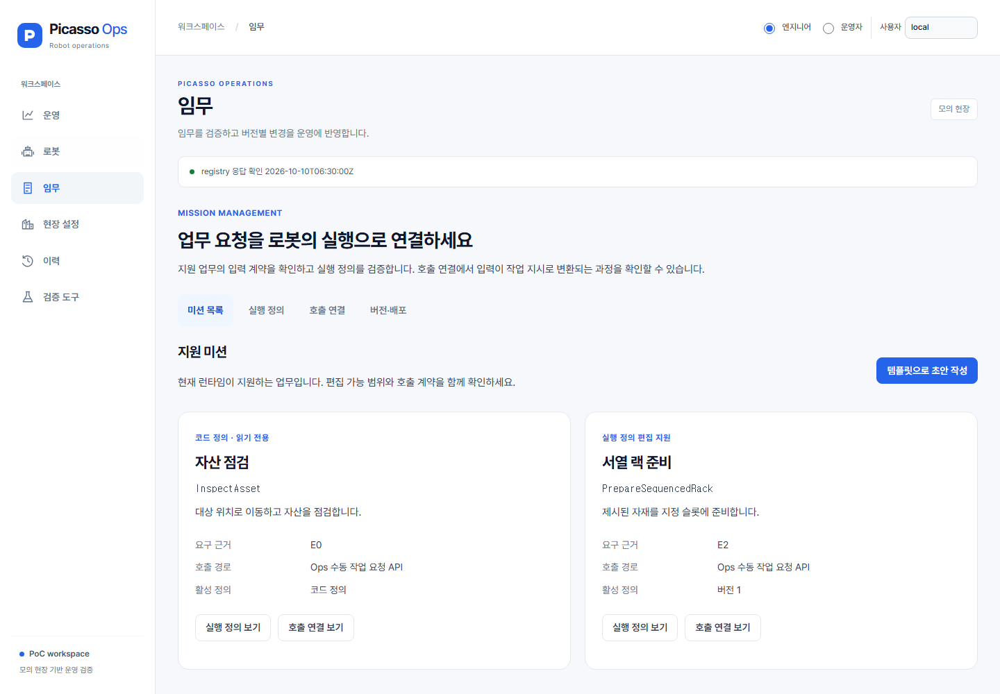
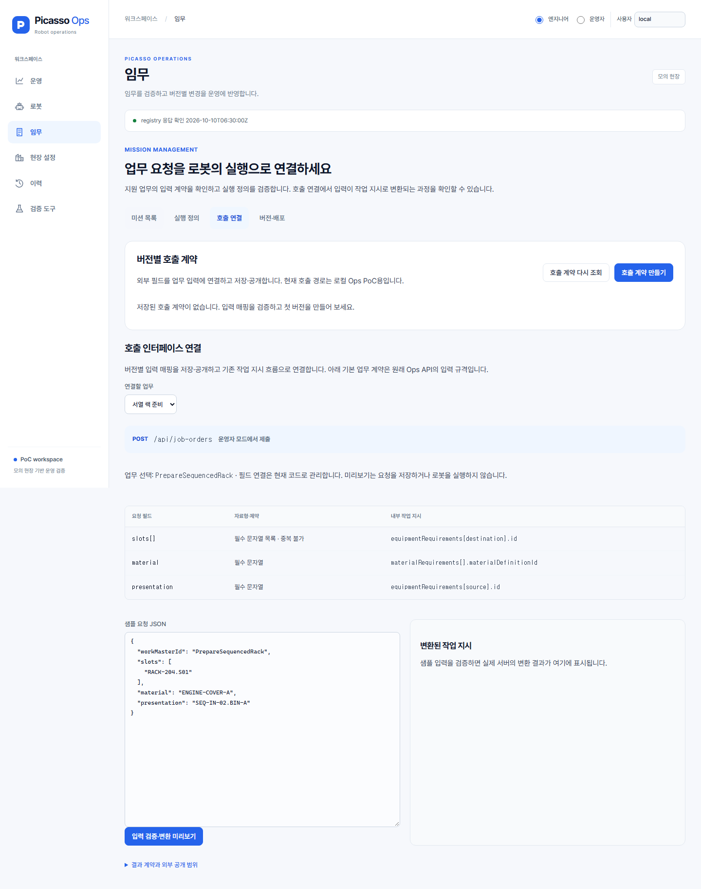
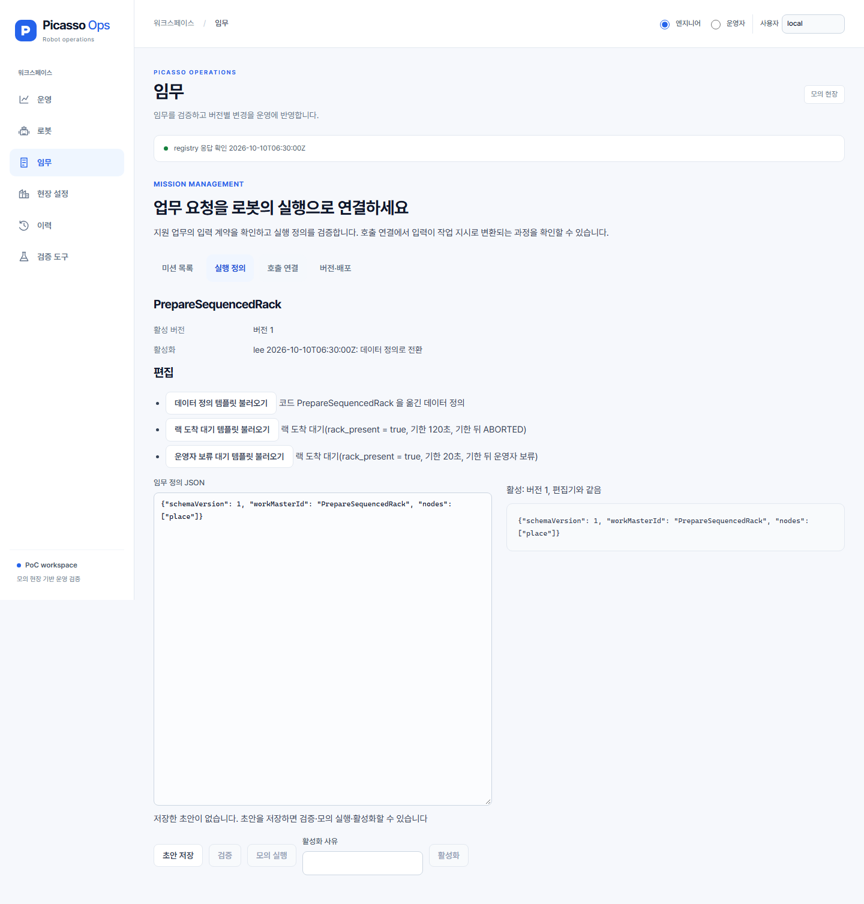
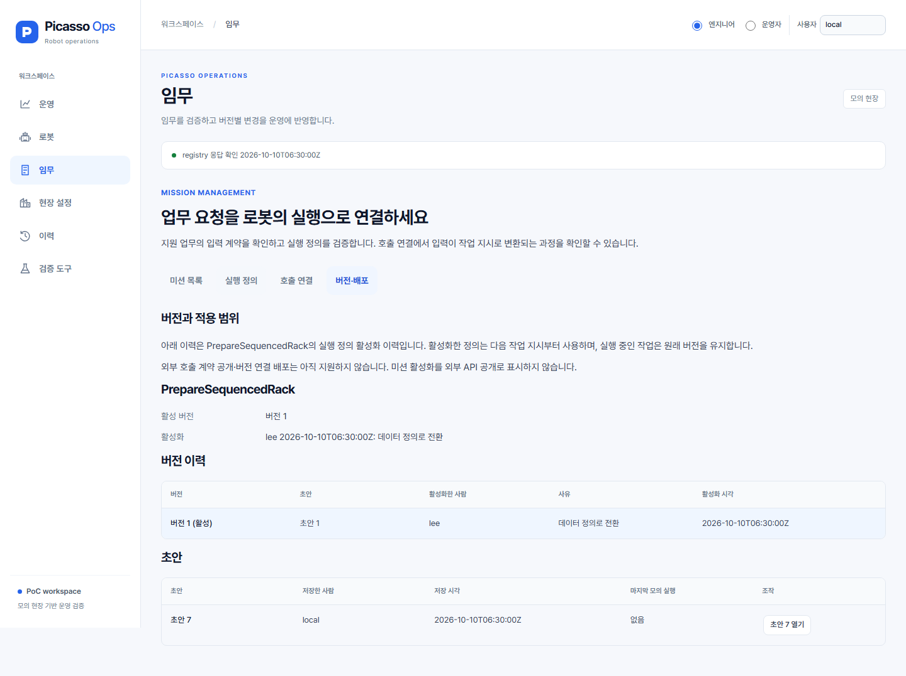
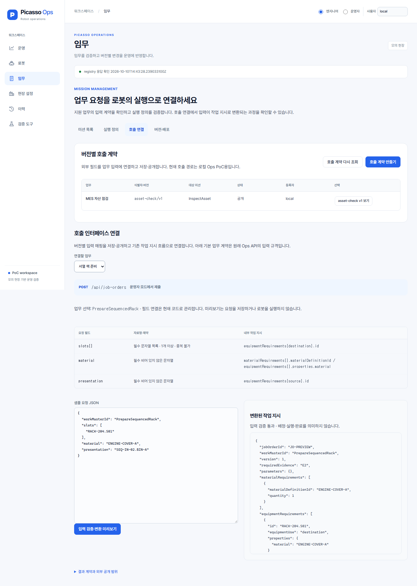

# 미션 관리 UX 개편 — 2026-10-10

> 후속 실제 구현: [입력 매핑 편집·영속 저장·공개·실행 연결](mission-interface-implementation.md). 아래는 1차 구현 당시의 범위와 검증 기록이다.

상위 시스템 중심 개편 계획의 미션 관리 1차 구현이다. 기존 두 업무를 조회하고, 실행 정의 편집과 호출 계약 확인을 연결했다.

## 구현 내용

- 미션 목록: 자산 점검(InspectAsset), 서열 랙 준비(PrepareSequencedRack). 편집 가능 여부, 요구 근거, 호출 경로, 활성 정의를 표시한다.
- 실행 정의: 기존 템플릿·초안 저장·검증·모의 실행·활성화를 유지한다. InspectAsset은 코드 정의로 안내한다.
- 호출 연결: 업무별 입력 필드·제약·내부 JobOrder 필드 연결을 표시하고 샘플 JSON을 실제 서버에서 검증·변환한다.
- 버전·배포: 실행 정의 활성화 이력과 초안·모의 실행 결과를 보여준다. 초안 열기는 편집 화면으로 이동한다. 외부 호출 계약 공개와 기존 활성화의 차이를 설명한다.
- 미션 관리 내부 탭 왕복에서 편집기·사유·저장 초안 선택을 유지한다. 다른 주 메뉴 이동 시의 보존/URL 탐색은 전체 운영 UX 후속 범위다.
- 입력을 수정하면 이전 샘플 변환 결과를 현재 결과처럼 표시하지 않는다. 미리보기는 접수·배정·실행을 발생시키지 않는다.

## 추가 API

| 경로 | 의미 |
|---|---|
| GET /api/job-contracts | 현재 지원하는 업무의 코드 기반 입력 계약·필드 매핑·샘플 목록 |
| POST /api/job-orders/preview | 실제 JobOrderForm.read/jobOrder를 사용한 입력 검증·변환. ID는 JO-PREVIEW |

미리보기는 기존 Ops 읽기/배정 판정과 같은 부작용 없는 기능이며, 호스트·로봇·DB 쓰기를 호출하지 않는다. 실제 제출은 기존 POST /api/job-orders의 운영자 모드 검사를 따른다. JSON 오류·미지원 업무·중복 단위·길이 제한은 실제 제출과 같은 규칙을 사용한다. 장소·슬롯의 현장 유효성 및 배정 가능 여부까지 검증했다고 표시하지 않는다.

이 경로는 내부 Ops API다. 버전이 있는 MES/WMS 외부 공개 API를 구현한 것으로 간주하지 않는다.

## 범위

현재 연결은 **조회 가능한 코드 기반 매핑**이다. 동적 필드 매핑 저장·새로운 업무 종류 생성·외부 인증·외부 주문 영속 접수·공개 계약 배포·MES 수신 확인은 후속 범위이며 화면에서 동작 가능한 기능으로 가장하지 않는다.

PrepareSequencedRack의 새로운 실행 정의 초안 생성은 기존 서버로 저장·검증·모의 실행·활성화할 수 있다. 새 WorkMaster를 임의로 생성하는 기능과는 구분한다.

## 검증

- UI 전체 테스트: 163개 통과. 초안 열기 → 편집 이동 추가 후 미션 관리 8개 테스트도 통과했다. 기존 편집기·App 테스트는 최종 편집기 변경 후 통과했다.
- TypeScript/Vite 빌드·린트 통과.
- ops-service 테스트 245개와 배포본 생성 통과. 신규 서버 테스트 4개 포함.
- 전체 스택 lifecycle E2E: 1개 종합 시나리오 통과(5.0분). 계약 조회·실제 변환 미리보기·새 탭 탐색과 기존 로봇 도입·미션 저장/검증/모의 실행/활성화·물리 실행·예외 대응·송신 기록·registry 단절을 확인했다. 정상 구간 API 404 없음도 검증했다.
- API 대역을 사용하는 실제 React 화면 촬영: 1440/1280/768/390px에서 주요 메뉴와 미션 하위 화면을 확인. 페이지 오류·문서 가로 넘침 없음, Pretendard 로드 확인.
- docs/screens/img의 기존 전체 화면 캡처 세트는 재촬영하지 않았다. capture.spec.ts의 미션 탐색과 버전 화면 기대값은 갱신했다.

## 화면

아래 이미지는 API 대역 기반 스타일 검토용이며 실제 MES·실물 로봇 화면이 아니다.

실제 HTTP 검증 화면(E2E 스택: PostgreSQL·registry·Mimic·mission-host·ops-service·React, API 가로채기 없음):

