# picasso-ops 화면 설계서

문서 기준은 picasso-ops `main` = `bb1d8b5`(PR #23 머지, 2026-10-13), 서브모듈 picasso = `74e4d3d` 입니다. 이 문서는 지금 화면을 기술합니다. 리터치는 끝났고 지금 UI 가 최종입니다. 스크린숏 21장은 `img/` 에 있고, 목록은 `img/INDEX.md` 에 있습니다. 표기에서 «…» 는 화면·코드 글자 그대로이며, `${…}` 는 값이 끼워지는 자리입니다. 파일 위치는 따로 적지 않으면 `ui/src/components/` 기준입니다. `App.tsx`, `api.ts`, `areas.ts`, `labels.ts`, `poll.ts`, `jobOrderDraft.ts`, `manualRequests.ts`, `missionTemplates.ts`, `styles.css` 는 `ui/src/` 바로 아래에 있습니다. 행 번호는 적지 않고 파일 이름까지만 적습니다.

## 목차

1. 제품과 사용자
2. 전역 구조
3. 영역별 화면
4. 화면을 바꿀 때 지킬 것
5. 그림 목록

---

## 1. 제품과 사용자

### 1.1 무엇인가

picasso-ops 는 상위 시스템(MES·WMS)의 외부 주문을 로봇 임무에 연결하고, 작업 요청부터 실행·결과 회신까지 운영하는 미들웨어 PoC 입니다(저장소 `README.md` 첫 줄). 스택 구성은 다음과 같습니다.
- PostgreSQL
- picasso registry·mimic
- 셀 대역
- 실행 호스트
- 운영 API(ops-service)
- React UI(`ui/`)

실제 로봇 하드웨어, PLC, 상용 MES 연계는 검증하지 않았습니다. 상위 연계는 단일 Mock MES 식별자로 검증합니다.

이 문서가 다루는 것은 `ui/` 의 관리 화면입니다. 화면은 운영 서비스(`/api/**`)만 부르고, 운영 서비스가 registry 와 실행 호스트를 부릅니다.

보안과 인증에서 모드와 사용자 이름은 로그인 없이 화면에서 고르고, 요청 헤더 `X-Ops-Mode`(`engineer` 또는 `operator`)와 `X-Ops-User` 로 운영 서비스에 실립니다(`api.ts`). 운영 서비스가 모드를 다시 집행해 맞지 않는 조작을 403 `MODE_NOT_ALLOWED` 로 막습니다. 화면 글자로는 «이 모드에서 할 수 없는 조작» 입니다.

외부 주문 API(`/integration/v1/job-orders`)는 화면이 부르지 않습니다. Mock MES 가 부르며 `PICASSO_INTEGRATION_TOKEN` 이 비어 있으면 꺼집니다.

### 1.2 두 모드

모드는 상단 바 오른쪽 `ModeSwitch.tsx` 의 라디오 «엔지니어»·«운영자»(이 순서)로 고릅니다. 처음 값은 엔지니어입니다.

| 모드 | 하는 일 |
|---|---|
| 엔지니어 | 기체 선언, 어댑터 제품·빌드 선언과 인스턴스 등록, 프로파일 리비전 제출·시험 요청·활성화, 바인딩, 명칭 등록 기록, 현장 설정 변경, 장애 주입, 새 임무 만들기, 임무 정의 편집(초안 저장·검증·모의 실행·활성화), 호출 계약 작성·복제·공개·공개 중지, 실행 배포, 공유 스테이션 등록, 임무 필수 자원 등록 |
| 운영자 | 퇴역·복귀, 수동 작업 요청 내기(작업 지시 폼), 호출 계약으로 작업 요청, 보관된 수동 작업 요청 재확인·새 작업 작성, 운영자 판단(완료 확인·재작업), 미배정 재평가, 현장 확인 기록, 공유 스테이션 작업 요청, 대기 작업 취소·현장 확인 후 자원 해제·재실행 없이 관측 재개, 실행 취소·결함 수용(운영 › 실행), 기체 빈손 확인(운영 › 배정 가능 아래 잔여 파지 확인) |
| 두 모드 공통 | 모든 조회, 배정 가능 확인(작업 지시 폼, 호출 계약 입력), 입력 검증·변환 미리보기, 셀 대역 신호 켜기·끄기, 송신 기록 거르기, 작업 요청 검색, 작업 요청 비교, 이력 |

### 1.3 모드 가르기의 세 방식

코드에는 세 방식이 섞여 있습니다.

1. 감추고 모드 문장을 세웁니다. 다른 모드에서 폼·버튼이 사라지고 그 자리에 문장이 섭니다.
- 기체 선언: «선언은 엔지니어 모드에서 합니다»
- 어댑터: «어댑터 등록은 엔지니어 모드에서 합니다»
- 프로파일: «프로파일 관리는 엔지니어 모드에서 합니다» (조작 열도 없어집니다)
- 퇴역·복귀: «퇴역과 복귀는 운영자 모드에서 합니다»
- 현장 설정: «현장 설정 변경은 엔지니어 모드에서 합니다»
- 장애 주입: «장애 주입은 엔지니어 모드에서 합니다»
- 임무 편집: «임무 편집은 엔지니어 모드에서 합니다» (활성 정의는 보입니다)
- 작업 지시 폼의 제출 버튼: «작업 요청은 운영자 모드에서 합니다.» (폼과 배정 가능 판정은 두 모드에 보입니다)
- 운영자 판단: «보류 중입니다. 운영자 판단은 운영자 모드에서 합니다»
- 현장 확인 기록: «현장 확인 기록은 운영자 모드에서 작성합니다.»
- 실행 취소: «실행 취소는 운영자 모드에서 합니다» (취소할 수 있는 실행이 있을 때만 문장, 없으면 아무것도 없음)
- 결함 수용: «결함 수용은 운영자 모드에서 합니다» (결함으로 막힌 실행이 있을 때만 문장, 없으면 아무것도 없음)
- 기체 빈손 확인: «기체 빈손 확인은 운영자 모드에서 합니다» (표의 확인 칸은 버튼 대신 «운영자 모드», 표는 두 모드에 보임)

2. 감추기만 하고 문장이 없습니다.
- 바인딩 폼, 버튼 «명칭 등록 기록» (엔지니어만)
- 버튼 «새 임무 만들기», «템플릿으로 초안 작성» (엔지니어만)
- 버튼 «호출 계약 만들기», «새 버전으로 복제», 칸 «공개 변경 사유»와 공개 버튼, 실행 배포 칸 (엔지니어만)
- 접기 «공유 스테이션 등록», «임무 자원 요구 등록» (엔지니어만)
- 접기 «공유 스테이션 작업 요청», 스테이션 작업의 운영자 판단 폼 (운영자만)

3. 보이되 비활성입니다.
- 버튼 «미배정 재평가» (운영자가 아니면 비활성, 문장 없음)
- 버튼 «호출 계약으로 작업 요청» (운영자가 아니면 비활성, 문장 «실제 호출은 운영자 모드에서 가능합니다.»)
- 수동 작업 요청 추적의 버튼 «동일 작업 요청 확인», «새 작업 작성» (운영자가 아니면 비활성)
- `MissionCreator.tsx` 와 호출 계약 작성 폼의 fieldset (엔지니어가 아니면 비활성)

화면이 감추거나 막아도 최종 집행은 운영 서비스(403 `MODE_NOT_ALLOWED`)가 합니다.

### 1.4 사용자 이름 칸

`ModeSwitch.tsx` 의 fieldset legend «모드» 안 칸 «사용자» 에 사용자 이름을 입력합니다. 처음 값은 `local` 입니다.

규칙은 `USER_PATTERN` = `/^[A-Za-z0-9._-]{1,64}$/` 입니다(`api.ts`). 규칙에 어긋나면 칸에 `aria-invalid` 가 서고 `span.invalid` 에 «사용자 이름은 영문·숫자·._- 로 1~64자입니다. 요청에는 직전 이름(${session.user})을 씁니다» 가 표시됩니다. 어긋난 이름은 요청에 싣지 않습니다.

세션(모드·사용자)은 `App.tsx` 의 `useState` 하나이며 저장하지 않습니다. 새로고침하면 엔지니어·`local` 로 돌아갑니다.

모드나 사용자가 바뀌면 다섯 조회를 곧바로 다시 읽고, 영역별 읽기도 세션을 따라 다시 읽습니다. 공유 자원 영역(`StationWorkspace`)은 `key=${mode}/${user}` 로 다시 마운트됩니다. 운영 영역은 마지막 제출 알림과 보관 요청을 다시 읽습니다.

이력의 행위자 칸은 «엔지니어» 또는 «운영자» 와 사용자 이름을 «/» 로 이어 보입니다(예: 운영자/kim).

### 1.5 아홉 영역

메뉴 순서는 `areas.ts` 의 `AREAS` 를 따릅니다.

| 순서 | 해시 | 메뉴 글자 | 영역 설명(화면 글자) | 그리는 컴포넌트 |
|---|---|---|---|---|
| 1 | `#overview` | «운영 개요» | «작업 요청과 로봇 실행의 현재 관측, 확인이 필요한 작업을 살펴봅니다.» | `OverviewArea`, `CollectorStatus` |
| 2 | `#requests` | «작업 요청» | «외부 주문과 운영자 요청을 검색하고 작업 요청부터 실행 결과까지 추적합니다.» | `WorkRequests`, `RequestRecovery`, `RequestReview`, `RejectionSummary`, `StoredResultSummary` |
| 3 | `#stations` | «공유 자원» | «공유 스테이션의 점유와 준비 조건, 임무 실행·완료 근거를 조정합니다.» | `StationWorkspace`, `MissionResourceSettings` |
| 4 | `#operations` | «운영» | «작업의 진행과 완료 근거를 확인하고 필요한 판단을 기록합니다.» | `OperationsArea` |
| 5 | `#robots` | «로봇» | «기체와 어댑터를 연결하고 운영에 필요한 준비 상태를 확인합니다.» | `RobotsArea` |
| 6 | `#missions` | «임무» | «임무를 검증하고 버전별 변경을 운영에 반영합니다.» | `MissionsArea` |
| 7 | `#site` | «현장 설정» | «현장 설정의 저장 버전과 실행 호스트의 적용 상태를 확인합니다.» | `SiteArea` |
| 8 | `#history` | «이력» | «누가 무엇을 변경했는지 조작 기록을 확인합니다.» | `HistoryArea` |
| 9 | `#validation` | «검증 도구» | «모의 현장에 장애를 주입하고 예외 상황 대응을 검증합니다.» | `ManufacturingValidation`, `FaultPanel` |

영역 설명은 `App.tsx` 의 `AREA_DESCRIPTIONS` 이고, 아이콘 경로는 `AREA_ICONS` 입니다.

`areas.ts` 의 `ready` 는 아홉 모두 `true` 입니다. `ready:false` 일 때의 «다음 단계»·«이 영역은 다음 단계에서 엽니다.» 갈래는 코드에만 남아 있고 화면에 나오지 않습니다.

### 1.6 해시 라우팅과 처음 영역

라우터 라이브러리 없이 `window.location.hash` 를 읽습니다(`App.tsx`). 해시는 `#${areaId}` 이며 `hashchange` 를 듣습니다.

해시가 없거나 모르는 값이면 처음 영역은 메뉴 첫 항목이 아니라 5번 «로봇»(`robots`)입니다. 메뉴를 누르면 `location.assign('#id')` 로 가며 해시 뒤 쿼리가 지워집니다.

작업 요청 영역만 쿼리를 읽고 씁니다: `#requests?search=&state=&result=&offset=&receipt=`. 검색어, 상태 필터, 외부 결과 필터, 쪽 위치, 고른 작업 요청이 URL 에 남아 새로고침해도 남습니다.

새로고침 시 상태 유지는 다음과 같습니다.
- 새로고침해도 남는 것: 영역, 작업 요청 쿼리, sessionStorage 에 보관한 멱등 요청(§2.6)
- 처음 값으로 돌아가는 것: 모드·사용자, 로봇 하위 탭(«기체»), 임무 패널(«임무 목록»), 폼 입력

로봇 영역만 늘 마운트하고 `hidden` 으로 감춥니다. 그래서 하위 탭, 고른 기체, 폼 입력이 메뉴 왕복에도 남습니다. 나머지 여덟 영역은 고를 때만 마운트되어 떠나면 상태가 사라집니다.

`App.tsx` 의 영역 대체값은 `AREAS[1]`(작업 요청)인데 처음 영역은 «로봇» 입니다. 대체값은 실제로 쓰이지 않습니다.

## 2. 전역 구조

### 2.1 앱 껍데기

문서 설정은 `lang="ko"`, `<title>Picasso Ops · Robot Operations</title>`, 파비콘 `/favicon.svg` 입니다(`App.tsx`, `ui/index.html`, `styles.css`).
글꼴은 Pretendard Variable 을 저장소가 직접 제공합니다(`ui/public/fonts/PretendardVariable.woff2`, 라이선스 고지 `ui/public/fonts/LICENSE.txt`). JSON 편집기와 `pre` 는 고정폭 글꼴 `ui-monospace, 'Cascadia Code', Consolas` 를 씁니다.
색과 모서리는 `:root` 토큰을 씁니다.
- `--primary`: `#2563eb`
- `--primary-hover`
- `--primary-soft`
- `--ink`
- `--muted`
- `--border`
- `--surface`
- `--danger`: `#b91c1c`
- `--warning`: `#92400e`
- `--radius`: `14px`

스타일은 `styles.css` 한 파일(257행)입니다. 다크 모드는 없습니다(`prefers-color-scheme` 규칙 없음).

배치 순서는 위와 왼쪽부터 다음과 같습니다.
1. 건너뛰기 링크 «본문으로 이동» (누르면 `main#main-content` 로 포커스).
2. 왼쪽 `aside.sidebar`: 파비콘 이미지와 h1 «Picasso Ops», 부제 «Robot operations», 캡션 «워크스페이스», `nav[aria-label=영역]` 안 메뉴 버튼 아홉(아이콘 SVG + 글자, 고른 버튼에 `aria-current="page"`), 맨 아래 «PoC workspace» 와 «모의 현장 기반 운영 검증».
3. 오른쪽 `.workspace`: `header.topbar` 에 브레드크럼 «워크스페이스» / 영역 이름과 `ModeSwitch`.
4. `main#main-content`: 영역 제목 블록(eyebrow «PICASSO OPERATIONS», h2 영역 이름, 영역 설명, 배지 «모의 현장») → 전체 상태 띠(`RegistryBanner`) → `.area-content.area-${id}` 안의 영역 본문.

반응형 규칙은 `styles.css` 의 `@media` 에 따릅니다.
- 1199px 이하: 사이드바 폭 192px, `.split` 2열 구역이 1열로 바뀝니다.
- 767px 이하: 사이드바가 위로 올라가고 메뉴가 가로 스크롤되며, 브레드크럼·환경 배지·캡션·사이드바 아래 문구를 숨기고, 폼 칸 폭 100%, `dl` 1열이 됩니다.
- 그 밖에 900px·760px 규칙이 카드 격자를 1열로 바꿉니다.
- `prefers-reduced-motion` 에서 전환 효과를 끕니다.

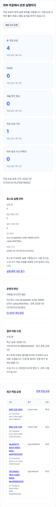

그림 20은 390px 폭의 운영 개요이며 사이드바가 위로 올라가 메뉴가 가로로 놓입니다.

### 2.2 상단 바와 모드 전환

상단 바 오른쪽 `ModeSwitch.tsx` 에는 fieldset legend «모드», 라디오 «엔지니어»·«운영자», 칸 «사용자» 가 있습니다. 규칙과 효과는 §1.2~§1.4 입니다.
모드를 바꿔도 화면 이동은 없습니다. 같은 영역에서 폼·버튼이 바뀝니다.

### 2.3 전체 상태 띠

전체 상태 띠(`RegistryBanner.tsx`)는 영역 제목 블록 아래에 서며 아홉 영역 모두에 섭니다.

| 조건 | 요소 | 글자 |
|---|---|---|
| 운영 서비스에 닿지 않음(다섯 조회 중 하나라도 실패) | `div.banner.unknown`, `role="alert"` | «모름: 운영 서비스에 닿지 않습니다 (${opsError})» |
| 첫 읽기 전 | `div.banner` | «확인 중» |
| registry `OK` | `div.banner.ok` | «registry 응답 확인 ${checkedAt}» |
| `REGISTRY_SILENT` | `div.banner.unknown`, alert | «모름: registry 가 답하지 않습니다. 해결 담당 엔지니어, registry 상태 확인. 확인 시각 ${checkedAt}» |
| `REGISTRY_UNAUTHORIZED` | `div.banner.unknown`, alert | «모름: registry 가 운영자 토큰을 거부합니다. 해결 담당 엔지니어, 운영자 토큰 설정 확인. 확인 시각 ${checkedAt}» |

띠의 판정 재료(다섯 조회)는 로봇·현장 설정·이력·장애 주입 영역만 씁니다. 운영 개요·작업 요청·공유 자원·운영·임무는 자기 읽기의 실패를 구역마다 따로 보입니다. 그래서 띠가 «registry 응답 확인» 이어도 다른 구역에 «모름» 이 설 수 있습니다.
모양은 `.banner::before` 의 작은 원 색으로 가릅니다(정상 초록, 모름 주황). 모름은 배경 `#fffbeb` 입니다.

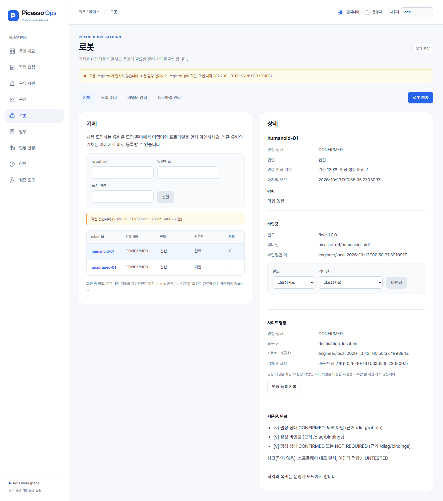

그림 19는 런처(registry)를 끈 뒤의 로봇 영역이며 띠가 모름 상태로 바뀝니다.

### 2.4 읽기 주기와 데이터 출처

주기 상수는 `poll.ts` 에 정의되어 있습니다.
- `POLL_MS` = 5000(5초)
- `ELIGIBILITY_DEBOUNCE_MS` = 300
- `SIGNAL_SETTLE_MS` = 500

실패해도 직전 값을 지우지 않고 직전 값임을 표시합니다(§2.5).

| 읽기 | 엔드포인트 | 주기·시점 | 실패 표현 |
|---|---|---|---|
| 다섯 조회(`App.tsx`) | GET `/api/robots`, `/api/adapters`, `/api/profiles`, `/api/operations`, `/api/site-settings` 를 `Promise.all` 로 | 5초, 모드·사용자 변경, 조작 직후 | 하나라도 실패하면 다섯 모두 직전 값 + 띠 «모름: 운영 서비스에 닿지 않습니다 (${opsError})» |
| 운영 개요 | GET `/api/work-requests/summary`, `/api/executions/summary`, `/api/incidents`, `/api/work-requests/collector` | 영역이 열려 있을 때 5초, 넷이 따로 실패 | 구역마다 alert |
| 작업 요청 | GET `/api/work-requests?search=&state=&offset=&limit=20&result=`, `/api/work-requests/{receiptId}` | 5초, 검색·필터·쪽 변경, 고른 작업 요청 변경 | alert 와 «직전 조회 값입니다.» 꼬리 |
| 공유 자원 | GET `/api/stations`, `/api/mission-interfaces`, `/api/mission-resources`, `/api/stations/runs/{runId}` | 스테이션·호출 계약은 5초, 자원 요구는 마운트 때와 호출 계약 목록을 다시 받을 때마다 | alert «자원 조회 실패: ${e} · 표는 직전 값입니다. 조작 전 다시 조회하세요.» |
| 운영 | GET `/api/executions?recent=20`, `/api/cell`, `/api/incidents`, `/api/job-responses`(거르면 `?jobOrderId=`), `/api/incidents/{id}?instanceId=`, GET `/api/robots/residual-holds`, POST `/api/job-orders/eligibility`, 그리고 맨 위 작업 요청 목록 | 5초. `GET /api/executions?before=${settleSeq}&limit=20`은 «이전 실행 더 보기»를 누를 때만(새 종결로 이력이 밀릴 때의 따라잡기 읽기 포함). 배정 가능은 폼이 바뀌고 300ms 멈춘 뒤, 신호 조작·판단·실행 취소·결함 수용·기체 빈손 확인 뒤 곧바로와 500ms 뒤 한 번 더 | 구역마다 «직전 값입니다. 실행 호스트 불통: ${error}». 잔여 파지 표는 첫 읽기 전·실패면 «모름: 잔여 파지 표시를 아직 읽지 못했습니다 (${error})», 직전 값이면 «직전 값입니다. 실행 호스트 불통: ${error}» |
| 임무 | GET `/api/job-contracts`(마운트와 «계약 다시 조회» 때만), `/api/mission-interfaces`(마운트와 «호출 계약 다시 조회» 때), `/api/missions/{workMasterId}`(5초), `/api/missions/templates/{workMasterId}`(읽힐 때까지 5초), `/api/mission-interfaces/{id}/{version}/deployments`, POST `/api/job-orders/preview` | | 구역마다 alert 또는 «모름: …» |
| 현장 설정·이력 | 다섯 조회의 `/api/site-settings`, `/api/operations` | 5초 | «직전 값입니다» |
| 검증 도구 | GET `/api/work-requests?search=&offset=0&limit=20`, `/api/work-requests/{receiptId}` 두 번, POST `/api/faults` | 버튼을 누를 때만 | alert |

실행 호스트를 거치는 읽기(실행, 셀, 인시던트, 배정 가능, 임무 버전)는 다섯 조회에 넣지 않습니다. 실행 호스트가 멈춰도 다섯 조회가 직전 값이 되지 않게 운영·임무 영역이 따로 읽습니다.
`api.ts` 에 `POST /api/job-orders` 를 부르는 `submitJobOrder` 가 남아 있지만 화면은 부르지 않습니다. 작업 지시 폼은 수동 작업 요청 `POST /api/work-requests/manual` 로 보냅니다.

### 2.5 값의 상태: 알 수 있음, 없음, 모름, 직전 값

화면은 값을 넷으로 가릅니다.
- 알 수 있음: 값입니다.
- 없음: «… 없습니다» 꼴 문장입니다.
- 모름: 아직 못 읽었거나 읽기에 실패한 상태입니다.
- 직전 값: 앞서 읽은 값을 그대로 두고 표시를 덧붙입니다.

실패해도 직전 값을 지우지 않습니다.

다섯 조회를 쓰는 영역의 옛 꼴은 그대로 유지합니다.
해당 영역은 다음과 같습니다.
- 로봇
- 현장 설정
- 이력
- 장애 주입

못 읽음은 «모름: 기체 목록을 아직 읽지 못했습니다» 처럼 «모름:» 으로 시작합니다.
직전 값은 `p.stale` 문장 «직전 값입니다 (${asOf} 기준)» 또는 «직전 값입니다» 로 표시합니다.
`.stale` 은 주황 왼쪽 선과 연한 노랑 배경입니다.

운영 영역의 실행 호스트 읽기에서 못 읽음은 «모름: 실행 목록을 아직 읽지 못했습니다» 입니다.
직전 값은 «직전 값입니다. 실행 호스트 불통: ${error}» 입니다.

새 영역에서 생긴 꼴은 다음과 같습니다.
해당 새 영역은 다음과 같습니다.
- 운영 개요
- 작업 요청
- 공유 자원
- 임무 관리
- 검증 도구

| 상태 | 예 |
|---|---|
| 한 번도 못 읽음(«모름:» 접두 없음) | «작업 요청 목록을 아직 읽지 못했습니다.», «호출 계약 목록을 아직 읽지 못했습니다.», «자원 요구를 아직 읽지 못했습니다.», «배포 이력을 아직 읽지 못했습니다.», «최근 작업 요청 모름», «수집 상태 모름», «실행 상태 모름 · 관측을 기다립니다.», «판단 대기 상태 모름», 지표 카드 값 «모름» |
| 읽는 중 | «지원 임무 계약을 조회하고 있습니다.», «필수 자원 확인 중», 버튼 글자 «검증 중…», «등록 중…», «비교 조회 중» |
| 읽었고 비었음 | «저장된 작업 요청이 없습니다.», «대체 위치 없음»(거부 사유·미배정의 기체별 출발 결품 구역, 셀이 «든 자리 없음» 이라 답함. 출발 미관측에는 대체 위치 줄이 없다(«대체 위치 조회 불가» 로도 보이지 않는다)), «조건에 맞는 작업 요청이 없습니다. 이전 직접 제출 API의 작업은 별도 실행 이력에서 확인합니다.», «등록된 공유 스테이션이 없습니다. 엔지니어 모드에서 현장 신호를 연결하세요.», «등록된 임무 자원 요구가 없습니다.», «저장된 호출 계약이 없습니다. 입력 매핑을 검증하고 첫 버전을 만들어 보세요.» |
| 직전 값(alert 안 꼬리) | « · 직전 조회 값입니다.», « · 상세는 직전 값입니다.», « · 아래는 직전 값입니다.», « · 표는 직전 값입니다. 조작 전 다시 조회하세요.», « · 목록은 직전 검색 값입니다.» |
| 직전 값(카드·접기) | 지표 카드 작은 글자 «직전 값 · 재확인 필요», 로봇 도입 준비 «직전 관측입니다. 최신 조회 전에는 현재 준비 완료로 판단하지 마세요.», 작업 요청 상세 접기 «마지막으로 확인한 실행 · 직전 관측» |
| 칸 하나를 모름 | «확인 안 됨»(작업 요청 상세, 비교 표, 저장 결과 요약), «모름 · 호스트 조회 실패», «현재 실행 확인 안 됨», 옛 영역의 칸 값 «모름», «대체 위치 조회 불가»(거부 사유·미배정 기체별, 셀이 답하지 않음, «대체 위치 없음» 으로 접히지 않음) |

지금 화면에는 다음 표현이 함께 쓰입니다.
- «모름: …»
- 접두 없는 «… 아직 읽지 못했습니다.»
- «… 모름»
- «확인 안 됨»

직전 값도 회색 `p.stale` 한 꼴이 아니라 alert 꼬리와 카드 글자로 나뉩니다.

### 2.6 결과 알림과 멱등 재확인

결과 알림은 대개 `role="status"` 이고 «${what}: ${결과}» 꼴입니다.
구역마다 마지막 하나만 들고 있습니다.
결과 알림에는 다음 세 가지가 없습니다.
- 닫기 버튼
- 시각
- 쌓임

성공과 실패는 색이나 아이콘이 아니라 글자로 가릅니다.

접근 이름이 있는 결과 알림은 다음과 같습니다.

| 컴포넌트 | 쓰는 곳 | 접근 이름 |
|---|---|---|
| `OutcomeNotice` | 로봇 영역의 registry 조작 전부(도구 줄 아래 한 자리), 현장 설정 | 없음 |
| `JobOrderNotice` | 운영 › 작업 지시의 수동 작업 요청 | «제출 결과» |
| `MissionNotice` | 임무 초안 저장, 검증, 모의 실행, 활성화 | «임무 조작 결과» |
| `SignalNotice` | 셀 대역 신호 켜기·끄기 | «신호 조작 결과» |
| `FaultPanel.tsx` 의 결과 | 장애 주입 | «장애 주입 결과» |
| `IncidentSection.tsx` 의 결과 | 운영자 판단 | «판단 결과» |
| `ExecutionControls.tsx` 의 `CancelExecutionForm` | 운영 › 실행의 실행 취소 | «실행 취소 결과» |
| `ExecutionControls.tsx` 의 `ReleaseFaultForm` | 운영 › 실행의 결함 수용 | «결함 수용 결과» |
| `ExecutionControls.tsx` 의 `ResidualHolds` | 운영 › 잔여 파지 확인의 기체 빈손 확인 | «빈손 확인 결과» |
| `MissionInterfaces.tsx` | 호출 계약 초안 저장·공개·공개 중지 | «호출 계약 처리 결과» |
| `MissionInterfaces.tsx` | 호출 계약으로 작업 요청 | «계약 호출 결과» |

이름 없는 status 는 다음과 같습니다.
- 재평가(`RequestRecovery`)
- 현장 확인(`RequestReview`)
- 스테이션 작업 근거(`StationWorkspace`)
- 비교 결과(`ManufacturingValidation`)

#### 2.6.1 registry 조작 결과 OutcomeNotice

`OutcomeNotice` 의 결과 갈래는 다음과 같습니다.

| 경우 | 글자 |
|---|---|
| 운영 서비스 사전 거부(400·403) | «${what}: 보내지 않음. ${detail}» |
| 운영 서비스 비정상·끊김 | «${what}: 결과 모름(${cause}). 목록을 다시 읽어 확인하십시오» |
| 성공 | «${what}: 반영됨» |
| registry 토큰 거부 | «${what}: registry 가 운영자 토큰을 거부했습니다. 상단의 전체 상태를 보십시오» |
| registry 거부 | «${what}: 거부됨» 과 그 아래 `FindingCard`(§2.7) |
| 응답 없음, 다시 읽어 반영 | «${what}: 응답은 없었으나 다시 읽어 보니 반영됨» |
| 응답 없음, 반영 안 됨 | «${what}: 응답 없음. 다시 읽어 보니 반영 안 됨. 다시 하려면 새로 요청하십시오» |
| 응답 없음, 다시 읽기도 실패 | «${what}: 반영되었을 수 있음. 다시 읽지도 못해 확인하지 못했습니다. 목록에서 확인하십시오» |

분류는 `api.ts` 의 `deliver` 가 맡습니다.
2xx 는 결과입니다.
400·403 은 사전 거부입니다. 본문에 detail 이 없으면 «운영 서비스가 요청을 거부했습니다(HTTP ${status})» 를 씁니다.
그 밖은 결과 모름이며 `cause` 기본값은 «운영 서비스 응답 ${status}» 입니다.

다른 알림 컴포넌트도 같은 틀입니다.
해당 틀의 갈래는 다음과 같습니다.
- 성공
- 보내지 않음(사전 거부)
- 상대가 거부함
- 결과 모름
- 응답 없음 세 갈래(다시 읽어 반영, 반영 안 됨, 다시 읽지도 못함)

#### 2.6.2 호출 계약·공유 자원 쓰기

다음 대상의 쓰기는 `api.ts` 의 `interfaceRequest` 를 씁니다.
- 호출 계약
- 공유 스테이션
- 임무 필수 자원

실패하면 예외(`InterfaceApiError`)를 던집니다.
메시지는 서버 detail 또는 «호출 계약 요청 실패 (HTTP ${status})» 입니다.
2xx 인데 본문이 없으면 «응답 내용을 확인할 수 없습니다. 목록과 실행 이력을 다시 조회하세요.» 입니다.

화면은 이 메시지를 알림 컴포넌트 없이 `p[role=alert]` 에 그대로 보입니다.
구역에 따라 «· 응답 불명 시 …» 꼴의 꼬리를 붙입니다.

#### 2.6.3 멱등 재확인과 보관 요청

작업 요청을 만드는 조작은 요청 id(UUID)를 보내기 전에 sessionStorage 에 적습니다.
응답이 불명이면 새 id 로 다시 보내지 않고 같은 id 로만 다시 확인합니다.
새로고침해도 보관 요청은 복원됩니다.

조작별 키는 다음과 같습니다.

| 조작 | 키 |
|---|---|
| 수동 작업 요청(운영 › 작업 지시) | `picasso.manual-request.v1.${mode}.${user}` (`manualRequests.ts`) |
| 호출 계약으로 작업 요청 | `picasso.interface-request.v1.${mode}.${user}.${interfaceId}/${version}` |
| 공유 스테이션 작업 요청 | `picasso.station/${mode}/${user}` |
| 미배정 재평가 | `picasso.recovery.v1.${user}.${receiptId}` |
| 현장 확인 기록 | `picasso.review.v1.${user}.${receiptId}` |
| 새 임무 등록 | `picasso.mission-create.v1.${user}` |

보관값을 못 읽으면 alert 를 세우고 새 전송을 막습니다.
그 예시는 다음과 같습니다.
- «보관된 수동 요청을 읽지 못했습니다. 저장소를 지우고 재제출하기 전에 실행 이력을 확인하세요»
- «보관된 재평가 요청을 읽지 못했습니다. 실행·재평가 이력을 확인하세요.»
- «보관된 확인 기록을 읽지 못했습니다. 이력을 확인하세요.»
- «보관된 임무 등록 입력을 읽지 못했습니다. 임무 목록을 확인하세요.»

보관에 실패하면 보내지 않습니다.
문구는 «요청 보관 실패로 전송하지 않았습니다.» 입니다.

#### 2.6.4 게이트: 체크박스와 사유

확인 대화(`confirm`)는 없습니다.

체크박스 게이트 일곱은 다음과 같습니다.
- «이 입력으로 실제 작업을 지시합니다»(호출 계약으로 작업 요청)
- «준비 조건이 충족되면 실제 로봇 작업을 지시합니다»(공유 스테이션 작업 요청)
- «현장 작업과 자원 해제 가능 여부를 확인했습니다»(현장 확인 후 자원 해제)
- «설비·로봇 상태와 격리 해제 가능 여부를 확인했습니다»(현장 확인 후 격리 해제)
- «기체·설비 상태를 확인했고 이 실행을 끝냅니다»(실행 취소)
- «기체 상태를 현장에서 확인했고 이 결함을 안고 계속합니다»(결함 수용)
- «기체 손에 남은 물체가 없음을 현장에서 직접 확인했습니다»(기체 빈손 확인)

사유 입력 게이트는 비면 보내지 않거나 버튼을 비활성화합니다.
해당 게이트는 다음과 같습니다.
- 퇴역
- 현장 설정 변경
- 장애 주입
- 임무 활성화
- 운영자 판단
- 호출 계약 공개 변경
- 실행 배포
- 임무 필수 자원 등록
- 미배정 재평가
- 현장 확인 기록
- 스테이션 작업의 운영자 판단
- 실행 취소
- 결함 수용
- 기체 빈손 확인

### 2.7 거부·막힘 카드와 상태 글자

#### 2.7.1 FindingCard

`FindingCard.tsx` 는 막힘(기체 상세)과 거부(조작 결과)를 같은 카드로 보입니다. `<dl className="finding">` 을 씁니다.

| dt | dd |
|---|---|
| «종류» | `kindLabel(kind)`(이름 표를 따르며, 표에 없으면 값 그대로 보입니다) |
| «관측값과 기대값» | «${observed} / 기대: ${expected}» |
| «마지막 확인» | `checkedAt` 그대로 |
| «근거 버전» | «현장 설정 버전 ${n}» 또는 «해당 없음» |
| «해결 담당» | 담당 이름 뒤 괄호에 «화면 안» 또는 «화면 밖», 그 뒤에 «: ${action}» |
| «바로 가기»(대상이 있고 상위가 `onSelect` 를 넘길 때만) | 버튼 «${target} 상세». 누르면 로봇 영역의 기체 탭에서 그 기체 상세를 엽니다. |

`labels.ts` 의 `OWNER_LABEL` 에 정의된 담당 이름은 다음과 같습니다.
- SITE: «현장»
- OPERATOR: «운영자»
- ENGINEER: «엔지니어»
- NONE: «없음»

기체 상세 안의 막힘 카드와 임무 조작의 거부 카드에는 «바로 가기» 가 없습니다.

#### 2.7.2 거부·막힘 이름

`labels.ts` 의 `KIND_LABEL` 에 정의된 이름과 글자 대응은 다음과 같습니다.

| 이름 | 글자 | 이름 | 글자 |
|---|---|---|---|
| AWAITING_FIRST_REPORT | «첫 보고 대기» | REPORT_STALE | «보고 오래됨» |
| REPORTING_AFTER_RETIREMENT | «퇴역 뒤 보고» | UNREGISTERED_ROW | «출처 없는 행» |
| BAD_REQUEST | «본문 오류» | WRONG_DOOR | «이미 다른 문으로 들어온 기체» |
| RETIRED_ALREADY | «이미 퇴역한 기체» | RETIRE_BAD_REQUEST | «퇴역 요청 오류» |
| UNKNOWN_ROBOT | «모르는 기체» | ADAPTER_BAD_REQUEST | «제품·빌드 형식 오류» |
| UNKNOWN_ADAPTER | «없는 제품» | VERSION_CONFLICT | «같은 버전에 다른 계약값» |
| INSTANCE_BAD_REQUEST | «인스턴스 본문 오류» | UNBOUND | «바인딩 없음» |
| SITE_NAMES_UNREGISTERED | «명칭 기록 없음» | SITE_NAMES_UNANSWERED | «기체가 명칭에 답하지 않음» |
| SITE_NAMES_CONTRADICTED | «기체가 아는 명칭 없음» | PROFILE_UNREADABLE | «읽을 수 없는 문서» |
| REVISION_NOT_MONOTONIC | «리비전 번호가 오르지 않음» | UNKNOWN_REVISION | «없는 리비전» |
| REVISION_NOT_TESTABLE | «시험할 수 없는 상태» | ACTIVATION_REFUSED | «활성화 조건 미달» |
| UNKNOWN_BUILD | «없는 빌드» | REVISION_NOT_ACTIVE | «활성 리비전이 아님» |
| ROBOT_RETIRED | «퇴역한 기체» | CONTRACT_TOO_OLD | «빌드의 계약이 낮음» |
| NO_ACTIVE_BINDING | «활성 바인딩 없음» | NOTHING_TO_REGISTER | «등록할 명칭 없음» |
| UNCLASSIFIED | «분류되지 않은 거부» | SETTINGS_VERSION_CONFLICT | «현장 설정 버전 충돌» |
| JOB_ORDER_BAD_REQUEST | «작업 지시 폼 오류» | UNKNOWN_WORK_MASTER | «받지 않는 임무» |
| UNIT_ID_CONFLICT | «단위 id 겹침» | NO_ELIGIBLE_ROBOT | «배정 가능한 기체 없음» |
| MODE_NOT_ALLOWED | «이 모드에서 할 수 없는 조작» | ACTOR_REQUIRED | «행위자 없음» |
| UNREADABLE | «읽을 수 없는 정의» | DUPLICATE_NODE_ID | «노드 id 겹침» |
| DEADLINE_INVALID | «대기 기한 오류» | SIGNAL_NOT_IN_SPEC | «신호 사양에 없는 신호» |
| SIGNAL_VALUE_INVALID | «신호 종류에 맞지 않는 값» | FLOOR_UNOWNED | «바닥 소유 없음» |
| SKILL_NOT_IN_CONTRACT | «계약에 없는 스킬» | SKILL_NOT_ON_SITE | «현장에 없는 스킬» |
| SAFETY_SIGNAL_WAIT | «안전 신호 대기» | SOURCE_OBSERVATION_UNDECLARED | «출발 관측 선언 없음» |
| SOURCE_OBSERVATION_UNUSED | «출발 관측 선언 미사용» | | |
| MISSION_BAD_REQUEST | «임무 요청 오류» | REASON_REQUIRED | «사유 없음» |
| DRAFT_NOT_FOUND | «없는 초안» | REQUEST_ID_REUSED | «요청 id 재사용» |
| HOST_SILENT | «실행 호스트 불통» | SIGNAL_BAD_REQUEST | «신호 값 형식 오류» |
| UNKNOWN_SIGNAL | «모르는 신호» | SAFETY_SIGNAL_READ_ONLY | «안전 신호는 쓸 수 없음» |
| NO_RUNNING_TASK | «진행 중 태스크 없음» | UNSUPPORTED_FAULT | «받지 않는 장애 종류» |
| FAULT_REFUSED | «mimic 엔진이 강제를 거부함» | UNSUPPORTED_MEDIA_TYPE | «JSON 이 아닌 본문» |
| FAULT_BAD_REQUEST | «장애 주입 본문 오류» | RESOLVE_BAD_REQUEST | «판단 본문 오류» |
| INSTANCE_MISMATCH | «실행 호스트가 재기동해 인스턴스가 다름» | JOB_RESPONSE_BAD_REQUEST | «송신 기록 요청 오류» |
| CANCEL_BAD_REQUEST | «취소 본문 오류» | CLEAR_BAD_REQUEST | «빈손 확인 본문 오류» |
| RESIDUAL_HOLD_NOT_FOUND | «없는 잔여 파지 표시» | RESIDUAL_HOLD_ALREADY_CLEARED | «이미 해소한 잔여 파지 표시» |
| RELEASE_BAD_REQUEST | «수용 본문 오류» | | |

풀이 함수 동작은 다음과 같습니다.
- `kindLabel`: 모르는 이름은 그대로 둡니다.
- `rejectionLabel`: null 이면 «이유 없음» 입니다.
- `rejectionText(who, r)`: «${who}(${풀이})» 뒤에 detail 이 있으면 «. ${detail}» 을 붙입니다.

#### 2.7.3 그 밖의 상태 글자

| 표 | 값 → 글자 | 위치 |
|---|---|---|
| `CONNECTION_LABEL` | FRESH «신선», STALE «오래됨», NO_REPORT «보고 없음» | `labels.ts` |
| `COMMISSIONING_LABEL` | COMPLETE «완료», INCOMPLETE «미완», RETIRED «퇴역» | `labels.ts` |
| `SOFTWARE_LABEL` | MATCH «일치», MISMATCH «불일치», UNREPORTED «보고 없음» | `labels.ts` |
| `TEST_REQUEST_LABEL` | NONE «요청 없음», WAITING «대기», RUNNING «실행 중», EXPIRED «만료», DONE «끝남» | `labels.ts` |
| `SKILL_FIT_LABEL` | FIT «적합», MISSING «모자람», UNKNOWN «모름» | `labels.ts` |
| `SUBMIT_RESULT_LABEL` | ACCEPTED «배정됨», IDEMPOTENT «같은 작업 지시의 기존 실행», REJECTED «거부됨», UNASSIGNED «미배정» | `labels.ts` |
| `MOCK_RUN_FAILURE_LABEL` | DEFINITION «정의(같은 신호에 다른 기대 값)», SUBMISSION_REJECTED «표본 작업 지시 거부», NOT_SETTLED «종결하지 않음», WALL_CLOCK_LIMIT «실제 시간 상한 초과», EXECUTION_FAILED «실행 실패» | `labels.ts` |
| `mockRunVerdict` | «통과», «실패», «실패(${하위 범주})» | `labels.ts` |
| `TEMPLATE_LABEL` | DATA_V1 «데이터 정의 템플릿», ARRIVAL_WAIT «랙 도착 대기 템플릿», ARRIVAL_WAIT_HOLD «운영자 보류 대기 템플릿» | `labels.ts` |
| `FAULT_KIND_LABEL` | SKILL_EXECUTION_FAILED «스킬 실패», CONNECTION «연결 상태» | `labels.ts` |
| `DISPOSITION_LABEL` | SENT «송신», RESTART_DUPLICATE «재기동 중복(송신 안 함)» | `labels.ts` |
| `DECISION_LABEL` | CONFIRM_DONE «완료 확인», REWORK «재작업» | `labels.ts` |
| `CANCEL_RESULT_LABEL` | CANCELED «취소를 걸었습니다. 실행 호스트의 다음 pump 에서 중단(ABORTED)으로 종결합니다», NOT_CANCELABLE «취소할 수 없는 실행입니다», NOT_FOUND «지금 실행 호스트 인스턴스에 없는 실행입니다», REFUSED «에이전트는 실행을 취소하지 못합니다» | `labels.ts` |
| `REMEDY_CAUSE_LABEL` | NO_CAPABILITY «케이퍼빌리티 없음», DEPTH_LIMIT «탐색 상한 도달»(모르는 값은 코드 그대로) | `labels.ts` |
| `reviewLabels`(현장 관측) | NOT_CONFIRMED «현장 상태 미확인», NOT_STARTED «현장 미착수 확인», IN_PROGRESS «현장 진행 중 확인», COMPLETED «현장 완료 관측» | `labels.ts` |
| 작업 요청 상태 | WAITING_RESOURCE «필수 자원·설비 대기», RECEIVED «수신됨», DISPATCHING «제출 처리 중·확인 필요», ACCEPTED «호스트 수락», REJECTED «거부», UNASSIGNED «미배정», IN_DOUBT «전송 결과 불명», 필터 전용 NEEDS_CONFIRMATION «제출 확인 필요 · 전체» | `WorkRequests.tsx` |
| 작업 요청 출처 | `ops:manual` «운영자 수동», `ops:interface` «호출 계약 · 운영자», 그 밖은 출처 식별자 그대로 | `WorkRequests.tsx` |
| 스테이션 작업 상태 | QUEUED «자원 대기», WAITING_READY «설비 준비 대기», DISPATCHING «제출 중», RUNNING «실행·설비 완료 대기», WAITING_ROBOT «가용 기체 대기», RETRYING «미배정 재평가 중», REWORKING «재작업 전달 중», REVIEW_REQUIRED «현장 확인 필요», COMPLETED «완료», TIMED_OUT «준비 시간 초과», REJECTED «제출 거부», MANUALLY_CLEARED «현장 확인 후 해제», CANCELLED «대기 취소» | `StationWorkspace.tsx` |
| 호출 계약 상태 | DRAFT «초안», ENABLED «공개», DISABLED «공개 중지» | `MissionInterfaces.tsx` |
| 결과 수집기 상태 | OK «수집 중», WAITING «첫 수집 대기», 그 밖 «수집 실패 · 확인 필요» | `CollectorStatus.tsx` |

상태 글자 표는 `labels.ts` 밖 세 파일(`WorkRequests.tsx`, `StationWorkspace.tsx`, `MissionInterfaces.tsx`)에도 있습니다.

풀지 않고 코드 값 그대로 보이는 칸은 다음과 같습니다.
- 원장 상태(CLAIMED, CONFIRMED, RETIRED)
- 적합성(UNTESTED)
- 리비전 상태(DRAFT, TESTED, ACTIVE 등)
- 스위트 결과(PASS, FAIL)
- 명칭 상태
- 물리 상태(RUNNING, PHYSICALLY_DONE, PARTIAL 등)
- 단위 상태
- 신호 종류(BOOLEAN, TEXT)
- 경로(SIGNAL, ROBOT)
- 실패 종류(GRASP_FAILED, SIGNAL_DEADLINE)
- 확인 결과
- 이력 결과(SUCCEEDED 등)
- 결과 전달 상태(DELIVERED 등)
- 조치 제안 단계의 스킬 이름(skillType), 출발 자리·대체 위치 id(거부 사유 구역, «기체별 출발 결품» 구역, «기체별 미배정 사유» 목록), 구역 «출발 미관측» 의 출발 자리 id·자재 id·기체 id, 구역 «출발 자리 확인 이력» 의 행위자, 연결 구역(«상위 시스템이 대신 보낸 작업 요청», «상위 시스템이 대신한 앞선 작업 요청»)의 `externalOrderId`, `linkedAt`

운영 개요의 «최근 작업 요청» 표와 검증 도구 비교 카드는 작업 요청 상태와 출처도 코드 값 그대로 보입니다(작업 요청 목록은 글자로 풉니다). 시험이 이 코드 글자에 기댑니다.

### 2.8 빈 상태와 읽는 중

| 관례 | 사실 |
|---|---|
| 빈 상태 | 표 대신 문장 하나를 씁니다. 일러스트나 아이콘은 없습니다. 새 영역의 빈 문장 일부는 다음 행동을 함께 적습니다(예 «등록된 공유 스테이션이 없습니다. 엔지니어 모드에서 현장 신호를 연결하세요.»). |
| 읽는 중 | 옛 영역은 따로 없고 «모름: … 아직 읽지 못했습니다» 가 첫 읽기 대기와 실패를 함께 나타냅니다. 예외는 띠 «확인 중», 배정 가능 «판정 중», 인시던트 상세 «상세를 읽는 중입니다» 입니다. 새 영역은 «지원 임무 계약을 조회하고 있습니다.», «필수 자원 확인 중» 처럼 읽는 중 문장이 따로 있는 곳과 «… 아직 읽지 못했습니다.» 로 겸하는 곳이 섞여 있습니다. |
| 조작 중 | 스피너는 없습니다. 조작 버튼이 비활성(`busy`)이 되거나 버튼 글자가 «검증 중…», «등록 중…», «비교 조회 중» 으로 바뀝니다. |
| 확인 대화 | 없습니다. 게이트는 §2.6.4 의 체크박스 여섯과 사유 입력입니다. |
| 입력 오류 | 보내기 전 검사 문장은 `role="alert"` 입니다. |

### 2.9 접근성 장치

시험은 `data-testid` 를 쓰지 않고 역할, 접근 이름, 라벨, 글자, CSS 클래스로 요소를 찾습니다. 그래서 아래 장치는 모양을 바꿔도 남아야 합니다(§4).

| 장치 | 역할 | 쓰임 |
|---|---|---|
| `<section aria-label>` | region | 구역마다 |
| `div[role=region][aria-label]` | region | «호출 계약 작성», «선택한 호출 계약» |
| `<article aria-label>` | article | «작업 요청 상세», «스테이션 작업 근거», «작업 요청 A 근거», «작업 요청 B 근거» |
| `<form aria-label>` | form | 폼마다 |
| `<table aria-label>`, `<ul aria-label>` | table, list | 표와 목록 |
| `<dl aria-label>`, `<pre aria-label>`, `
` | 라벨로 찾음 | 결함 카드, 활성 버전 정의, 계약 매핑 미리보기, 호출 전 자원 요구 등 |
| `<fieldset><legend>` | group | 모드, 결과 판정 값, 정체 표시, 점검 대상, 슬롯, 계약 정의, 로봇 도입 경로(legend «어떤 로봇을 추가하나요?») |
| `div.table-scroll[role=group][tabindex=0]` | group | 넓은 표를 감싸 가로 스크롤과 키보드 포커스를 줍니다. 접근 이름은 대개 «표 가로 스크롤»(17곳)이고, 표마다 따로 붙인 이름이 일곱 있습니다: «최근 작업 요청 표 스크롤», «작업 요청 표 스크롤», «자원 표 가로 스크롤», «스테이션 작업 표 가로 스크롤», «호출 계약 표 스크롤», «입력 매핑 표 스크롤», «계약 비교 표 스크롤». |
| `nav[aria-label]` | navigation | «영역»(메뉴), «로봇 관리»(로봇 하위 탭), «임무 관리»(임무 패널) |
| `aria-current="page"` | 고른 메뉴·탭 버튼 | 사이드바 메뉴, 로봇 하위 탭 |
| `aria-invalid` | 사용자 칸 | `ModeSwitch.tsx` |
| `role="alert"` | 띠의 모름, 입력 오류, 읽기 실패 | |
| `role="status"` | 결과 알림 | §2.6 |
| 건너뛰기 링크 | 링크 | «본문으로 이동» |
| `

` | 접기 | 원문·근거·고급 입력을 접어 둡니다(예 «원본 요청·변환·제출 기록», «공유 스테이션 등록»). |

같은 글자가 여러 번 나오는 버튼에는 구별용 접근 이름을 붙였습니다.
- 작업 요청 목록의 «이전»·«다음» 버튼은 «작업 요청 목록 이전 페이지»·«작업 요청 목록 다음 페이지» 입니다.
- 외부 결과 select 는 «외부 결과 필터» 입니다.
- 셀 대역 신호 버튼은 «${name} 켜기»·«${name} 끄기» 입니다.
- 운영 개요 지표 카드 링크는 «${label} ${값} · 직전 값» 꼴입니다.

모든 입력은 `<label>` 로 감싼 암묵 라벨입니다(`for`/`id` 없음). `aria-live` 지정은 없습니다.

## 3. 영역별 화면

이 장은 메뉴 순서(운영 개요, 작업 요청, 공유 자원, 운영, 로봇, 임무, 현장 설정, 이력, 검증 도구)로 영역마다 목적, 쓰는 모드, 들어오는 길, 컴포넌트, API, 상태, 조작을 적습니다. 대표 그림이 없는 상태는 글로 적으며, 그림은 1440×900 밝은 색과 실제 스택이 기본이고 이름이 `-mock` 으로 끝나면 응답 대역으로 그린 화면입니다.

### 3.1 운영 개요 (`#overview`)

| 항목 | 내용 |
|---|---|
| 목적 | 작업 요청 집계와 실행 호스트의 현재 관측, 확인이 필요한 작업으로 가는 입구입니다. |
| 누가 | 두 모드에서 사용합니다. 조작이 없는 읽기 전용입니다. |
| 진입 | 메뉴 1번입니다. 다른 영역에서 오는 링크는 없습니다. |
| 컴포넌트 | `OverviewArea.tsx`, `CollectorStatus.tsx` |
| API | GET `/api/work-requests/summary`(컴포넌트 안에서 직접 `fetch`), `/api/executions/summary`, `/api/incidents`, `/api/work-requests/collector` 를 영역이 열려 있을 때 5초마다 호출합니다. 넷이 따로 실패합니다. |

운영 개요의 구역 이름은 `section[aria-label=운영 개요]` 입니다.

| 구역 | 내용과 글자 | 상태 |
|---|---|---|
| 머리 | h2 «외부 주문에서 로봇 실행까지», 설명 «작업 요청과 현재 실행 관측을 구분합니다. 작업 요청 수락은 물리 완료나 품질 승인을 뜻하지 않습니다.», 버튼 «개요 다시 조회» 가 있습니다. | 없음 |
| 지표 카드 다섯 | `a.overview-card` 링크 다섯 개가 있습니다. «총 작업 요청» → `#requests` «미배정» → `#requests?state=UNASSIGNED` «제출 확인 필요»(RECEIVED, DISPATCHING, IN_DOUBT 의 합) → `#requests?state=NEEDS_CONFIRMATION` «작업 요청 거부» → `#requests?state=REJECTED` «외부 결과 수신 미확인» → `#requests?result=unacknowledged` 카드마다 값과 작은 글자 «작업 요청 기록 기준»이 있습니다. 카드 링크의 접근 이름은 «${label} ${값}» 꼴이고 값을 모르면 «모름», 직전 값이면 « · 직전 값» 이 붙습니다. 카드 아래에는 «작업 요청 집계 시각: ${observedAt}»이 표시되며, 아직 못 읽었으면 «아직 조회하지 못함»이 표시됩니다. | 못 읽음: 카드 값 «모름», alert «작업 요청 집계: ${error} · 모름» 다시 읽기 실패: alert «작업 요청 집계: ${error} · 직전 조회 값입니다.», 카드에 `.stale` 클래스와 작은 글자 «직전 값 · 재확인 필요» |
| 호스트 실행 관측 | h3 «호스트 실행 관측» dl «실행 중»(남은 실행 요약의 물리 상태 `states.RUNNING`), «판단·확인 대기»(남은 실행 요약의 `states.OPERATOR_HOLD` + `states.IN_DOUBT`), «일지 저장 차단»(남은 실행 요약의 `journalBlockedExecutionIds` 수), «인스턴스», «조회 시각» 문장 «호스트가 보유한 실행 기준입니다. 다른 인스턴스의 과거 작업 요청을 포함한 누적 집계가 아닙니다.» 링크 «실행·예외 대응 열기»(`#operations`) 근거: `ExecutionList.test.tsx` 의 `운영 개요는 실행 수만 읽고 실행 목록을 읽지 않는다`, `FollowupWorkspace.test.tsx` 의 `개요 재조회 실패는 직전 집계를 유지하고 오래된 값임을 표시한다` | 못 읽음: «실행 상태 모름 · 관측을 기다립니다.» 실패: alert «호스트: ${error} · 직전 관측입니다.» 또는 «호스트: ${error} · 모름» |
| 운영자 판단 | h3 «운영자 판단» «미해결 인시던트 ${n}건» «인스턴스 ${id} · 조회 ${at}» 링크 «인시던트 확인·판단»(`#operations`) | 못 읽음: «판단 대기 상태 모름» 실패: alert «인시던트: ${error} · 직전 관측입니다.» 또는 «인시던트: ${error} · 모름» |
| 결과 자동 수집(`CollectorStatus`, region «결과 자동 수집») | 작업 응답 수집기 상태입니다. h3 «결과 자동 수집» 상태 글자: «수집 중»(OK), «첫 수집 대기»(WAITING), «수집 실패 · 확인 필요»(그 밖) «최근 성공: ${lastSuccessAt} · 최근 관측 요청 ${n}건»(없으면 «없음», 수를 모르면 «모름») 수집기 오류가 있으면 alert «${error} · 마지막 시도 ${lastAttemptAt}» 커서 방식이 `DURABLE_OUTBOX` 면 «호스트에 저장된 결과를 마지막 커서부터 순서대로 수집합니다. 단절 중 결과도 연결 복구 후 재수집합니다.» 와 «수집 커서 ${sequence} / 확인한 마지막 번호 ${highWatermark} · 관측 시점 미수집 ${n}건» 아니면 «수집 방식 확인 중 · 마지막 성공 시각과 현재 연결 상태를 함께 확인하세요.» | 못 읽음: «수집 상태 모름» 조회 실패: alert «수집기 조회 모름: ${error}», 앞서 읽은 값이 있으면 뒤에 « · 아래는 직전 값입니다.» |
| 최근 작업 요청 | h3 «최근 작업 요청» 과 링크 «전체 작업 요청»(`#requests`) 표 `table[aria-label=최근 작업 요청]`(스크롤 감싸개 «최근 작업 요청 표 스크롤») 열: 요청(외부 주문 id 링크 → `#requests?receipt=${receiptId}`, 아래 작은 글자로 작업 지시 id) / 출처(출처 식별자 그대로) / 작업 요청 상태(상태 코드 그대로) / 시각 | 못 읽음: «최근 작업 요청 모름» 빈 상태: «저장된 작업 요청이 없습니다.» |

이 표는 작업 요청 목록(§3.2)과 달리 출처와 상태를 글자로 풀지 않습니다.
지표 카드 글자 «총 작업 요청» 은 같은 영역의 링크 «전체 작업 요청» 과 접근 이름이 겹치지 않게 PR #23 에서 바꾼 것입니다.
390px 폭 화면은 §2.1 의 그림 20 입니다.

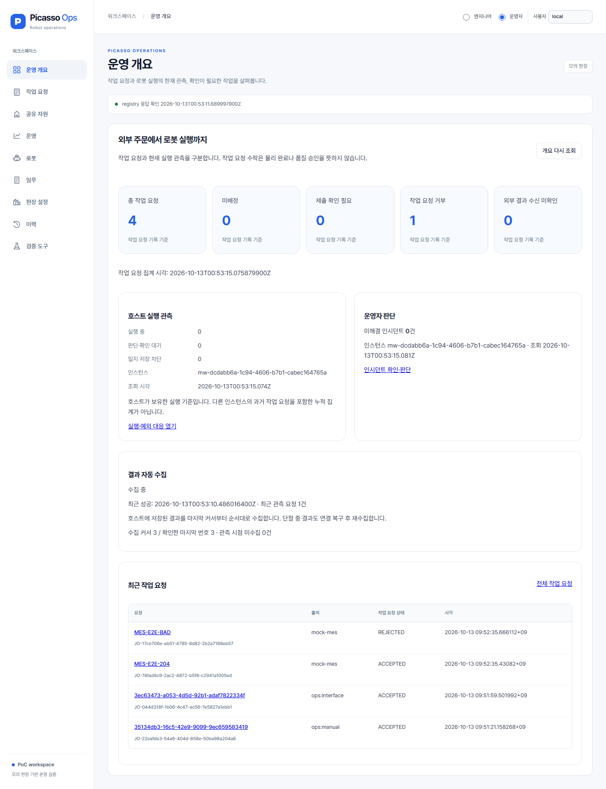

그림 06. 운영 개요 전체. 위에서부터 지표 카드, 호스트 실행 관측과 운영자 판단, 결과 자동 수집, 최근 작업 요청.

### 3.2 작업 요청 (`#requests`)

| 항목 | 내용 |
|---|---|
| 목적 | 외부 주문(Mock MES)과 운영자 수동 작업 요청, 호출 계약으로 만든 작업 요청을 한 목록에서 검색하고, 작업 요청부터 실행 결과·외부 결과 수신 확인까지 추적합니다. 작업 요청 수신, 호스트 수락, 물리 완료는 서로 다른 상태로 보입니다. |
| 누가 | 조회는 두 모드가 합니다. 미배정 재평가와 현장 확인 기록은 운영자가 합니다. |
| 진입 | 메뉴 2번, 운영 개요의 지표 카드와 최근 작업 요청 링크, 공유 자원의 «작업 요청·실행 결과» 링크, 호출 계약의 «작업 요청·실행 결과 보기», 검증 도구 링크로 진입합니다. 운영 영역 맨 위에도 같은 컴포넌트가 들어갑니다(§3.4.1). |
| 컴포넌트 | `WorkRequests.tsx`, `RequestRecovery.tsx`, `RequestReview.tsx`, `RejectionSummary.tsx`, `SourceConfirmation.tsx`, `StoredResultSummary.tsx`, 구역 `section[aria-label=상위 작업 요청]` |
| API | GET `/api/work-requests?search=&state=&offset=&limit=20&result=`, GET `/api/work-requests/{receiptId}`(5초), POST `/api/work-requests/{receiptId}/recover` `{requestId, reason, expectedUpdatedAt}`, POST `/api/work-requests/{receiptId}/reviews` `{requestId, observation, reason, expectedUpdatedAt}`, POST `/api/work-requests/{receiptId}/source-confirmations` `{requestId, source, identity, reason, expectedUpdatedAt}`, 공유 자원 작업은 같은 본문으로 POST `/api/stations/runs/{runId}/source-confirmations`(`runId` 는 상세 응답의 `resource.runId`) |

검색어, 상태, 외부 결과 필터, 쪽 위치, 고른 작업 요청이 `#requests?search=&state=&result=&offset=&receipt=` 에 남습니다. 운영 영역 안에서는 해시가 `#operations` 라 URL 에 남지 않습니다.

#### 3.2.1 목록

머리에는 h2 «통합 작업 요청», 설명 «외부 주문과 운영자 수동 작업을 작업 요청부터 로봇 실행까지 확인합니다. 작업 요청 수신, 호스트 수락, 물리 완료는 서로 다른 상태입니다.», 버튼 «작업 요청 다시 조회»가 있습니다.

검색 폼 `form[aria-label=작업 요청 검색]`의 구성 요소는 다음과 같습니다.
- 칸 «외부 주문·출처·내부 ID 검색»(최대 160자)
- select «작업 요청 상태»(전체와 상태 여덟)
- select 외부 결과(접근 이름 «외부 결과 필터», 보기 «전체», «최신 결과 수신 미확인»)
- 버튼 «작업 요청 검색»

상태 글자와 출처 글자는 §2.7.3 표를 따릅니다.

표 `table[aria-label=작업 요청 목록]`은 스크롤 감싸개 «작업 요청 표 스크롤» 안에 있습니다.
표 위에는 «검색 결과 ${total}건 · 현재 ${n}건 표시»가 나타납니다.
열 순서는 다음과 같습니다.
1. 출처
2. 외부 주문(외부 주문 id, 그 아래 작업 지시 id)
3. 작업 요청 상태
4. 요청 시각
5. 상세(버튼 «${externalOrderId} 작업 요청 보기»)

표 아래에는 20건씩 이동하는 버튼 «이전»과 버튼 «다음»이 있습니다. 접근 이름은 «작업 요청 목록 이전 페이지»와 «작업 요청 목록 다음 페이지»입니다.

목록의 상태 표시는 다음과 같습니다.

| 상태 | 표시 |
|---|---|
| 못 읽음 | «작업 요청 목록을 아직 읽지 못했습니다.» |
| 빈 결과 | «조건에 맞는 작업 요청이 없습니다. 이전 직접 제출 API의 작업은 별도 실행 이력에서 확인합니다.» |
| 읽기 실패 | alert «작업 요청 조회 실패: HTTP ${n}» |

앞서 읽은 값이 있으면 « · 직전 조회 값입니다.» 가 붙습니다.

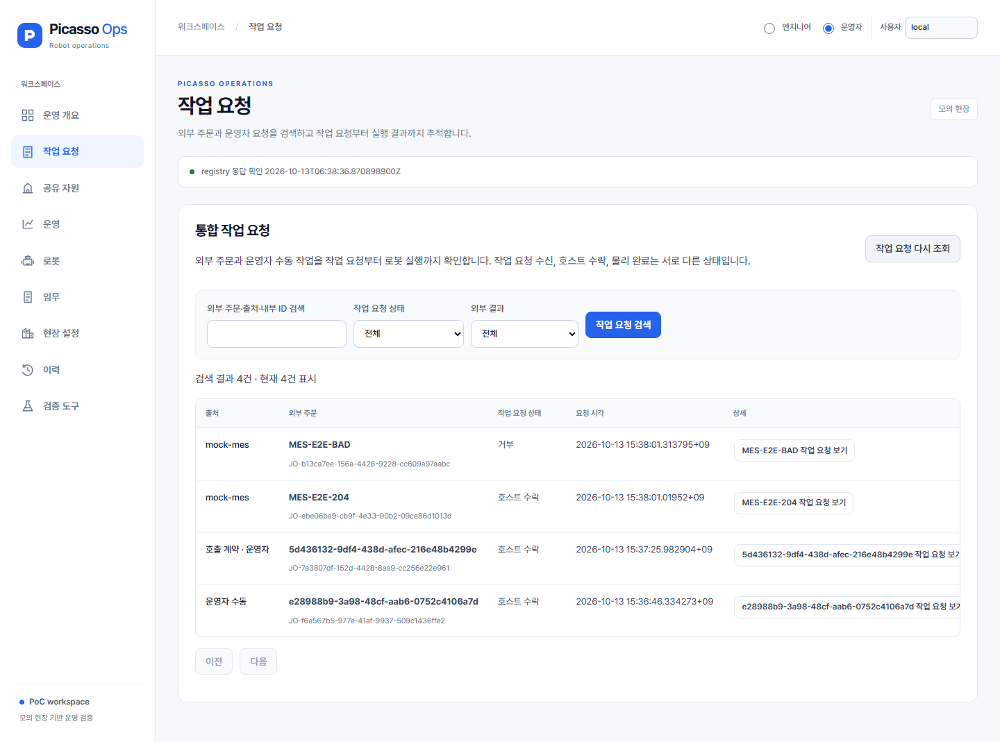

그림 07. 외부 주문과 수동 작업 요청이 섞인 작업 요청 목록.

#### 3.2.2 상세

`article[aria-label=작업 요청 상세]` 는 위에서 아래로 다음 요소를 배치합니다.

| 순서 | 요소 | 글자·조건 |
|---|---|---|
| 1 | 머리 | h3 «작업 요청 상세», 버튼 «작업 요청 상세 닫기» |
| 2 | 읽기 실패 | alert «${error}», 앞서 읽은 상세가 있으면 « · 상세는 직전 값입니다.» |
| 3 | 제목 | h4 «${externalOrderId} · ${상태 글자}» 와 서버 detail 문장. 상세 응답에 `rejection` 이 있으면(호스트가 거부한 REJECTED) detail 문장 대신 region «거부 사유»(`RejectionSummary.tsx`) 표시. 위에서 아래로: 굵게 «거부 사유» 와 «${reason}»(reason 이 null 이면 «사유 없음»); `rejection.forgottenJobOrder` 가 참이면(호스트가 이미 끝나 이빅션한 작업 지시를 거부한 경우) «이미 끝나 이빅션한 작업 지시입니다. 같은 작업 지시는 다시 받지 않으므로 다시 할 일은 새 작업 지시로 냅니다.» 줄, 다른 거부에는 줄 없음(근거: `WorkRequests.test.tsx` 의 `이미 끝나 놓은 작업 지시라는 호스트 거부는 거부 사유에 새 작업으로 내라는 안내를 붙이고 다른 거부는 붙이지 않는다`); `sourceMissing` 이 있으면 «출발 자리 ${source} · 비어 있음»(observed null) 또는 «출발 자리 ${source} · ${observed} 있음»; `sourceUnobserved` 가 있으면 «출발 미관측 · 출발 자리 ${source} · 설비 응답 없음»(`occupied` null) 또는 «출발 미관측 · 출발 자리 ${source} · 있음 · 신원 모름»(`occupied` true), `material` 이 있으면 끝에 « · 확인할 자재 ${material}». 출발 미관측 거부에는 출발 자리 결품 줄과 대체 위치 줄이 없다; 대체 위치(목록이 있으면 «대체 위치: A, B», 빈 목록이면 «대체 위치 없음», null 이면 `sourceMissing` 이 있을 때만 «대체 위치 조회 불가», 출발 결품이 아니면 줄 없음); 조치(`remedyWithheld` 면 «조치 제안 보류 · 사람이 먼저 진단», `FOUND` 면 «조치 제안 ${n}단계: a → b»(skillType 을 « → » 로 이음), `NONE` 이면 «조치 제안 없음 · ${REMEDY_CAUSE_LABEL}», remedy null 이면 줄 없음). 호스트 미배정은 서버 detail 문장(«호스트 미배정: …»)을 두고, 출발 결품으로 떨어진 기체가 하나라도 있을 때 detail 문장 아래에 region «기체별 출발 결품»(`RejectionSummary.tsx` 의 `UnassignedSourceMissing`) 표시. 기체마다 굵은 robotId, «출발 자리 ${source} · 비어 있음» 또는 «… · ${observed} 있음», 대체 위치 줄(거부 사유 구역과 같은 규칙: 목록, «대체 위치 없음», «대체 위치 조회 불가»). 출발 결품이 아닌 기체는 목록에 없고, 그런 기체가 없으면 구역도 없음 |
| 4 | 상위 연결(상세 응답에 `supersededBy` 나 `replaces` 가 있을 때, region «상위 시스템이 대신 보낸 작업 요청»·«상위 시스템이 대신한 앞선 작업 요청») | `WorkRequests.tsx` 안의 `UpstreamLink`. 상세 응답에 `supersededBy` 가 있으면 region «상위 시스템이 대신 보낸 작업 요청»: h4 같은 이름, 줄 «${externalOrderId} · ${상태 글자} · 연결 ${linkedAt}», 버튼 «${externalOrderId} 작업 요청 열기», 안내 «이 작업 요청은 다시 제출하지 않습니다. 상태와 기록은 그대로입니다.». `replaces` 가 있으면 region «상위 시스템이 대신한 앞선 작업 요청»: h4 같은 이름, 같은 줄과 버튼, 안내 없음. 둘 다 있을 수 있다(연쇄 가운데). 그때 `supersededBy` 구역이 먼저다. 버튼은 그 작업 요청의 상세로 옮기고 주소의 `receipt` 를 바꾼다. 상태 글자는 목록과 같은 표다(`REJECTED` 거부, `UNASSIGNED` 미배정, `ACCEPTED` 호스트 수락 …). |
| 5 | 출발 미관측(상세 응답의 `pendingSources` 가 비지 않고 `supersededBy` 가 없을 때, region «출발 미관측») | `SourceConfirmation.tsx`. h4 «출발 미관측 · 확인 필요», 안내 «결품이 아닙니다. 설비가 출발 자리의 자재를 확인해 주지 않았습니다. 사람이 출발 자리를 확인해 기록하기 전에는 다시 제출하지 않습니다.», 목록(출발 자리마다 출발 미관측 줄과 « · 기체 a, b»). 운영자 모드면: 출발 자리가 둘 이상일 때 select «확인할 출발 자리», 입력 «확인한 자재»(요구 자재로 시작), «확인 근거·담당자», 버튼 «출발 자리 확인 기록»(두 칸이 다 비지 않아야 켜짐. 보낸 뒤 실패하면 글자가 «같은 확인 다시 보내기» 가 되고 같은 확인 ID 로 다시 보냄. 4xx 면 새 ID), «확인 ID: …», 알림 status «출발 자리 확인 기록됨 · ${state}», 실패 alert «${detail} · 같은 확인 ID로 다시 확인하세요.». 엔지니어 모드면 «출발 자리 확인은 운영자 모드에서 기록합니다.». 이력이 있으면 그 안에 region «출발 자리 확인 이력»(h4 같은 이름, 줄마다 «${createdAt} · ${actor} · ${source} = ${identity}» 와 사유). 확인 대기가 없고 이력만 있으면 region «출발 자리 확인 이력» 만 보인다. 상세 응답에 `supersededBy` 가 있으면 확인 대기(`pendingSources`)가 있어도 region «출발 미관측» 을 그리지 않고, 이력이 있으면 region «출발 자리 확인 이력» 만 보인다. |
| 6 | 자원 대기(필수 자원이 있을 때, region «작업 요청의 자원 대기») | h4 «필수 자원 ${stationId}», «${state} · ${reason}», «앞선 대기 작업 ${n}건 · 점유 작업 ${owner}»(없으면 «없음»), 링크 «공유 자원에서 점유·복구 확인» |
| 7 | dl | «출처», «요청자»(payload 의 requestedBy, 없으면 «외부 시스템»), «작업 요청 ID», «내부 작업 ID», «호스트 조회»(«조회됨» 또는 «모름 · 호스트 조회 실패»), «실행 상태»(물리 상태, 없으면 «현재 실행 확인 안 됨»), «기체»(없으면 «확인 안 됨»), «적용 임무 버전»(번호, «코드 정의», «확인 안 됨») |
| 8 | 일지 차단 | alert «일지 저장 실패로 호스트의 새 명령 진행이 차단되었습니다.» |
| 8a | 작업 허가 대기(현재 실행에 `permitBlock` 이 있을 때, region «작업 허가 대기») | §3.4.4 열 6 과 같은 컴포넌트(`PermitBlockNotice.tsx`)와 같은 글자. 근거: `PermitBlockNotice.test.tsx` 의 `작업 요청 상세는 현재 실행의 작업 허가 대기를 보인다`. |
| 9 | 불명 안내(RECEIVED·DISPATCHING·IN_DOUBT) | «작업 요청 처리 또는 전송 결과를 확정할 수 없습니다. 동일한 외부 주문이나 수동 작업은 자동으로 재제출하지 않습니다. 내부 작업 ID로 실행 이력을 확인하세요.» |
| 10 | 미배정 안내(UNASSIGNED, 출발 미관측 대기(`pendingSources`)나 `supersededBy` 가 있으면 이 안내를 숨긴다) | «미배정 작업 요청입니다. 전송 전 미배정은 아래에서 운영자 판단으로 재평가할 수 있습니다.» |
| 11 | 실행 줄 | «실행 ID: ${id} · 호스트 인스턴스: ${id} · 조회 시각: ${at}»(값이 없으면 «확인 안 됨») |
| 12 | 직전 관측(현재 실행이 없고 마지막으로 본 실행이 있을 때) | `details` summary «마지막으로 확인한 실행 · 직전 관측», 시각·인스턴스·JSON, «현재 호스트 상태를 의미하지 않습니다.» |
| 13 | 미배정 재평가 | §3.2.3. 출발 미관측 대기나 `supersededBy` 가 있으면 이 구역(«미배정 재평가» 와 «새 제출은 차단됩니다…» 문장 포함)이 없다. |
| 14 | 현장 확인 기록 | §3.2.4 |
| 15 | 현장 확인 이력(region «현장 확인 이력») | 줄마다 «${createdAt} · ${actor} · ${관측 글자}», 사유, 접기 «확인 당시 관측» |
| 16 | 재평가 판단 이력(region «재평가 판단 이력») | 줄마다 «${createdAt} · ${actor} · ${reason} · ${requestId}» |
| 17 | 요청 시 배포(region «요청 시 배포») | h4 «요청 시 고정된 배포», JSON |
| 18 | 원문 접기 둘 | «원본 요청·변환·제출 기록», «실행과 완료 근거» |
| 19 | 외부 결과 | §3.2.5 |

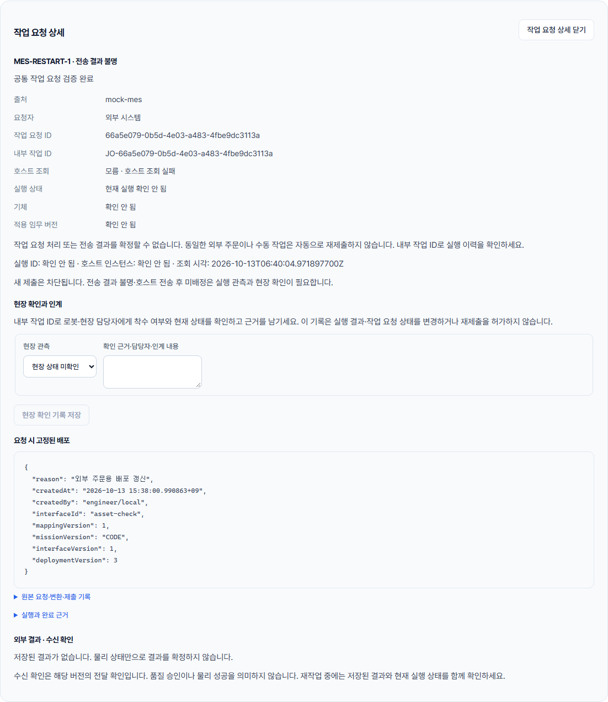

그림 09. 전송 결과가 불명인 작업 요청의 상세. 불명 안내와 현장 확인 기록이 보인다.

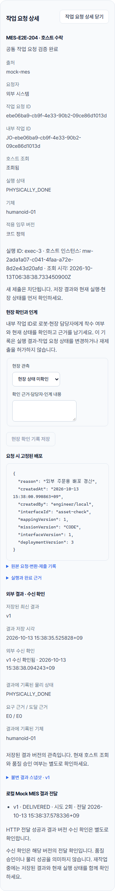

그림 21. 390px 폭의 작업 요청 상세.

#### 3.2.3 미배정 재평가

상세 응답의 `pendingSources` 가 비지 않으면(출발 미관측 대기) `RequestRecovery.tsx` 를 그리지 않습니다. `supersededBy` 가 있을 때(상위 시스템이 대신 보낸 작업 요청이 있을 때)도 `RequestRecovery.tsx` 를 그리지 않습니다. 그래서 아래 표의 «새 제출은 차단됩니다…» 문장도 보이지 않습니다. `RequestRecovery.tsx` 컴포넌트의 화면 갈래는 다음과 같습니다.

| 조건 | 화면 |
|---|---|
| 필수 자원이 있는 작업 요청 | «필수 자원 ${id}의 조정기가 미배정을 재평가합니다.» 와 링크 «공유 자원에서 관측·복구» |
| 안전 조건이 아니고 ACCEPTED | «새 제출은 차단됩니다. 저장 결과와 현재 실행·현장 상태를 먼저 확인하세요.» |
| 안전 조건이 아니고 그 밖 | «새 제출은 차단됩니다. 전송 결과 불명·호스트 전송 후 미배정은 실행 관측과 현장 확인이 필요합니다.» |
| 안전(UNASSIGNED, 제출 기록 없음, 실행 없음) 또는 보관 요청 있음 | region «미배정 안전 재평가», h4 «미배정 재평가», 안내 «호스트 전송 전에 후보가 없어 멈춘 요청만 기존 작업 ID로 다시 배정 판단합니다. 입력은 변경하지 않습니다.», 칸 «재평가 판단 사유»(1000자), 버튼 «미배정 재평가»(보관 중이면 «동일 재평가 요청 확인») |

버튼은 운영자가 아니면, 사유가 비면, 보관값 복원에 실패하면 비활성화됩니다.

끝난 뒤 화면은 다음과 같습니다.
- status «재평가 요청 기록됨 · ${state}» 또는 «기존 재평가 확인 · ${state}»
- «재평가 ID: ${uuid}»
- 버튼 «재평가 기록 확인 완료»(보관 해제)

오류 화면은 다음과 같습니다.
- 오류: alert «${error} · 기존 재평가 ID로 확인하세요.»
- 보관 실패: «요청 보관 실패로 전송하지 않았습니다.»
- 복원 실패: «보관된 재평가 요청을 읽지 못했습니다. 실행·재평가 이력을 확인하세요.»

#### 3.2.4 현장 확인 기록

`RequestReview.tsx` 컴포넌트는 region «현장 확인 기록» 에 있습니다.
h4 «현장 확인과 인계», 안내 «내부 작업 ID로 로봇·현장 담당자에게 착수 여부와 현재 상태를 확인하고 근거를 남기세요. 이 기록은 실행 결과·작업 요청 상태를 변경하거나 재제출을 허가하지 않습니다.» 가 들어갑니다.

모드에 따른 작성 화면은 다음과 같습니다.
- 엔지니어: «현장 확인 기록은 운영자 모드에서 작성합니다.»
- 운영자: select «현장 관측»(§2.7.3 의 `reviewLabels` 넷), textarea «확인 근거·담당자·인계 내용»(1000자), 버튼 «현장 확인 기록 저장»

보관 중일 때 화면은 다음과 같습니다.
- 버튼 «동일 확인 기록 조회»
- «이력 확인 후 새 기록 작성»
- «확인 ID: ${uuid}»

결과와 오류 표시는 다음과 같습니다.
- 결과: status «현장 확인 기록 저장됨» 또는 «기존 현장 확인 기록 확인됨»
- 오류: alert «${error} · 같은 확인 ID로 다시 확인하세요.»
- 복원 실패: «보관된 확인 기록을 읽지 못했습니다. 이력을 확인하세요.»

#### 3.2.5 외부 결과 수신 확인

region «외부 결과 수신 확인» 은 `WorkRequests.tsx` 안에 있습니다. 그 안의 저장 결과 요약(region «저장 결과의 완료 근거»)만 `StoredResultSummary.tsx` 가 그립니다.
h4 «외부 결과 · 수신 확인» 이 있습니다.

결과가 있을 때 dl 은 다음과 같습니다.
- «저장된 최신 결과»: «v${n}»
- «결과 저장 시각»
- «외부 수신 확인»: «로컬 작업 · 외부 수신 확인 대상 아님», «v${n} 수신 확인됨 · ${at}», «v${n} 수신 확인 대기» 중 하나

저장 결과 요약(region «저장 결과의 완료 근거»)은 다음과 같습니다.
- dl: «결과에 기록된 물리 상태», «요구 근거 / 도달 근거», «결과에 기록된 기체»가 있으며 값이 없으면 «확인 안 됨» 입니다.
- 끝 문장 «저장된 결과 버전의 관측입니다. 현재 호스트 조회와 품질 승인 여부는 별도로 확인하세요.» 가 붙습니다.
- 접기 «불변 결과 스냅샷 · v${n}»(SHA-256)이 있습니다.

결과가 없을 때는 «저장된 결과가 없습니다. 물리 상태만으로 결과를 확정하지 않습니다.» 가 나타납니다.

결과 전달 이력(`div[aria-label=결과 전달 이력]`)은 다음과 같습니다.
- h4 «로컬 Mock MES 결과 전달»
- 줄마다 «v${n} · ${state} · 시도 ${n}회» 가 나타납니다. 실패면 « · ${lastError} · 다음 시도 ${at}» 가 붙고, 전달되면 « · 전달 ${at}» 가 붙습니다.
- 문장 «HTTP 전달 성공과 결과 버전 수신 확인은 별도로 확인합니다.» 가 있습니다.

끝 문장은 «수신 확인은 해당 버전의 전달 확인입니다. 품질 승인이나 물리 성공을 의미하지 않습니다. 재작업 중에는 저장된 결과와 현재 실행 상태를 함께 확인하세요.» 입니다.

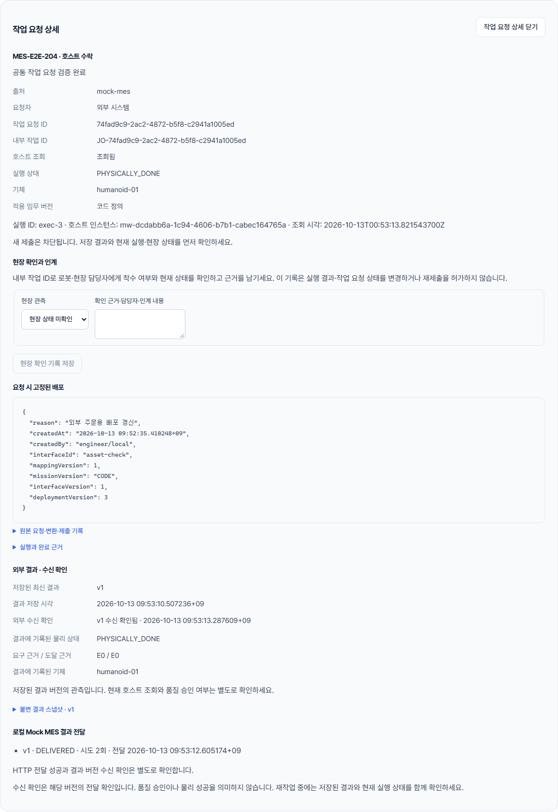

그림 08. 외부 주문의 상세. 저장 결과 버전, 수신 확인, 결과 전달 이력이 보인다.

### 3.3 공유 자원 (`#stations`)

| 항목 | 내용 |
|---|---|
| 목적 | 공유 스테이션(설비) 하나를 한 번에 한 작업만 점유하게 하고, 설비 준비 신호와 이번 작업의 설비 완료 신호를 확인한 뒤 자원을 해제합니다. 임무마다 필수 스테이션을 등록하면 외부 주문, 운영 화면, 직접 제출이 같은 대기열을 거칩니다. |
| 누가 | 엔지니어는 공유 스테이션 등록과 임무 필수 자원 등록을 합니다. 운영자는 공유 스테이션 작업 요청, 대기 작업 취소, 현장 확인 후 자원 해제, 현장 확인 후 격리 해제, 재실행 없이 관측 재개를 합니다. 조회는 두 모드에서 합니다. |
| 진입 | 메뉴 3번, 작업 요청 상세의 «공유 자원에서 점유·복구 확인»과 «공유 자원에서 관측·복구» 링크로 진입합니다. |
| 컴포넌트 | `StationWorkspace.tsx`(구역 `section[aria-label=공유 스테이션 운영]`), `MissionResourceSettings.tsx`입니다. 모드나 사용자가 바뀌면 `StationWorkspace` 가 다시 마운트됩니다. |
| API | GET `/api/stations`(스테이션과 최근 작업, 스테이션 행에 `jobSignal`, `jobEchoSignal`, `quarantinedBy`, `quarantinedAt`이 실림), GET `/api/mission-interfaces`(5초, 둘을 함께), GET `/api/stations/runs/{runId}`, 링크 `/api/stations/runs/{runId}/evidence`, POST `/api/stations`(등록, 본문 선택 칸 `jobSignal`·`jobEchoSignal`, 빈 칸은 보내지 않음), POST `/api/stations/runs`(작업 요청), POST `/api/stations/runs/{runId}/decision` `{expectedRevision, decision, reason}`(decision 은 `CANCEL_QUEUED`, `CONFIRM_CLEAR`, `RESUME_OBSERVATION`, `CONFIRM_STATION_IDLE`), GET·POST `/api/mission-resources`입니다. 쓰기는 `interfaceRequest`(§2.6.2)를 사용합니다. |

| 구역 | 내용과 글자 | 상태 |
|---|---|---|
| 머리와 흐름 | h2 «공유 자원과 작업 흐름», 설명 «스테이션을 확보하고 설비 준비를 확인한 뒤 임무를 호출합니다. 로봇 완료와 이번 작업의 설비 완료 근거를 확인해야 자원을 해제합니다.». 단계 넷(`ol.validation-journey`): «자원 확보»(«스테이션별 작업 요청 순서로 한 작업만 점유합니다.»), «설비 준비»(«준비 true·완료 false를 확인합니다.»), «임무 수행»(«고정 배포를 호출하고 작업 요청을 추적합니다.»), «완료 확인»(«로봇 물리 완료와 새 설비 완료 신호가 필요합니다.»). 안내 «임무에 필수 자원을 등록하면 외부 주문·운영 화면·직접 제출도 같은 대기열을 거칩니다. 외부 장비의 독립 제어를 잠그는 현장 인터록은 아닙니다. 설비 신호는 일반 공정 신호이며 안전 제어를 대체하지 않습니다.» | 조회 실패 alert «자원 조회 실패: ${error} · 표는 직전 값입니다. 조작 전 다시 조회하세요.», 조작 실패 alert(서버 detail 그대로), 보관 복원 실패 alert |
| 스테이션 점유 | 버튼 «자원 상태 새로고침». 표 `table[aria-label=스테이션 점유]`(스크롤 감싸개 «자원 표 가로 스크롤»), 열 넷: «스테이션»(이름과 id, 격리된 스테이션(`quarantinedBy`가 있음)이면 이름과 id 아래에 강조 글자 «격리 상태»를 더 보임), «준비 / 완료 신호»(값 «${readySignal} / ${completeSignal}», 작업 번호 신호가 있는 스테이션이면 아래 줄에 강조 글자 «작업번호 검증»과 «${jobSignal} / ${jobEchoSignal}»를 더 보임), «단계 기한»(값 «${n}초»), «점유 작업»(버튼 «점유 작업 보기» 또는 «비어 있음») | 빈 «등록된 공유 스테이션이 없습니다. 엔지니어 모드에서 현장 신호를 연결하세요.» |
| 공유 스테이션 등록(엔지니어, 접기 «공유 스테이션 등록») | 칸 «스테이션 ID»(64자), «스테이션 이름», «준비 신호 이름»(처음 값 `inspection_ready`), «완료 신호 이름»(처음 값 `inspection_complete`), 선택 칸 «작업 번호 송신 신호»(최대 120자, 처음 값 빈 칸), «작업 번호 반환 신호»(최대 120자, 처음 값 빈 칸), «단계 기한 초»(5~3600, 처음 값 120). 두 칸 아래 도움말 문단(두 칸의 `aria-describedby`가 가리킴) «작업 번호 일치를 검증하는 신호로, 설비는 시작 시 받은 번호를 유지했다가 완료 신호와 함께 반환해야 합니다. 연결하지 않으면 현장 확인 후 작업 해제 시 스테이션이 격리됩니다.». 빈 칸(공백만 있는 칸 포함)은 요청 본문에 `jobSignal`·`jobEchoSignal`을 넣지 않습니다. 한쪽만 채운 등록은 서버가 거부하고 화면은 서버 문구 «작업 번호 송신·반환 신호는 둘 다 연결하거나 둘 다 비워야 합니다.»를 alert로 그대로 보입니다. 서버는 «현장에 선언된 TEXT 신호가 필요합니다.»로도 거부할 수 있습니다. 안내 «준비·완료 신호는 안전 신호가 아닌 BOOLEAN 신호, 선택 항목인 작업 번호 송신·반환 신호는 TEXT 신호만 연결할 수 있습니다. 등록 후 설정은 변경할 수 없습니다.» 설비 쪽 요구는 문서 [공유 스테이션 설비 연동 요구 사양](../station-equipment-requirements.md)에 있습니다. 버튼 «스테이션 등록»(조회 실패 중 비활성) | - |
| 공유 스테이션 작업 요청(운영자, 펼친 접기 «공유 스테이션 작업 요청») | select «사용할 스테이션»(첫 보기 «스테이션 선택»), select «대상 호출 계약»(첫 보기 «계약 선택», 공개되고 배포가 있는 호출 계약만 «${name} · v${version}»), 고르면 «고정 배포 v${n} · 임무 ${missionVersion} · 필수 자원 ${stationId}»(필수 자원이 없으면 «미지정»), textarea «스테이션 계약 입력»(계약 샘플로 채움), 체크 «준비 조건이 충족되면 실제 로봇 작업을 지시합니다», 버튼 «스테이션 작업 요청». 버튼은 체크 전, 조회 실패 중, 보관 요청이 있을 때, 그리고 계약의 필수 자원이 고른 스테이션과 다를 때 비활성. 보관 중: status «요청 ${requestId}가 보관되어 있습니다. 응답이 불명확하면 새 ID로 보내지 마세요.» 와 버튼 «동일 스테이션 요청 확인». 보내기 전 오류: «호출 계약·배포와 실제 작업 지시를 확인하세요.», «입력은 JSON 객체입니다.», 응답 확인 오류 «작업 요청 ID가 일치하지 않습니다. 동일 요청으로 재확인하세요.», 보관 복원 실패 «보관 요청을 읽을 수 없습니다. 새 작업 요청을 보내기 전에 기존 스테이션 작업을 확인하세요.» | - |
| 임무 필수 자원 | §3.3.2 | - |
| 최근 작업과 대기 사유 | h3 «최근 작업과 대기 사유», «최근 100건입니다. 시작 후 불명확해진 작업은 자동 재할당하지 않습니다. 전송 전 미배정만 5초 간격으로 최대 3회 재평가합니다.» 표 `table[aria-label=스테이션 작업]`(스크롤 감싸개 «스테이션 작업 표 가로 스크롤»), 열: 작업(작업 id 앞 8자 버튼) / 스테이션 / 상태(§2.7.3 의 스테이션 작업 상태 글자) / 이유(서버 문장) / 작업 요청(링크 «작업 요청·실행 결과» → `#requests?receipt=…`, 아직 없으면 «아직 연결되지 않음») | - |

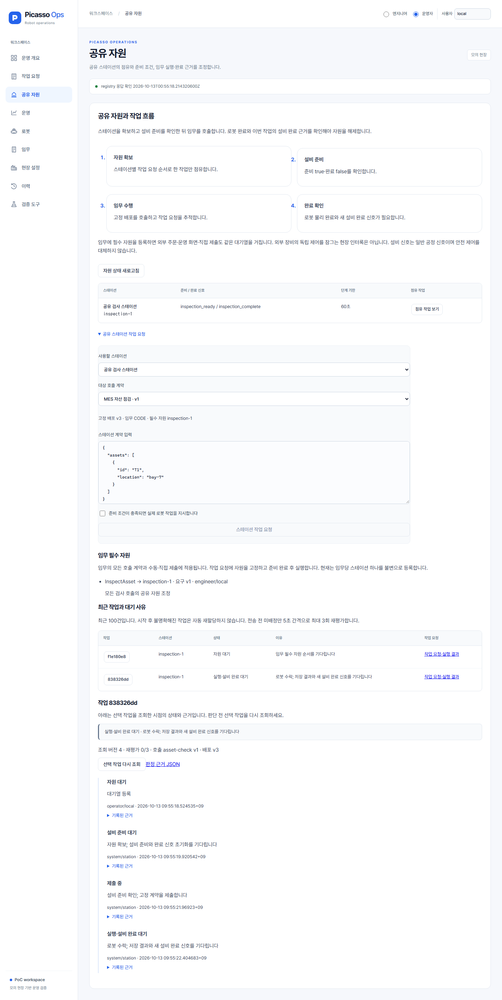

그림 10은 두 작업이 한 스테이션을 차례로 쓰는 상태인 스테이션 점유 표와 최근 작업 표입니다.

#### 3.3.1 스테이션 작업 근거와 운영자 판단

점유 작업이나 최근 작업을 누르면 `article[aria-label=스테이션 작업 근거]`가 열립니다.

상단에는 h3 «작업 ${id 앞 8자}»와 안내 «아래는 선택 작업을 조회한 시점의 상태와 근거입니다. 판단 전 선택 작업을 다시 조회하세요.»가 표시됩니다.

status에는 «${상태 글자} · ${reason}»이 표시됩니다.

정보 줄에는 «조회 버전 ${revision} · 재평가 ${attempt}/3 · 호출 ${interfaceId} v${version} · 배포 v${n}»이 표시됩니다. 호출 계약이 없으면 임무 id나 «직접 임무»가 표시되고, 배포가 없으면 «코드 정의»가 표시됩니다.

버튼 «선택 작업 다시 조회»와 링크 «판정 근거 JSON»(새 탭, `/api/stations/runs/{runId}/evidence`)을 제공합니다.

상태 이력 `ol.station-timeline`에는 항목마다 상태 글자, 이유, «${actor} · ${recordedAt}», 접기 «기록된 근거»(JSON)가 포함됩니다.

운영자 판단 폼은 운영자 모드이고 상태가 QUEUED 또는 REVIEW_REQUIRED이거나, 격리된 스테이션의 `WAITING_READY` 작업일 때만 표시됩니다. 칸 «운영자 판단 근거»(1000자)가 비어 있으면 버튼이 비활성화됩니다:
- QUEUED 상태에서는 버튼 «대기 작업 취소»(`CANCEL_QUEUED`)를 제공합니다.
- REVIEW_REQUIRED 상태에서는 문장 «해제는 물리 완료 판정이 아닙니다. 로봇 작업·잔류 물체·설비 상태를 현장에서 확인한 뒤 판단하세요.»가 표시됩니다. 또한 체크 «현장 작업과 자원 해제 가능 여부를 확인했습니다»와 버튼 «현장 확인 후 자원 해제»(`CONFIRM_CLEAR`, 체크 전 비활성), «재실행 없이 관측 재개»(`RESUME_OBSERVATION`, 작업 요청이 연결된 작업만)를 제공합니다. 버튼 «현장 확인 후 자원 해제» 바로 아래에, 그 작업의 스테이션에 작업 번호 신호가 없을 때만 문장 «자원을 해제해도 이전 작업은 멈추지 않으며 해당 스테이션은 격리됩니다.»가 보입니다. 작업 번호 신호가 있는 스테이션에서는 이 문장이 없습니다.
- 격리된 스테이션의 `WAITING_READY` 작업에서는 `role="note"` 문단 «설비가 비어 있고 이전 작업 로봇이 멈췄는지 현장에서 확인하세요. 설비 완료 신호가 꺼진 것을 확인한 뒤 판단하세요.», 칸 «운영자 판단 근거»(1000자), 체크 «설비·로봇 상태와 격리 해제 가능 여부를 확인했습니다», 버튼 «현장 확인 후 격리 해제»(`CONFIRM_STATION_IDLE`, 사유가 비었거나 체크 전이거나 조회 실패 중이면 비활성)를 제공합니다. 판단 뒤 선택 작업을 다시 조회하고 칸과 체크를 비웁니다. 이 폼이 보일 때 «현장 확인 후 자원 해제» 버튼은 없습니다.

서버가 상태 줄과 «이유» 칸, 상태 이력에 내는 새 사유는 서버 문장 그대로 보입니다: `WAITING_READY`의 «작업 번호 쓰기 실패; 설비 신호 기록을 기다립니다», «스테이션 격리; 현장 확인과 격리 해제 판단을 기다립니다», «작업 허가 대기; 작업 번호를 쓰지 않고 작업 요청을 내지 않습니다: ${기체} ${허가}…; 풀릴 근거: ${근거}», 허가를 못 읽으면 «작업 허가 대기; 작업 번호를 쓰지 않고 작업 요청을 내지 않습니다: 작업 허가를 읽지 못했습니다», `REVIEW_REQUIRED`의 «설비 완료 신호 수신, 작업 번호 불일치; 현장 확인이 필요합니다», «출발 미관측; 작업 요청 상세에서 출발 자리 확인을 기록하기 전에는 다시 제출하지 않고 점유를 유지합니다», 출발 자리 확인 뒤 이력(`RETRYING`)의 «출발 자리 확인 기록; 같은 작업 요청을 다시 제출합니다», 해제한 작업 이력의 «자원 해제에 따른 스테이션 격리», 격리 해제 뒤 이력의 «현장 확인 후 격리 해제: ${사유}», 허가가 돌아온 뒤의 «작업 허가 복귀; 설비 준비 기한을 다시 셉니다». 설비 쪽 요구는 문서 [공유 스테이션 설비 연동 요구 사양](../station-equipment-requirements.md)에 있습니다.

판단은 조회한 버전(`expectedRevision`)을 함께 보냅니다.

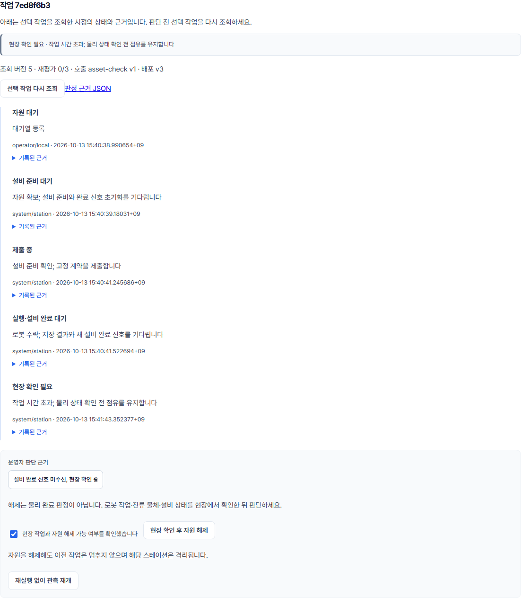

그림 11은 현장 확인이 필요한 스테이션 작업의 근거와 운영자 판단 폼(운영자 모드)입니다.

#### 3.3.2 임무 필수 자원

컴포넌트 `MissionResourceSettings.tsx`의 region «임무 필수 자원»에서 확인합니다.

h3 «임무 필수 자원»과 안내 «임무의 모든 호출 계약과 수동·직접 제출에 적용됩니다. 작업 요청에 자원을 고정하고 준비 완료 후 실행합니다. 현재는 임무당 스테이션 하나를 불변으로 등록합니다.»가 표시됩니다.

목록 줄에는 «${workMasterId} → ${stationId} · 요구 v${revision} · ${createdBy}»와 그 아래 사유가 표시됩니다.

엔지니어 모드에서는 접기 «임무 자원 요구 등록»이 제공됩니다:
- select «자원이 필요한 임무»(첫 보기 «임무 선택», 아직 등록하지 않은 임무만)
- select «필수 스테이션»(첫 보기 «스테이션 선택»)
- 칸 «자원 요구 등록 사유»(1000자)
- 안내 «진행 중·완료 불명 작업 요청이 있으면 등록할 수 없습니다. 등록 후 변경·삭제는 제공하지 않습니다.»
- 버튼 «필수 자원 등록»(목록을 못 읽었거나 칸이 비면 비활성)

상태는 다음과 같이 표시됩니다:
- 못 읽음: «자원 요구를 아직 읽지 못했습니다.»
- 빈 상태: «등록된 임무 자원 요구가 없습니다.»
- 조회·등록 실패 alert: 조회 실패는 `String(e)` 그대로라 «Error: » 접두가 붙습니다.

운영 › 작업 지시와 호출 계약 작업 요청에는 호출 전 자원 안내(`MissionResourceNotice`, `p[aria-label=호출 전 자원 요구]`)가 같은 데이터를 읽어 보입니다(§3.4.2).

### 3.4 운영 (`#operations`)

| 항목 | 내용 |
|---|---|
| 목적 | 운영자가 작업 지시 폼으로 수동 작업 요청을 내고, 실행 호스트의 실행·인시던트·셀 대역·작업 응답 송신 기록을 보고, 보류된 단위를 판단하고, 실행을 취소하며(부분 완료 닫기 등), 잔여 파지 표시가 선 기체의 빈손을 확인합니다. |
| 누가 | 조회와 셀 대역 신호 켜기·끄기, 송신 기록 거르기, 잔여 파지 표 보기는 두 모드에서 합니다. 작업 요청 내기와 운영자 판단, 실행 취소, 결함 수용, 기체 빈손 확인은 운영자가 합니다. |
| 진입 | 메뉴 4번, 운영 개요의 «실행·예외 대응 열기»·«인시던트 확인·판단», 로봇 도입 준비의 «운영에서 배정 조건 확인», 검증 도구의 «배정·실행 확인»·«보류·인시던트 판단»에서 진입합니다. |
| 컴포넌트 | `OperationsArea.tsx` |
| 배치 | 위에서 아래로 작업 요청 목록(region «상위 작업 요청») → `.split`[region «작업 지시» \| region «배정 가능»(배정 가능 표 아래 region «잔여 파지 확인»(h3))] → region «실행»(실행 목록 표 아래 form «실행 취소»(h3), 결함으로 막힌 실행이 있으면 그 아래 form «결함 수용»(h3)) → region «인시던트» → region «셀 대역» → region «작업 응답 송신 기록» 순서입니다. 1199px 이하에서 `.split` 은 1열입니다. 탭이나 앵커는 없습니다. |

실행 호스트를 거치는 읽기는 이 영역이 열려 있을 때만 5초마다 합니다. 신호 조작, 판단, 실행 취소, 결함 수용, 기체 빈손 확인 뒤에는 곧바로 한 번, 500ms 뒤에 한 번 더 읽습니다. 잔여 파지 표도 이 읽기에 포함됩니다(같은 `tick`). 모드나 사용자가 바뀌면 마지막 제출 알림과 보관 요청을 다시 읽습니다.

#### 3.4.1 맨 위 작업 요청 목록

§3.2 의 `WorkRequests` 컴포넌트를 그대로 넣습니다(region «상위 작업 요청»). 운영 영역이 다시 읽을 때 함께 읽습니다.
수동 작업 요청 추적의 «작업 요청·실행 결과 보기» 를 누르면 이 목록에서 그 작업 요청 상세가 열립니다.
해시가 `#operations` 라 검색어와 고른 작업 요청이 URL 에 남지 않습니다.

#### 3.4.2 작업 지시

region «작업 지시»(h2 «작업 지시»)의 구성 요소는 위에서 아래로 다음과 같습니다.
1. 제출 결과(`JobOrderNotice`)
2. 보관 오류 alert
3. 수동 작업 요청 추적
4. 호출 전 자원 안내
5. 폼(`JobOrderFormView`)

보내는 곳은 POST `/api/work-requests/manual` `{requestId, form}` 이며 202 `{receipt, duplicate}` 를 받습니다. 화면은 작업 요청의 제출 기록을 작업 지시 결과 꼴로 다시 써서(`api.ts` 의 `manualJobOutcome`) 알림에 보입니다. what 은 «${workMasterId} 작업 지시» 입니다. 작업 요청이 WAITING_RESOURCE(필수 자원 대기)이면 이 알림을 세우지 않습니다.
운영 서비스는 운영자 모드가 아니면 403 `MODE_NOT_ALLOWED` 로 막습니다.

폼(`JobOrderFormView.tsx`, form «작업 지시 폼»)의 구성은 다음과 같습니다.
select «임무» 는 InspectAsset, PrepareSequencedRack 둘로 고정됩니다. 영역을 옮기면 처음 값 InspectAsset 으로 돌아옵니다.
InspectAsset 을 고르면 fieldset «점검 대상» 이 나타납니다. 대상마다 «대상 ${i} id», «대상 ${i} 장소», 버튼 «대상 ${i} 빼기» 가 있습니다. 버튼 «대상 더하기» 가 있습니다. 회색 문장 «장소 이름은 기체가 아는 명칭이어야 합니다. 화면은 검사하지 않습니다» 가 표시됩니다.
PrepareSequencedRack 을 골랐을 때 셀 대역을 못 읽었으면 «모름: 셀 대역을 읽지 못해 슬롯과 자재를 고를 수 없습니다» 가 표시됩니다. 셀 대역을 읽었으면 fieldset «슬롯»(슬롯마다 체크박스), select «자재»(첫 보기 «고르십시오», 점유된 제시 자리의 자재), «제시 자리 ${id}»(없으면 «-»)가 나타납니다.
운영자 모드에서는 버튼 «작업 요청 내기» 가 보입니다. 엔지니어 모드에서는 버튼 자리에 «작업 요청은 운영자 모드에서 합니다.» 가 표시됩니다.

보내지 않음 alert(`jobOrderDraft.ts`, `OperationsArea.tsx`) 목록은 다음과 같습니다.
- «점검 대상을 하나 이상 넣으십시오»
- «점검 대상마다 대상 id 와 장소 이름을 넣으십시오»
- «셀 대역을 읽지 못해 슬롯과 자재를 고를 수 없습니다»
- «슬롯을 하나 이상 고르십시오»
- «자재를 고르십시오»
- «${material} 를 든 제시 자리가 셀 대역에 없습니다»
- «보관된 요청 ID로 작업 요청을 먼저 확인하세요»
- «보관된 요청과 입력이 다릅니다. 동일 작업 요청을 확인하거나, 확인된 작업 요청에서 새 작업 작성을 선택하세요»

호출 전 자원 안내(`MissionResourceNotice`, `p[aria-label=호출 전 자원 요구]`, 고른 임무 기준)는 네 갈래로 나뉩니다.
- «필수 자원 확인 중»
- «필수 자원 ${stationId} · 작업 요청을 받은 뒤 자원과 설비 준비를 기다립니다. 준비 완료 전 로봇을 실행하지 않습니다.»
- «등록된 필수 자원 없음 · 작업 요청을 받을 때 서버가 최신 요구를 확인합니다.»
- «필수 자원 조회 실패 · 작업 요청을 받을 때 서버가 요구를 확인합니다.»

수동 작업 요청 추적(region «수동 작업 요청 추적»)은 보관 요청이 있을 때 나타납니다.
h3 «수동 작업 요청» 과 «요청 ID: ${uuid}» 가 표시됩니다.
상태 줄에는 «작업 요청 기록 저장됨 · ${state}» 또는 «기존 작업 요청 확인 · 추가 실행 없음 · ${state}» 가 표시됩니다. 새로고침으로 복원한 직후에는 «보관된 요청입니다. 같은 ID와 원본 입력으로 작업 요청을 확인합니다.» 가 표시됩니다.
작업 요청 상태가 WAITING_RESOURCE 이면 status «작업 요청 저장 완료 · 필수 자원과 설비 준비를 기다립니다. 아직 로봇에 전송하지 않았습니다.» 가 표시됩니다.
경고로 «응답 불명·처리 중인 요청은 새 ID로 재제출하지 마세요. 새 작업 작성은 별도 실행을 의미합니다.» 가 표시됩니다.
버튼과 접기 구성은 다음과 같습니다.
- 버튼 «동일 작업 요청 확인»
- 버튼 «새 작업 작성»(작업 요청 상태가 WAITING_RESOURCE, ACCEPTED, REJECTED, UNASSIGNED 일 때만 활성)
- 버튼 «작업 요청·실행 결과 보기»(작업 요청 id 가 있을 때)
- 접기 «보관된 요청 입력»

앞의 둘은 운영자가 아니면 비활성입니다. 같은 폼으로 다음 작업을 내려면 먼저 «새 작업 작성» 을 눌러 보관 요청을 비웁니다.

보관 오류 alert 목록은 다음과 같습니다.
- «요청 ID 보관 실패: ${error}. 작업을 제출하지 않았습니다»
- «작업 요청 응답은 받았으나 브라우저 보관 실패: ${error}»
- «보관된 수동 요청을 읽지 못했습니다. 저장소를 지우고 재제출하기 전에 실행 이력을 확인하세요»

제출 결과(`JobOrderNotice.tsx`, status «제출 결과») 표는 다음과 같습니다.

| 경우 | 글자 |
|---|---|
| 사전 거부 | «${what}: 막힘(${풀이})» 과 detail |
| 비정상 | «${what}: 결과 모름(${cause}). 실행 목록을 다시 읽어 확인하십시오» |
| 호스트 응답 없음, 다시 읽어 실행이 있음 | «${what}: 응답은 없었으나 다시 읽어 보니 실행이 있음. 실행 목록에서 보십시오» |
| 호스트 응답 없음, 실행이 보이지 않음 | «${what}: 응답 없음. 현재 실행이 보이지 않습니다. 기존 요청 ID로 작업 요청을 확인하세요» |
| 호스트 응답 없음, 다시 읽지도 못함 | «${what}: 반영되었을 수 있음. 다시 읽지도 못해 확인하지 못했습니다. 실행 목록에서 확인하십시오» |
| 결과 있음 | «${what}: ${결과}»(결과는 «배정됨», «같은 작업 지시의 기존 실행», «거부됨», «미배정») |

호스트 응답 없음 세 갈래에는 dl «작업 지시 id» 가 붙습니다.
결과 있음에는 dl «작업 지시 id», «실행 id», «배정된 기체», «거부 사유»(있는 것만)와 목록 «기체별 미배정 사유», «실행 호스트가 후보에서 뺀 기체» 가 붙습니다. «기체별 미배정 사유» 목록에서는 출발 결품 기체의 «${robotId}: ${reason}» 아래에 출발 자리 줄과 대체 위치 줄이 붙고 다른 기체는 붙지 않습니다. 출발 미관측으로 떨어진 기체의 «${robotId}: ${reason}» 아래에는 출발 미관측 줄 하나가 붙습니다(대체 위치 줄 없음). `outcome.forgottenJobOrder` 가 참이면 dl 바로 아래(출발 미관측 줄 위)에 «이미 끝나 이빅션한 작업 지시입니다. 같은 작업 지시는 다시 받지 않으므로 다시 할 일은 새 작업 지시로 냅니다.» 문단이 붙습니다(근거: `JobOrderNotice.test.tsx` 의 `이미 끝나 놓은 작업 지시라는 거부는 거부 사유와 함께 새 작업 지시로 내라는 안내를 보이고 다른 거부는 보이지 않는다`). 결과가 REJECTED 이고 `outcome.sourceUnobserved` 가 있으면 dl 아래에 출발 미관측 줄이 붙습니다. 출발 미관측 줄 글자는 «출발 미관측 · 출발 자리 ${source} · 설비 응답 없음»(`occupied` null) 또는 «출발 미관측 · 출발 자리 ${source} · 있음 · 신원 모름»(`occupied` true), `material` 이 있으면 끝에 « · 확인할 자재 ${material}».
제출한 작업 지시의 실행 행은 실행 목록에서 `tr.selected` 로 강조됩니다.
작업 지시 구역과 배정 가능 구역에는 대표 그림이 없습니다.

#### 3.4.3 배정 가능

region «배정 가능»(h2 «배정 가능», `EligibilityTable.tsx`)에서는 폼이 다 차면 POST `/api/job-orders/eligibility` 로 판정을 묻습니다. 폼이 바뀐 뒤 300ms 더 바뀌지 않을 때 묻고, 그 뒤 5초마다 다시 묻습니다.

상태 표는 다음과 같습니다.

| 상태 | 글자 |
|---|---|
| 폼이 덜 참 | «폼을 채우면 기체별 배정 가능을 봅니다» |
| 운영 서비스가 폼을 막음(400) | alert «${풀이}: ${detail}»(예 «작업 지시 폼 오류») |
| 판정 전 | «판정 중» |
| 못 읽음 | «모름: 배정 가능을 읽지 못했습니다 (${error})» |
| 직전 값 | `p.stale` «직전 값입니다 (${error})» |
| 폼이 바뀌어 다시 판정 중 | `p.stale` «폼이 바뀌어 다시 판정하는 중입니다» |
| 판정 시각 | «판정 시각 ${checkedAt}» |
| 기체 목록 모름 | «모름: 기체 목록을 아직 읽지 못했습니다» |
| 기체 없음 | «이 사이트에 기체가 없습니다» |

표 `table[aria-label=기체별 배정 가능]` 의 아홉 열 순서는 다음과 같습니다.
1. 기체
2. 시운전(«완료»·«미완»·«퇴역», 모르면 «모름»)
3. 연결(«${연결 글자}(현장 설정 버전 ${n})»)
4. 진행 중인 실행(실행 id, «없음», «모름»). 실행 호스트의 `runningExecutionId` 는 그 기체를 쥔 실행(종결하지 않은 실행, 운영자 보류, 부분 완료 `PARTIAL`)입니다. 잔여 파지 표시만 있는 기체는 이 칸이 «없음» 이어도 배정 «불가» 이고 이유 칸에 «잔여 파지 확인 필요: ${jobOrderId} ${unitId}» 가 보입니다.
5. 요구 스킬
6. 기체 제공 스킬(목록, «없음», «모름»)
7. 스킬 적합(«적합», «모름», 또는 «모자람» 뒤에 콜론과 빠진 스킬 목록)
8. 배정 가능(«가능», «불가»)
9. 이유(«; » 로 이음)

같은 표가 임무 › 호출 연결의 «실행 전 배정 확인» 에도 쓰입니다(§3.6.4).
시운전 «완료» 인 기체만 배정 가능합니다.

##### 잔여 파지 확인

`ExecutionControls.tsx` 의 `ResidualHolds` 컴포넌트가 담당하며 `section[aria-label=잔여 파지 확인]` 과 h3 «잔여 파지 확인» 을 씁니다. 소개 문장은 «실행이 끝날 때 로봇이 물체를 든 채로 관측된 기체입니다. 사람이 현장에서 빈손을 확인하기 전까지 그 기체는 배정에서 빠집니다.» 입니다. GET `/api/robots/residual-holds` 를 5초(`tick`)와 조작 뒤에 읽습니다.

- 상태: 첫 읽기 전·실패면 «모름: 잔여 파지 표시를 아직 읽지 못했습니다»(오류가 있으면 « (${error})»), 직전 값이면 `p.stale` «직전 값입니다. 실행 호스트 불통: ${error}», 미해소 표시가 없으면 «미해소 잔여 파지 표시가 없습니다».
- 표 `table[aria-label=미해소 잔여 파지]`(감싸개 «표 가로 스크롤») 일곱 열: 기체, 작업 지시, 실행(칸 title «인스턴스 ${instanceId}»), 단위, 든 것(`objectRef`, 없으면 «이름 없음»), 기록 시각(코드 값 ISO), 확인(운영자 모드면 버튼 «기체 빈손 확인», 엔지니어 모드면 글자 «운영자 모드»). 고른 행은 `tr.selected`. 엔지니어 모드이고 행이 있으면 표 아래에 «기체 빈손 확인은 운영자 모드에서 합니다» 가 보입니다.
- 폼 `form[aria-label=기체 빈손 확인]`(운영자 모드, 행의 버튼을 누르면 열림): 머리는 «${robotId}: ${jobOrderId} ${unitId}(${objectRef 또는 «이름 없음»}). 확인자는 ${user}입니다.», `role="note"` 문단은 «이 확인은 물리 확인입니다. 로봇 손과 그리퍼에 물체가 남지 않았는지 현장에서 직접 보고 확인하세요. 화면이나 로봇 보고만으로 확인하지 마세요.», 입력은 «빈손 확인 근거»(`maxLength=1000`), 체크박스는 «기체 손에 남은 물체가 없음을 현장에서 직접 확인했습니다», 버튼은 «기체 빈손 확인»(사유와 체크가 있어야 활성)입니다. POST `/api/robots/{robotId}/residual-holds/{markerId}/clear` 본문은 `{reason}`(앞뒤 공백 뗌)이며 승인자는 싣지 않습니다(운영 서비스가 `X-Ops-User`).
- 결과 status «빈손 확인 결과»: «${robotId} 기체 빈손 확인(${jobOrderId} ${unitId}): ${결과}» 로 표시합니다. 결과는 성공 시 «빈손 확인이 기록되었습니다. 그 기체는 다음 배정 판정부터 다시 판정됩니다», 호스트 거부 시 «실행 호스트가 거부함(${풀이}). ${detail}», 사전 거부 시 «보내지 않음(${풀이}). ${detail}», 결과 모름 시 «결과 모름(${cause}). 잔여 파지 표에서 확인하십시오», 응답 없음 셋은 «응답은 없었으나 다시 읽어 보니 표시가 해소됨», «응답 없음. 다시 읽어 보니 표시가 그대로임. 잔여 파지 표에서 확인하십시오», «응답 없음. 해소됐을 수 있음. 다시 읽지도 못해 확인하지 못했습니다. 잔여 파지 표에서 확인하십시오» 입니다.
- 표시가 서는 조건: 실행이 종결할 때 마지막 로봇 단위(계획 순서)의 파지 관측이 «든 채» 입니다. 표시가 있는 동안 실행 호스트 판정이 그 기체를 배정에서 뺍니다(배정 가능 표 이유 칸에 «잔여 파지 확인 필요: ${jobOrderId} ${unitId}» 로 보임). 대표 그림은 없습니다.

#### 3.4.4 실행

`ExecutionList.tsx` 컴포넌트가 담당하며 region «실행» 과 h2 «실행» 을 씁니다. 실행 목록 보기는 두 모드에서 지원하며, 실행 취소와 결함 수용은 운영자 모드에서만 합니다(표 아래 `ExecutionControls.tsx` 의 `CancelExecutionForm` 과 `ReleaseFaultForm`).

상태와 요소는 다음 표와 같습니다.

| 요소 | 글자 |
|---|---|
| 못 읽음 | «모름: 실행 목록을 아직 읽지 못했습니다» (오류가 있으면 뒤에 « (${error})») |
| 직전 값 | `p.stale` «직전 값입니다. 실행 호스트 불통: ${error}» |
| dl | «실행 호스트 인스턴스» ${instanceId}, «마지막 pump» ${pumpedAt}(없으면 «아직 없음») |
| 일지 차단 | alert «실행 일지 저장 실패로 호스트의 명령 진행과 신규 배정이 차단되었습니다: ${executionIds}» |
| 범위 안내 | 표에 행이 있을 때만 «진행 중이거나 판단이 필요한 실행과 최근 종결한 실행 20건을 표시합니다. 그보다 오래된 실행은 이전 실행에서 확인합니다.» |
| 빈 상태 | 남은 실행과 종결 이력 행이 모두 없을 때 «실행이 없습니다» |

재기동 복원 보고는 region «재기동 복원 보고» 와 `.restore` 클래스를 쓰며 표보다 앞에 놓입니다. 재기동 뒤 행이 있을 때만 표시합니다.
- «재기동: 이전 인스턴스의 실행 ${n}건을 리빌드했습니다» 와 «(복원 시각 ${at})»
- 목록 «리빌드한 실행»: «${jobOrderId}(${robotId}): 이전 ${prev} → ${exec}»
- «미룬 실행 ${n}건. 실행 호스트가 다시 시도하며 그동안 그 기체는 배정에서 빠집니다» 와 목록 «미룬 실행»
- «포기한 실행 ${n}건. 리빌드하지 않습니다. 기체의 남은 태스크를 운영자가 확인하십시오» 와 목록 «포기한 실행»

컴포넌트는 5초마다 `GET /api/executions?recent=20` 을 읽으며, 본문에는 현재 인스턴스의 남은 실행(진행 중이거나 운영자 판단을 기다리는 실행, 또는 종결했으나 종결 기록이 아직 커밋되지 않은 실행)과 종결 이력 최근 20행(실행 호스트의 종결 기록에서 인스턴스 무관, 최근 종결부터)이 들어 있습니다. 표 `table[aria-label=실행 목록]` 은 먼저 남은 실행을 최신부터, 이어 종결 이력을 최근 종결부터 최대 20행까지 표시합니다. 남은 실행과 같은 실행(같은 인스턴스와 실행 id)인 이력 행은 감추고 남은 실행 행만 표시하며 여덟 열 순서는 다음과 같습니다.
1. 실행 id(재기동으로 리빌드했으면 뒤에 회색 « (이전 ${id})», 종결 이력 줄에서 행의 인스턴스가 현재 인스턴스와 다르면 뒤에 회색 span `.restored` 로 « (이전 인스턴스 ${instanceId})»)
2. 작업 지시 id
3. 임무
4. 임무 버전(«코드 정의», «버전 ${n}»)
5. 기체
6. 물리 상태(코드 값 뒤에, 이 인스턴스에서 건 운영자 취소가 있으면 회색 span(`.restored`) « (취소 요청: ${approverId}, ${reason})», title «${recordedAt}, 취소 때 ${physicalState}». 실행에 `permitBlock` 이 있으면 같은 칸 아래 region «작업 허가 대기»(`PermitBlockNotice.tsx`, `section.permit-block`, 연한 파랑 바탕과 파란 왼쪽 띠 `#2563eb`). 위에서 아래로 h4 «작업 허가 대기», 안내 «현장 안전 신호가 허가를 내지 않아 이 실행의 새 로봇 명령을 내지 않고 기다립니다. 실패나 운영자 보류가 아닙니다.», dl(«막힌 단위», «내지 않은 명령», «처음 막힌 시각»), 목록 `ul[aria-label=허가를 기다리는 기체]`(기체마다 굵게 «기체 ${robotId}: ${허가 글자}», 그 아래 판단마다 «까닭 ${까닭 글자} · 막는 주체 ${subject} · 풀릴 근거 ${resumeBasis}» 와 작은 글자 «(원천 ${source}, 관측 시각 ${observedAt})», 값이 null 이면 «없음»), 끝에 안내 둘(`PERMIT_BLOCK_TEXT.notOperator`, `notSafety`). 운영자 보류(`OPERATOR_HOLD`)·결함 차단 표시와 섞지 않고 버튼이 없음. 근거: `PermitBlockNotice.test.tsx` 의 `작업 허가로 막힌 실행은 막은 기체와 주체와 풀릴 근거를 운영자 보류와 다른 표시로 보이고 조작 버튼이 없다`, `모름(UNKNOWN)은 까닭과 원천 없음을 그대로 보인다`. 종결 이력 줄은 물리 상태 코드 뒤에 회색 span `.restored` 로 « (종결 ${settledAt})» 을 표시합니다. 그 뒤에 해당 줄의 실행에 작업 응답이 있으면 회색 span `.restored` 로 « (작업 지시 버전 ${jobResponse.version})» 을 표시합니다. 해당 줄이 `superseded` 이면 회색 span `.restored` 로 « (이후 다시 종결)» 을 표시합니다. 다시 종결한 작업 지시는 종결 이력 줄이 여러 개 생깁니다. 작업 응답이 없는 줄은 버전을 표시하지 않습니다. `blockedFaults` 가 비어 있지 않으면 코드 값 아래에 `strong.fault-blocked` «결함 차단 ${n}건»(주황 계열 글자, 작업 허가 대기 region 과 다른 표시)이 표시됩니다. `releases` 가 있으면 수용마다 회색 span(`.restored`) « (결함 수용: ${approverId}, ${reason})»(title «${recordedAt}, ${errorType 들}»)이 붙으며, `releases` 는 작업 지시 id 로 읽으므로 재기동 전 인스턴스의 수용도 보입니다.)
7. 단위(«${unitId} ${skillType}: ${state}, 근거 ${reached}», 종결 기록에 본문이 없으면(본문이 기록되기 전에 종결) 단위 목록 대신 «종결 기록에 단위·작업 응답이 없습니다»)
8. 작업 응답(«없음» 또는 작업 응답 요약 목록, «운영자 개입 필요» 포함)

방금 낸 작업 지시의 행은 `tr.selected` 입니다.

실행 목록 표 아래에는 `ExecutionControls.tsx` 의 `CancelExecutionForm` 이 담당하는 `form[aria-label=실행 취소]` 와 h3 «실행 취소» 가 있습니다. 실행 목록을 읽은 뒤에만 표 아래에 둡니다(빈 목록이어도 운영자 모드면 h3 와 마지막 결과는 보임).

- 고를 수 있는 실행: 남은 실행 중 물리 상태가 `PHYSICALLY_DONE`·`UNVERIFIED`·`FAILED`·`ABORTED`·`CANCELING` 이 아니고 `cancel` 이 없는 것(실행 호스트가 다시 판정하므로 고르기 편의). 없으면 폼 몸통은 없습니다.
- 몸통: 문단 «취소하면 남은 단위를 더 돌리지 않고 이 실행을 중단(ABORTED)으로 끝냅니다. 로봇이 든 물체와 설비 상태를 현장에서 확인한 뒤 결정하세요.», 문단 «부분 완료(PARTIAL) 실행은 취소하기 전까지 기체를 쥐고 있어 그 기체에 새 작업이 배정되지 않습니다.», select «취소할 실행»(첫 선택지 «실행 선택», 선택지 «${executionId} · ${jobOrderId} · ${robotId} · ${physicalState}»), 입력 «취소 사유»(`maxLength=1000`), 체크박스 «기체·설비 상태를 확인했고 이 실행을 끝냅니다», 버튼 «현장 확인 후 실행 취소»(실행·사유·체크가 있어야 활성)로 구성됩니다.
- POST `/api/executions/{executionId}/cancel` 본문 `{instanceId, reason}`(instanceId 는 실행 목록의 것, reason 은 앞뒤 공백 뗌). 승인자는 싣지 않습니다. 끝나면 고름·사유·체크를 비우고 곧바로와 500ms 뒤 다시 읽습니다.
- 결과 status «실행 취소 결과»: «${executionId}(${jobOrderId}) 실행 취소: ${결과}» 로 표시합니다. 결과는 `CANCEL_RESULT_LABEL` 에 따르며(CANCELED 가 아니고 detail 이 있으면 «${결과 글자}. ${detail}»), 호스트 4xx 거부 시 «실행 호스트가 거부함(${풀이}). ${detail}», 사전 거부 시 «보내지 않음(${풀이}). ${detail}», 결과 모름 시 «결과 모름(${cause}). 실행 목록에서 확인하십시오», 취소 응답 없음 셋은 «응답은 없었으나 다시 읽어 보니 취소가 걸림», «응답 없음. 다시 읽어 보니 취소가 걸리지 않음. 실행 목록에서 확인하십시오», «응답 없음. 취소가 걸렸을 수 있음. 다시 읽지도 못해 확인하지 못했습니다. 실행 목록에서 확인하십시오» 입니다.
- 엔지니어 모드: 폼이 없습니다. 고를 수 있는 실행이 있을 때만 «실행 취소는 운영자 모드에서 합니다» 문장이 보입니다.
- 취소한 실행은 실행 호스트의 다음 pump 에 `ABORTED` 로 종결하고, 마지막 로봇 단위가 든 채였으면 잔여 파지 표시가 섭니다(§3.4.3).

form «실행 취소» 아래에는 `ExecutionControls.tsx` 의 `ReleaseFaultForm` 이 담당하는 `form[aria-label=결함 수용]` 과 h3 «결함 수용» 이 있습니다. 운영자 모드에서 고를 실행도 마지막 결과도 없으면 폼 전체를 그리지 않습니다(취소 폼과 다름: 취소 폼은 빈 목록이어도 h3 를 보임).

- 고를 수 있는 실행: 남은 실행 중 `blockedFaults` 가 비지 않은 것입니다. 없으면 폼 몸통은 없습니다.
- 몸통: 문단 «수용은 결함을 지우지 않으며, 이 결함들이 다음 단위를 막지 않게 하고 다음 로봇 단위를 냅니다. 기체 상태를 현장에서 확인한 뒤 결정하세요.», 문단 «같은 결함은 다시 막지 않고 새 결함은 다시 막습니다. 작업 허가 대기는 수용으로 풀리지 않습니다.», select «수용할 실행»(첫 선택지 «실행 선택», 선택지 «${executionId} · ${jobOrderId} · ${robotId}»), 실행을 고르면 group «수용할 결함» 안에 결함 카드 «수용할 결함 ${n}»(인시던트 상세의 결함 카드와 같은 컴포넌트 `FaultCard.tsx`: 분류, 조치 힌트, 벤더 원문, 참조, 지금 태스크 계속, 새 태스크 받기, 유지), 입력 «수용 사유»(`maxLength=1000`), 체크박스 «기체 상태를 현장에서 확인했고 이 결함을 안고 계속합니다», 버튼 «현장 확인 후 결함 수용»(실행·사유·체크가 있어야 활성)으로 구성됩니다.
- POST `/api/executions/{executionId}/release` 본문 `{instanceId, reason, sawFaults}`. 보낼 때 카드에 보인 결함을 `sawFaults` 로 싣습니다. 승인자는 싣지 않습니다(`X-Ops-User`). 끝나면 고름·사유·체크를 비우고 곧바로와 500ms 뒤 다시 읽습니다.
- 결과 status «결함 수용 결과»: «${executionId}(${jobOrderId}) 결함 수용: ${결과}» 입니다. 결과 글자는 `RELEASE_RESULT_LABEL` 에 따릅니다(RELEASED «수용했습니다. 실행 호스트의 다음 pump 에서 다음 단위를 냅니다», NOT_BLOCKED «막는 결함이 없습니다», BLOCK_CHANGED «본 결함과 지금 막는 결함이 다릅니다. 실행 목록을 다시 읽고 결함을 확인한 뒤 다시 판단하십시오», NOT_FOUND «지금 실행 호스트 인스턴스에 없는 실행입니다», REFUSED «에이전트는 결함을 수용하지 못합니다»). 실행 호스트 detail 이 있으면 결과 이름과 관계없이 «${결과 글자}. ${detail}» 로 붙입니다(RELEASED 여도 작업 허가 대기 사실 «작업 허가 대기 중이다. 수용으로 풀리지 않는다: …» 가 붙음). 실행 호스트 4xx 는 «실행 호스트가 거부함(${풀이}). ${detail}», 사전 거부는 «보내지 않음(${풀이}). ${detail}», 결과 모름은 «결과 모름(${cause}). 실행 목록에서 확인하십시오», 응답 없음 셋은 «응답은 없었으나 다시 읽어 보니 수용이 걸림», «응답 없음. 다시 읽어 보니 수용이 걸리지 않음. 실행 목록에서 확인하십시오», «응답 없음. 수용이 걸렸을 수 있음. 다시 읽지도 못해 확인하지 못했습니다. 실행 목록에서 확인하십시오» 입니다.
- 엔지니어 모드: 폼이 없습니다. 고를 수 있는 실행이 있을 때만 «결함 수용은 운영자 모드에서 합니다» 문장이 보입니다.
- 근거: `ExecutionControls.test.tsx` 의 `막는 결함이 있는 실행만 고르고 고른 실행의 결함을 카드로 보이며 사유와 현장 확인이 있어야 본 결함을 실어 보낸다`, `실행 호스트 결과마다 그 풀이를 보이고 작업 허가 대기와 바뀐 결함의 사실 문장을 붙인다`, `응답이 없으면 다시 읽은 결과 셋을 가르고 운영 서비스가 답하지 않으면 결과 모름이다`, `엔지니어 모드에는 감수 폼이 없고 막힌 실행이 있을 때만 운영자 모드에서 한다는 안내가 있으며 막힌 실행이 없으면 운영자 모드에도 폼이 없다`, `물리 상태 칸에 지금 막는 결함의 수와 그 작업 지시에 건 감수를 보이고 작업 허가 대기 표시와 섞지 않는다`.

새 region «이전 실행»(h3 «이전 실행»)은 두 모드 모두에서 취소 폼 아래에 놓입니다. 5초 주기 읽기의 커서 `nextBefore` 에서 시작하여 `GET /api/executions?before=${settleSeq}&limit=20` 으로 이전 종결 이력을 한 번에 20건씩 읽습니다.
- 더 남아 있으면 문단 «이전 실행 ${n}건이 더 있습니다» 를 표시합니다.
- 단추 «이전 실행 더 보기» 는 읽기가 진행 중이면 비활성화하며, 더 남은 것이 없으면 감춥니다.
- 표 `table[aria-label=이전 실행 목록]` 은 같은 여덟 열을 쓰며, 종결 이력 줄도 같은 방식으로 표시합니다.
- 단추 «이전 실행 접기» 는 읽어온 것이 있을 때 나타나며, 접으면 더 읽은 것을 버립니다.
- 읽기에 실패하면 alert «이전 실행을 읽지 못했습니다: ${error}» 로 알리며, 주기 읽기의 표는 그대로 둡니다.
- 따라잡기: 더 읽은 뒤 새 종결로 5초 주기 읽기의 `nextBefore` 가 움직이면, 새 커서부터 읽어 밀려난 이력만 채워 읽어온 행과 맞닿게 하여 두 표가 종결 차례대로 이어지게 합니다. 최대 10페이지까지 읽으며, 이를 넘어서거나 커서가 사라지거나 뒤로 가면 더 읽은 이력을 버리고 상태 «종결 기록이 크게 바뀌어 이전 실행을 다시 읽어야 합니다» 를 표시합니다.
- 더 오래된 실행이 없고 읽어온 것도 없으면 region을 표시하지 않습니다.

근거: `ExecutionList.test.tsx` 의 `운영 화면은 남은 실행과 최근 정착 이력을 한 표에 보이고 전체 실행 목록을 읽지 않는다`, `이전 실행 더 보기는 주기 읽기의 커서에서 한 페이지씩 더 읽고 끝나면 단추를 감추며 접으면 더 읽은 것을 버린다`, `더 읽은 뒤 새 정착으로 최근 정착 이력이 밀리면 밀려난 이력만 채워 두 표가 정착 차례대로 맞닿는다`, `따라잡을 이력이 상한보다 많으면 더 읽은 이력을 버리고 알린다`, `이전 실행을 못 읽으면 알리고 주기 읽기의 표는 그대로다`, `다시 정착한 작업 지시의 정착 이력은 줄마다 작업 지시 버전을 보이고 앞 줄에 이후 다시 정착 표시를 붙인다`; `executionHistory.test.ts` 의 시험 4개.

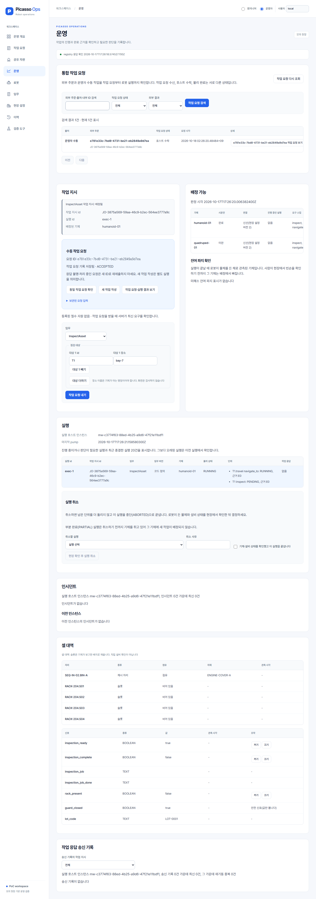

그림 12. 운영 영역의 실행 구역에서 실행 호스트 인스턴스와 실행 목록 표를 보여 줍니다.

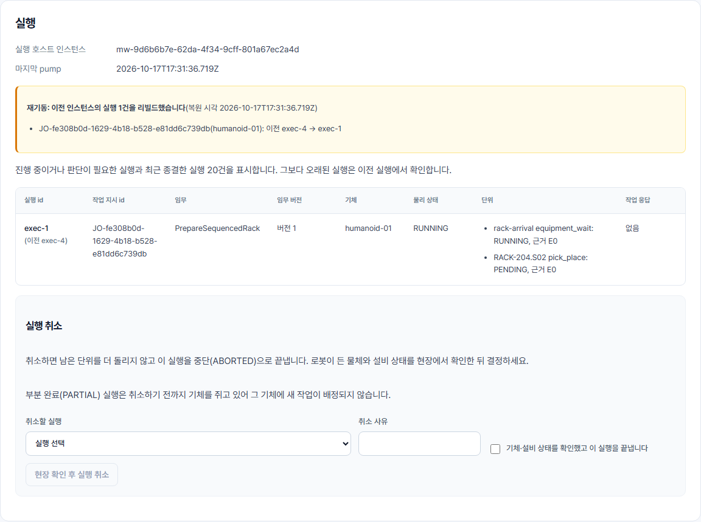

그림 14. 실행 호스트 재기동 뒤의 복원 보고 띠와 «(이전 …)» 이 붙은 실행 행을 응답 대역으로 그린 화면을 보여 줍니다.

#### 3.4.5 인시던트

`IncidentSection.tsx` 컴포넌트가 담당하며 region «인시던트» 를 씁니다. 운영자는 보기와 보류 단위 판단(완료 확인, 재작업)을 합니다. 엔지니어는 보기만 하며 판단 폼 자리에 «보류 중입니다. 운영자 판단은 운영자 모드에서 합니다» 를 표시합니다.

화면 배치는 다음 순서로 합니다.
1. 판단 결과 알림
2. 직전 값
3. 머리 줄 «실행 호스트 인스턴스 ${id}, 인시던트 ${total}건 가운데 최신 ${n}건»
4. 지금 인스턴스 표
5. region «이전 인스턴스»
6. region «인시던트 상세»

상태 표시는 다음과 같습니다.
- «모름: 인시던트 목록을 아직 읽지 못했습니다»
- 직전 값: «직전 값입니다. 실행 호스트 불통: ${error}»
- 빈 상태: «인시던트가 없습니다»

표 `table[aria-label=인시던트 목록]` 의 열한 열 순서는 다음과 같습니다.
1. 인시던트(id 버튼, 접근 이름 «${id} 상세 보기»)
2. 발생 시각
3. 기체
4. 실행 id
5. 단위
6. 실패 종류(코드 값 또는 «-»)
7. 경로(코드 값)
8. 현장 설정 버전(«버전 ${n}», «모름»)
9. 임무 버전(«버전 ${n}», «코드 정의»)
10. 판단(«판단됨(설비 근거 없이 완료 확인)», «판단됨», «미해결», «판단 대상 아님»)
11. 보류(«보류 중» 또는 «-»)

보류 행은 `tr.held` 로 연한 노랑 배경이며, 고른 행은 `tr.selected` 입니다.

이전 인스턴스는 실행 호스트가 `earlier` 를 실을 때 섭니다. 지금 실제 스택은 빈 배열이라 «이전 인스턴스의 인시던트가 없습니다» 를 표시합니다. 차 있으면 «재기동 앞 인스턴스의 인시던트 ${total}건 가운데 최신 ${n}건. 읽기 전용이며 여기서 판단하지 않습니다» 와 표 «이전 인스턴스 인시던트 목록» 을 표시합니다. 이 표는 맨 앞에 «인스턴스» 열이 있고 «보류» 열이 없으며, 버튼 접근 이름은 «${instanceId} ${id} 상세 보기» 입니다.

상세는 region «인시던트 상세» 에 위치하며 제목은 h3 «${id} 상세» 입니다. 이전 인스턴스면 «이전 인스턴스의 사본입니다. 읽기 전용이며 판단하지 않습니다» 를 표시합니다. 읽기 상태는 다음과 같습니다.
- «상세를 읽는 중입니다»
- «모름: 상세를 읽지 못했습니다 (${error})»
- «실행 호스트에 이 인시던트가 없습니다. 실행 호스트를 재기동했을 수 있습니다»

사람의 판단은 없으면 «사람의 판단 없음. 아래 값은 모두 관측입니다» 를 표시합니다. 있으면 region «사람의 판단»(`.asserted`, 왼쪽 이중선)에 다음을 표시합니다.
- «사람이 판단함: ${id}, ${wallClockAt}»
- «결정 ${완료 확인 또는 재작업}(${코드}), 호스트 시각 ${at}»
- 해당하면 «설비 근거 없이 완료 확인»

관측은 region «관측»(`.observed`)에 위치하며 h4 «관측(봉인 때 기록)» 을 둡니다. dl 요소의 항목은 다음과 같습니다.
- 발생 시각
- 봉인한 실제 시각
- 기체
- 실행(«${exec}(작업 지시 ${jo})»)
- 단위
- 단위의 지금 상태
- 실패 종류
- 경로
- 현장 설정 버전
- 시간값
- 임무 버전
- 단계 위치
- 필요 근거 등급
- 도달 근거 등급
- 확인 결과(코드 이름)
- 위반된 사전 조건
- 파지
- 효과와 관측의 어긋남
- 연결

그 아래에는 h4 «결함»(결함 카드 «이 단위의 결함»), h4 «실행을 막던 결함(blockedBy)», h4 «근거 윈도우(앞 ${s}, 뒤 ${s})» 와 표 «근거 윈도우» 가 이어집니다. h4 «실행을 막던 결함(blockedBy)» 의 결함 카드 아래에는 지금 인스턴스의 상세이고 운영 영역이 읽은 실행 목록(같은 인스턴스)의 그 실행에 `blockedFaults` 가 있을 때만 note «이 실행은 지금도 결함으로 막혀 있습니다. 수용은 운영 영역의 실행 구역에서 합니다.» 가 붙습니다. 수용하여 막는 결함이 없어지거나 실행 목록이 다른 인스턴스면 이 안내는 보이지 않습니다(근거: `IncidentSection.test.tsx` 의 `지금 인스턴스의 그 실행이 아직 결함으로 막혀 있을 때만 상세에 감수는 실행 구역에서 한다는 안내를 붙인다`). 표 «근거 윈도우» 의 열은 순번, 시각, 종류, 내용, 출처(«미들웨어 기록», «현장 관측»)입니다. 관측이 비면 «윈도우 안의 관측이 없습니다» 를 표시합니다.

판단 폼은 운영자 모드이고 지금 인스턴스이며 보류 중일 때만 form «운영자 판단» 으로 표시합니다.
- «${exec}/${unit} 보류 해소 방식(완료 확인 또는 재작업)을 결정합니다. 결정자는 ${user}입니다.»
- 칸 «판단 사유»
- 버튼 «완료 확인»
- 버튼 «재작업»

판단 사유가 비면 alert «판단 사유를 넣으십시오» 를 표시합니다. API POST `/api/executions/{exec}/units/{unit}/resolve` 로 `{decision, instanceId, reason}` 을 보냅니다.

판단 결과(status «판단 결과», what «${exec}/${unit} ${완료 확인 또는 재작업}») 갈래는 다음과 같습니다.
- «판단이 섰습니다(${incidentId})»
- «보류 단위가 아닙니다»
- «에이전트 판단은 거부됩니다»
- «실행 호스트가 거부함(${풀이})»
- 응답 없음 세 갈래:
  - «응답은 없었으나 다시 읽어 보니 판단이 붙음»
  - «응답 없음. 다시 읽어 보니 판단이 붙지 않음. 늦게 붙을 수 있으니 인시던트 목록에서 확인하십시오»
  - «응답 없음. 판단이 붙었을 수 있음. 다시 읽지도 못해 확인하지 못했습니다. 인시던트 목록에서 확인하십시오»
- 사전 거부: «보내지 않음(${풀이}). ${detail}»
- 비정상: «결과 모름(${cause}). 인시던트 목록에서 확인하십시오»

관측과 사람의 판단을 다른 region 과 클래스(`.asserted`, `.observed`)로 가르는 것은 설계 요구입니다. 판단 사유는 picasso 인시던트에 실리지 않고 조작 기록(이력)에만 남습니다.

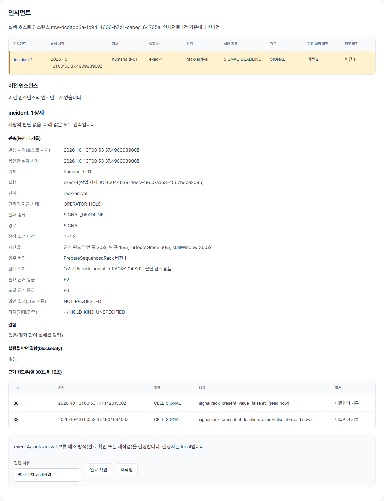

그림 13. 운영자 모드에서 보류 중 인시던트 행과 그 상세, 운영자 판단 폼을 보여 줍니다.

#### 3.4.6 셀 대역

`CellBand.tsx` 와 `SignalNotice.tsx` 가 담당하며 region «셀 대역» 과 h2 «셀 대역» 을 씁니다. 운영자 모드와 엔지니어 모드 두 모드가 보고 안전 신호가 아닌 BOOLEAN 신호를 켜고 끕니다. API POST `/api/cell/signals/{name}` 에 `{value: "true" 또는 "false"}` 를 보내며 what 은 «${name} 켜기» 또는 «${name} 끄기» 입니다.

화면 배치는 다음 순서로 합니다.
1. 신호 조작 결과
2. 회색 «셀 대역: 슬롯은 기체가 보고한 배치로 채웁니다. 독립 설비 확인이 아닙니다»
3. 자리 표
4. 신호 표

표마다 «표 가로 스크롤» 감싸개를 둡니다.

상태 표시는 다음과 같습니다.
- «모름: 셀 대역을 아직 읽지 못했습니다»
- «모름: 실행 호스트가 셀 대역을 읽지 못했습니다»
- «모름: 신호 값을 읽지 못했습니다»
- 직전 값: «직전 값입니다. 실행 호스트 불통: ${error}»
- «모름: 셀 대역이 신호 목록을 싣지 않았습니다»
- «셀 대역에 신호가 없습니다»

표 «셀 대역 자리» 의 열은 다음과 같습니다.
- 자리
- 종류(«제시 자리», «슬롯»)
- 점유(«점유», «비어 있음»)
- 자재
- 관측 시각

표 «셀 대역 신호» 의 열은 다음과 같습니다.
- 신호
- 종류
- 값
- 관측 시각
- 조작(안전 신호는 «안전 신호(값만 봅니다)», 안전 아닌 BOOLEAN 은 버튼 «켜기» 와 «끄기» 이며 접근 이름은 «${name} 켜기» 와 «${name} 끄기», 그 밖은 «-»)

결과(status «신호 조작 결과») 갈래는 다음과 같습니다.
- «반영됨(값 ${v})»
- «현장이 거부함(${풀이})»
- «응답은 없었으나 다시 읽어 보니 그 값임»
- «응답 없음. 다시 읽어 보니 그 값이 아님. 다시 하려면 새로 누르십시오»
- «반영되었을 수 있음. 다시 읽지도 못해 확인하지 못했습니다. 셀 대역 신호 표에서 확인하십시오»
- «보내지 않음(${풀이}). ${detail}»
- «결과 모름(${cause}). 셀 대역 신호 표에서 확인하십시오»

실제 스택의 신호는 `rack_present`, 공유 자원용 `inspection_ready`, `inspection_complete` 가 있습니다. 공유 자원용 작업 번호 TEXT 신호 `inspection_job`, `inspection_job_done` 도 있고 신호 표에서 조작 칸은 «-»를 보입니다. 슬롯과 자재는 작업 지시 폼의 PrepareSequencedRack 보기가 됩니다.

#### 3.4.7 작업 응답 송신 기록

`JobResponseLog.tsx` 가 담당하며 region «작업 응답 송신 기록» 을 씁니다. 거르개 select «송신 기록의 작업 지시»(«전체» 와 작업 지시 id 들)가 있습니다. 값을 바꾸면 GET `/api/job-responses?jobOrderId=` 로 다시 읽습니다.

상태 표시는 다음과 같습니다.
- «모름: 송신 기록을 아직 읽지 못했습니다»
- 직전 값: «직전 값입니다. 실행 호스트 불통: ${error}»
- 머리 줄: «실행 호스트 인스턴스 ${id}, 송신 기록 ${total}건 가운데 최신 ${n}건, 그 가운데 재기동 중복 ${k}건»
- 빈 상태: «송신 기록이 없습니다»

표 `table[aria-label=송신 기록 목록]` 의 열한 열 순서는 다음과 같습니다.
1. 인스턴스
2. 작업 응답 id
3. 작업 지시 id
4. 실행 id
5. 버전
6. 물리 상태
7. 근거(도달/요구)
8. 단위
9. 운영자 필요(«필요», «-»)
10. 처분(«송신», «재기동 중복(송신 안 함)»)
11. 적은 시각

재기동 중복 행은 `tr.duplicate` 로 회색입니다.

### 3.5 로봇 (`#robots`)

| 항목 | 내용 |
|---|---|
| 목적 | 기체 선언과 원장 상태, 어댑터 제품·빌드·인스턴스, 모델 프로파일 리비전, 바인딩과 현장 명칭, 시운전 판정을 다룹니다. 새 기체·모델·제조사를 들이는 도입 여정을 안내합니다. |
| 누가 | 기체 선언, 어댑터, 프로파일, 바인딩, 명칭 등록 기록은 엔지니어가 다룹니다. 퇴역과 복귀는 운영자가 다룹니다. 조회는 두 모드에서 모두 지원합니다. |
| 진입 | 메뉴 5번입니다. 해시 없이 처음 열면 이 영역으로 진입합니다. |
| 컴포넌트 | `RobotsArea.tsx`, `OnboardingGuide.tsx`, `DeclareForm.tsx`, `RobotDetail.tsx`, `CommissioningCards.tsx`, `AdaptersSection.tsx`, `AdapterForms.tsx`, `ProfilesSection.tsx`, `FindingCard.tsx`, `OutcomeNotice.tsx` 입니다. |
| API | 조회는 `App.tsx` 의 다섯 조회 중 `/api/robots`, `/api/adapters`, `/api/profiles` 이며 5초 주기입니다. 쓰기 요청은 POST `/api/robots`, POST·DELETE `/api/robots/{id}/retirement`, POST `/api/robots/{id}/binding`, POST `/api/robots/{id}/site-names`, POST `/api/adapters`, POST `/api/adapters/{id}/versions`, POST `/api/adapter-instances`, POST `/api/profile-revisions`, POST `/api/profile-revisions/{id}/test-requests`(시험 요청), POST `/api/profile-revisions/{id}/activation`(활성화)입니다. 조작이 끝나면 다섯 조회를 곧바로 다시 읽습니다. 조작 중에는 이 영역의 조작 버튼이 모두 비활성화됩니다. |
| 배치 | 1200px 이상에서 기체 탭과 도입 준비 탭은 `.split.robots-layout` 2열(기체 목록 \| 상세)입니다. 어댑터 관리와 프로파일 관리는 각자 탭의 전체 폭입니다. 1199px 이하에서는 1열입니다. |

이 영역만 늘 마운트하고 `hidden` 으로 감춥니다. 하위 탭, 고른 기체, 폼 입력은 메뉴를 오가도 남습니다. 새로고침하면 하위 탭은 «기체» 로 돌아갑니다(탭은 URL 에 없습니다).

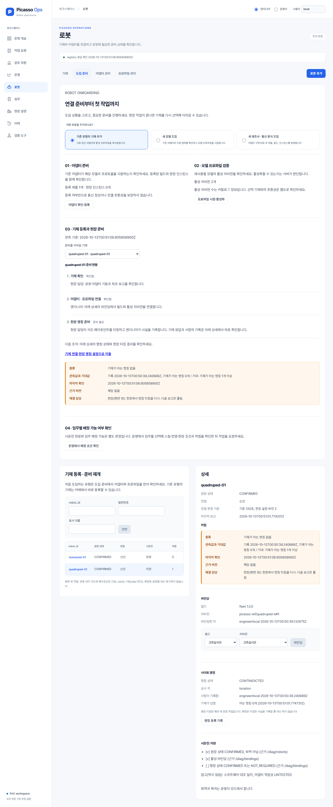

그림 01. 로봇 영역의 기체 탭에 도구 줄과 기체 목록, 상세 2열이 보입니다.

#### 3.5.1 도구 줄과 조작 결과

도구 줄 `.robot-toolbar` 의 `nav[aria-label=로봇 관리]` 안에는 다음 버튼이 있습니다.
- «기체»
- «도입 준비»
- «어댑터 관리»
- «프로파일 관리»

고른 탭에는 `aria-current="page"` 가 들어갑니다. 오른쪽 `.primary` 버튼은 «로봇 추가» 이며 누르면 도입 준비 탭으로 이동합니다.

도구 줄 바로 아래 한 자리에 `OutcomeNotice`(§2.6.1)가 위치합니다. 이 영역의 registry 조작 결과가 모두 여기에 표시됩니다. 거부 카드의 «${target} 상세» 를 누르면 기체 탭으로 이동하여 해당 기체를 선택합니다.

what 의 꼴은 다음과 같습니다.
- «${robotId} 선언»
- «${robotId} 퇴역»
- «${robotId} 복귀»
- «${robotId} 바인딩»
- «${robotId} 명칭 기록»
- «${vendor}/${name} 제품 선언»
- «${vendor}/${name} ${version} 빌드 선언»
- «${instanceId} 인스턴스 등록»
- «${vendor}/${model}#${revision} 시험 요청»
- «${vendor}/${model}#${revision} 활성화»
- «${vendor}/${model}#${revision} 제출»

#### 3.5.2 도입 준비

도입 준비 탭의 region «로봇 도입 준비» 는 `OnboardingGuide.tsx` 컴포넌트입니다. 상단에 eyebrow «ROBOT ONBOARDING», h2 «연결 준비부터 첫 작업까지», 안내 문구 «도입 상황을 고르고, 필요한 준비를 진행하세요. 현장 작업이 끝나면 기체를 다시 선택해 이어갈 수 있습니다.» 가 표시됩니다.

fieldset legend «어떤 로봇을 추가하나요?» 안에는 다음 세 가지 카드형 라디오가 있습니다.
- «기존 유형의 기체 추가»(«사용 중인 어댑터와 활성 프로파일을 재사용합니다.»)
- «새 모델 도입»(«기존 어댑터의 지원 범위를 확인하고 모델 프로파일을 시험합니다.»)
- «새 제조사 · 통신 방식 도입»(«어댑터 구현·배포 후 제품, 빌드, 인스턴스를 등록합니다.»)

준비 카드는 넷으로 구성됩니다.

첫째는 region «어댑터 준비 안내» 와 h3 «01 · 어댑터 준비» 입니다. 경로에 따라 «엔지니어가 통신·제어 어댑터를 구현하고 배포한 뒤 제품 → 빌드 → 현장 인스턴스 순서로 등록하세요. 등록 폼이 어댑터 코드를 생성하거나 배포하지는 않습니다.» 또는 «기존 어댑터가 해당 모델과 프로토콜을 지원하는지 확인하세요. 등록된 빌드와 현장 인스턴스를 함께 확인합니다.» 를 표시합니다. «등록 제품 ${n}개 · 현장 인스턴스 ${n}개» 와 «등록 여부만으로 통신 정상이나 모델 호환성을 보장하지 않습니다.» 를 안내합니다. 버튼 «어댑터 확인·등록» 을 누르면 어댑터 관리 탭으로 이동합니다. 목록을 못 읽으면 «모름: 어댑터 목록 미확인» 을 표시합니다.

둘째는 region «프로파일 준비 안내» 와 h3 «02 · 모델 프로파일 검증» 입니다. 경로에 따라 «재사용할 모델의 활성 리비전을 확인하세요.» 또는 «스킬·제약·현장 참조를 정의한 JSON을 등록하고 시험 요청 → 결과 확인 → 활성화 순서로 진행하세요.» 를 표시합니다. «활성 리비전 ${n}개» 와 «활성 리비전 수는 카탈로그 정보입니다. 선택 기체와의 호환성은 별도로 확인하세요.» 를 안내합니다. 버튼 «프로파일 시험·활성화» 를 누르면 프로파일 관리 탭으로 이동합니다. 목록을 못 읽으면 «모름: 프로파일 목록 미확인» 을 표시합니다.

셋째는 region «기체 준비 현황» 과 h3 «03 · 기체 등록과 현장 준비» 입니다. «관측 기준: ${asOf}»(없으면 «아직 읽지 못함»)를 표시하며, select «준비를 이어갈 기체»(첫 보기 «아래에서 새 기체를 등록하거나 기존 기체를 선택하세요»)를 제공합니다. 기체를 선택하기 전에는 «기체를 선택하면 서버가 확인한 준비 상태와 다음 조치를 표시합니다.» 를 표시합니다. 기체를 선택하면 h4 «${id} 준비 현황»(퇴역이면 « · 퇴역한 기체»)을 표시합니다.

세 단계 `ol.readiness-steps` 는 다음과 같습니다.
- «기체 확인»(«현장 담당: 로봇·어댑터 기동과 최초 보고를 확인합니다.»)
- «어댑터 · 프로파일 연결»(«엔지니어: 아래 상세의 바인딩에서 빌드와 활성 리비전을 연결합니다.»)
- «현장 명칭 준비»(«현장 담당이 지도·웨이포인트를 티칭하고 엔지니어가 사실을 기록합니다. 기체 응답과 사람의 기록은 아래 상세에서 따로 확인합니다.»)

단계마다 다음 상태 중 하나를 표시합니다.
- «확인됨»
- «준비 필요»
- «모름»
- «직전 값 · 재확인 필요»

다음 조치 문장은 상황에 따라 다릅니다.
- 퇴역: «퇴역 기체입니다. 운영자 모드의 상세에서 복귀 여부를 판단하세요.»
- 시운전 판정 없음: «시운전 판정을 아직 받지 못했습니다.»
- 직전 값: «직전 관측입니다. 최신 조회 전에는 현재 준비 완료로 판단하지 마세요.»
- 완료: «시운전 완료가 확인되었습니다. 운영에서 실제 임무의 배정 가능 여부를 확인하세요.»
- 미완: «다음 조치: » 뒤에 다음 세 문장 중 하나가 옵니다.
  - «현장에서 기체·어댑터의 최초 보고를 확인하세요.»
  - «아래 상세에서 빌드와 활성 프로파일을 바인딩하세요.»
  - «아래 상세의 명칭 상태와 현장 티칭 결과를 확인하세요.»

링크는 «기체 연결·현장 명칭 설정으로 이동»(`#robot-detail`)을 제공합니다.

넷째는 region «첫 작업 검증 안내» 와 h3 «04 · 임무별 배정 가능 여부 확인» 입니다. «시운전 완료와 임무 배정 가능은 별도 판정입니다. 운영에서 임무를 선택해 스킬·연결·현장 조건과 막힘을 확인한 뒤 작업을 요청하세요.» 를 표시합니다. 버튼 «운영에서 배정 조건 확인» 을 누르면 운영 영역으로 이동합니다.

도입 준비 탭에서도 아래에 기체 목록과 상세 2열이 함께 보입니다. 이때 기체 목록의 h2 는 «기체 등록 · 준비 재개» 로 바뀝니다.

#### 3.5.3 기체 목록

기체 탭의 region «기체 목록» 에는 h2 «기체» 가 있습니다. 안내 문구는 «처음 도입하는 유형은 도입 준비에서 어댑터와 프로파일을 먼저 확인하세요. 기존 유형의 기체는 아래에서 바로 등록할 수 있습니다.» 입니다.

기체 선언 form «기체 선언»(`DeclareForm.tsx`)의 입력 칸은 다음과 같습니다.
- «robot_id»
- «일련번호»
- «표시 이름»(선택)

버튼 «선언» 은 robot_id 와 일련번호가 차야 활성화됩니다. 운영자 모드에서는 «선언은 엔지니어 모드에서 합니다» 문구를 표시합니다.

표는 이름이 없으며 «표 가로 스크롤» 감싸개 안에 있습니다. 열 구성은 다음과 같습니다.

| 열 이름 | 설명 |
|---|---|
| «robot_id» | 링크 모양 버튼이며 누르면 상세를 엽니다. |
| «원장 상태» | 코드 값입니다. |
| «연결» | «신선», «오래됨», «보고 없음» 중 하나입니다. |
| «시운전» | «완료», «미완», «퇴역» 중 하나이며 없으면 «-» 입니다. |
| «막힘» | 건수입니다. |

고른 행은 `tr.selected` 가 들어갑니다. 퇴역 기체도 목록에 남습니다.

회색 `.offscreen` 문장은 «화면 밖 작업: 로봇 내부 지도와 웨이포인트 티칭, mimic 기동(site/ 런처). 화면은 완료를 대신 체크하지 않습니다» 입니다.

목록의 상태 표시는 다음과 같습니다.
- «모름: 기체 목록을 아직 읽지 못했습니다»
- «선언된 기체가 없습니다»
- 직전 값: «직전 값입니다 (${asOf} 기준)»

#### 3.5.4 상세

상세 영역은 region «상세», `#robot-detail`, h2 «상세» 이며 기체 탭과 도입 준비 탭의 오른쪽 열에 있습니다. 기체를 고르지 않았을 때는 «기체를 고르면 원장 상태와 연결이 여기에 보입니다.» 를 표시합니다. 목록에 없는 id 이면 «목록에 없는 기체입니다: ${id}» 를 표시합니다.

`RobotDetail.tsx` 는 region «${robotId} 상세» 이며 위에서 아래로 다음 요소를 배치합니다.
1. dl «원장 상태»(코드 값), «연결»(연결 글자), «연결 판정 기준»(«기준 ${seconds}초, 현장 설정 버전 ${version}»), «마지막 보고»(없으면 «보고 없음»), 퇴역 기체이면 «퇴역»
2. h4 «막힘»: 없으면 «막힘 없음» 을 표시하고, 있으면 `FindingCard` 여러 장을 표시하며 바로 가기는 없습니다.
3. 카드 셋(`CommissioningCards.tsx`, 각각 `section` region)
4. 맨 아래: 엔지니어 모드이면 «퇴역과 복귀는 운영자 모드에서 합니다» 를 표시합니다. 운영자 모드이고 퇴역 기체이면 버튼 «복귀»(DELETE `/api/robots/{id}/retirement`)를 표시합니다. 운영자 모드이고 현역 기체이면 form «퇴역»(칸 «퇴역 사유», 사유가 비면 비활성화되는 버튼 «퇴역», POST `/api/robots/{id}/retirement`)을 표시합니다.

카드 셋(`CommissioningCards.tsx`)의 구성은 다음 표와 같습니다.

| 카드 | 내용 | 조작(엔지니어) |
|---|---|---|
| region «바인딩» | 없으면 «활성 바인딩 없음» 을 표시합니다. 있으면 dl «빌드», «리비전», «바인딩한 이» 를 표시합니다. | 현역이면 form «바인딩»(select «빌드»(첫 보기 «고르십시오»), select «리비전»(«고르십시오» 와 ACTIVE 리비전만), 버튼 «바인딩»)을 표시하고 POST `/api/robots/{id}/binding` 으로 요청합니다. |
| region «사이트 명칭» | 바인딩이 없으면 «바인딩이 없어 요구할 명칭이 없습니다» 를 표시합니다. 있으면 dl «명칭 상태»(코드 값), «요구 키»(없으면 «없음»), «사람이 기록함»(«기록 없음» 또는 기록한 사람과 시각), «기체가 답함»(«아직 응답 없음», «명칭을 지원하지 않음 (${at})», «아는 명칭 ${n}개 (${at})»), 회색 «명칭 티칭은 화면 밖 현장 작업입니다. 화면은 티칭한 사실을 기록할 뿐 대신 하지 않습니다» 를 표시합니다. | 바인딩이 있으면 버튼 «명칭 등록 기록» 을 표시하고 POST `/api/robots/{id}/site-names` 로 요청합니다. |
| region «시운전» | h4 «시운전: ${완료 또는 미완 또는 퇴역}», 체크 목록 셋(글자 «[v]» 또는 «[ ]»): «원장 상태 CONFIRMED, 퇴역 아님 (근거 /diag/robots)», «활성 바인딩 (근거 /diag/bindings)», «명칭 상태 CONFIRMED 또는 NOT_REQUIRED (근거 /diag/bindings)». 참고 줄 «참고(막지 않음): 소프트웨어 대조 ${…}, 어댑터 적합성 ${…}» | 없음 |

막힘 카드의 «근거 버전» 과 «연결 판정 기준» 은 현장 설정 버전입니다(§3.7). 시운전 «완료» 인 기체만 운영에서 배정 가능합니다(§3.4.3).

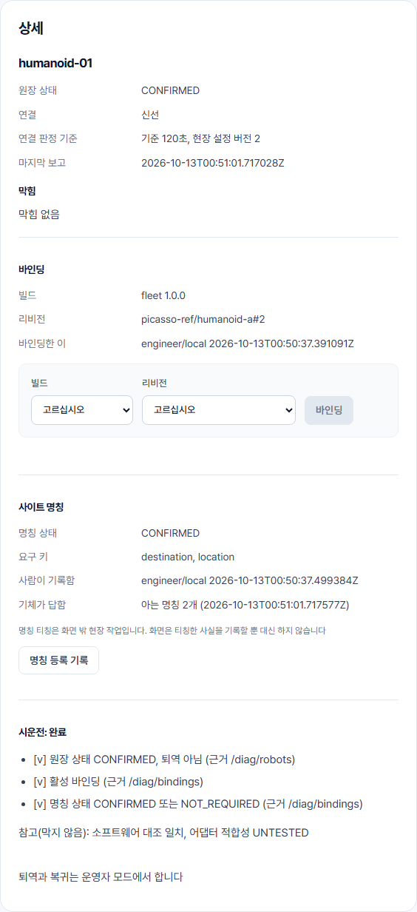

그림 02. 시운전 완료 기체의 상세 화면이며 막힘 없음과 바인딩, 사이트 명칭, 시운전 카드가 보입니다.

#### 3.5.5 어댑터 관리

어댑터 관리는 탭 «어댑터 관리», region «어댑터», h2 «어댑터» 이며 `AdaptersSection.tsx` 와 `AdapterForms.tsx` 로 구성되고 탭 전체 폭을 씁니다. 목록을 아직 읽지 못했을 때는 «모름: 어댑터 목록을 아직 읽지 못했습니다» 를 표시합니다. 직전 값을 표시할 때는 «직전 값입니다 (${asOf} 기준)» 을 표시합니다.

h3 «인스턴스» 아래에는 표 «인스턴스 목록» 이 있습니다. 열은 다음 항목으로 구성합니다.
- instance_id
- 빌드
- 계약 semver
- 적합성(값 그대로 표시하며 지금은 늘 UNTESTED)
- 플릿 주소(없으면 «직결»)
- 발견 기체

등록된 인스턴스가 없으면 «등록된 인스턴스가 없습니다» 를 표시합니다.

h3 «제품·빌드» 아래에는 표 «제품·빌드 목록» 이 있습니다. 열은 다음 항목으로 구성합니다.
- 제품(«${vendor}/${name}»)
- 버전(빌드 없으면 «빌드 없음»)
- 계약 semver
- 적합성

등록된 제품이 없으면 «등록된 제품이 없습니다» 를 표시합니다.

엔지니어 모드에서는 다음 세 폼을 제공합니다.
- form «제품 선언»: 칸 «vendor», «name», 버튼 «제품 선언»(POST `/api/adapters`)
- form «빌드 선언»: select «제품», 칸 «버전», «계약 semver», 버튼 «빌드 선언»(POST `/api/adapters/{id}/versions`)
- form «인스턴스 등록»: 칸 «instance_id», select «빌드», 칸 «플릿 주소»(선택), 버튼 «인스턴스 등록»(POST `/api/adapter-instances`)

버튼은 필수 칸이 차야 활성화됩니다. 운영자 모드에서는 «어댑터 등록은 엔지니어 모드에서 합니다» 를 표시합니다. 등록 폼은 어댑터 코드를 만들거나 배포하지 않습니다.

#### 3.5.6 프로파일 관리

프로파일 관리는 탭 «프로파일 관리», region «프로파일», h2 «프로파일» 이며 `ProfilesSection.tsx` 로 구성되고 탭 전체 폭을 씁니다. 목록을 아직 읽지 못했을 때는 «모름: 프로파일 목록을 아직 읽지 못했습니다» 를 표시합니다. 카탈로그 줄에는 «스킬 ${n}종, 계약 ${semver}» 를 표시합니다.

표 «리비전 목록» 의 열은 다음 항목으로 구성합니다.
- 기종(«${vendor}/${model}»)
- 번호
- 상태(코드 값, DRAFT 이면 접기 «저장됨: 검증 실패» 안에 사유)
- CONTRACT(각 결과와 실행 주체, 없으면 «-», FAIL 이면 접기 «상세»)
- NEGATIVE(각 결과와 실행 주체, 없으면 «-», FAIL 이면 접기 «상세»)
- DETERMINISM(각 결과와 실행 주체, 없으면 «-», FAIL 이면 접기 «상세»)
- 시험 요청(«요청 없음», «대기», «실행 중», «만료», «끝남»)
- 활성화(누가·언제)
- 조작(엔지니어만 표시하며 버튼 «시험 요청», «활성화»)

제출된 리비전이 없으면 «제출된 리비전이 없습니다» 를 표시합니다. 엔지니어 모드에서는 form «리비전 제출»(파일 칸 «프로파일 문서»(`.json`), 파일을 골라야 활성화되는 버튼 «제출»)을 제공합니다. 파일 글자를 그대로 POST `/api/profile-revisions` 로 보냅니다. 운영자 모드에서는 «프로파일 관리는 엔지니어 모드에서 합니다» 를 표시하고 «조작» 열은 없습니다. 시험 결과는 사람이 적지 않고 런처의 시험 실행기(`site-runner`)가 적습니다.

### 3.6 임무 (`#missions`)

| 항목 | 내용 |
|---|---|
| 목적 | 지원 임무와 입력 계약을 보고, 새 임무를 템플릿으로 등록하고, 임무 정의(실행 정의)를 초안 저장·검증·모의 실행·활성화하고, 호출 계약(외부 입력 → 임무 입력 매핑)을 버전별로 저장·공개하고 실행 배포를 고정합니다. |
| 누가 | 엔지니어는 임무 편집, 새 임무 등록, 호출 계약 작성·복제·공개·공개 중지, 실행 배포를 합니다. 운영자는 호출 계약으로 작업 요청을 합니다. 배정 가능 확인, 입력 검증·변환 미리보기, 조회는 두 모드에서 합니다. |
| 진입 | 메뉴 6번이나 검증 도구의 «임무·호출 계약» 링크로 진입합니다. 패널은 URL에 없고 처음은 «임무 목록» 입니다. |
| 컴포넌트 | `MissionsArea.tsx`, `MissionCreator.tsx`, `MissionInterfaces.tsx`, `InterfaceDeployment.tsx`, `MissionDefinitionEditor.tsx`, `MissionNotice.tsx`, `MockRunReport.tsx`, `missionTemplates.ts` |
| API | GET `/api/job-contracts`(마운트와 «계약 다시 조회» 때만), POST `/api/mission-profiles`(새 임무 등록), GET·POST `/api/mission-interfaces`, POST `/api/mission-interfaces/preview`, POST `/api/mission-interfaces/{id}/{version}/state`(공개·공개 중지), POST `/api/mission-interfaces/{id}/{version}/deploy`, GET `/api/mission-interfaces/{id}/{version}/deployments`, POST `/api/mission-interfaces/{id}/{version}/eligibility`, POST `/api/mission-interfaces/{id}/{version}/invoke`, POST `/api/job-orders/preview`, 임무 정의 쪽(§3.6.5) `/api/missions/{workMasterId}` 와 그 아래 drafts·validate·mock-run·activate, `/api/missions/templates/{workMasterId}` |

#### 3.6.1 머리와 패널

머리 영역은 region «임무 관리 개요» 입니다.
eyebrow는 «MISSION MANAGEMENT» 입니다.
h2는 «작업 요청을 로봇의 실행으로 연결하세요» 입니다.
설명은 «지원 임무의 입력 계약을 확인하고 실행 정의를 검증합니다. 호출 계약 연결에서 입력이 작업 지시로 변환되는 과정을 확인할 수 있습니다.» 입니다.
`nav[aria-label=임무 관리]` 에 네 개의 버튼이 있으며, 고른 버튼에는 `aria-current="page"` 가 적용됩니다.
패널 버튼은 다음과 같습니다.
- «임무 목록»
- «실행 정의»
- «호출 연결»
- «버전·배포»

계약 목록 조회에 실패하면 alert «계약 목록을 읽지 못했습니다: ${error}» 와 버튼 «계약 다시 조회» 가 표시됩니다.

#### 3.6.2 새 임무 생성

`MissionCreator.tsx` 컴포넌트이며, region «새 임무 생성» 에 해당합니다.
임무 목록의 «새 임무 만들기» 를 누르면 머리 아래에 열립니다.
h2는 «템플릿으로 새 임무 생성» 입니다.
설명은 «입력 계약과 변환 규칙을 등록한 뒤 실행 정의를 검증·모의 실행하고 버전을 확정합니다. 등록만으로 로봇이 실행되거나 API가 공개되지는 않습니다.» 입니다.
화면에 버튼 «생성 화면 닫기» 가 있습니다.
fieldset은 엔지니어가 아니면 비활성화됩니다.
fieldset의 항목은 다음과 같습니다.
- «새 임무 ID» (처음 값 `ManufacturingInspection`)
- «새 임무 이름» (처음 값 «공정 자산 점검»)
- «임무 설명»
- select «시작 템플릿» («대상 점검 · E0», «지정 위치 이동 · E0»)

접기 «입력 스키마·단계 연결·샘플 편집» 안에는 다음 항목이 있습니다.
- 안내 «입력 스키마와 orderMapping은 등록 후 불변입니다. 변경하려면 새 임무 ID를 사용합니다. …»
- textarea «임무 등록 JSON»
- 버튼 «템플릿 입력으로 되돌리기»

하단에 버튼 «임무 등록 후 실행 정의 열기» 가 있으며, 진행 중에는 «등록 중…» 으로 표시됩니다.
성공하면 그 임무를 골라 «실행 정의» 패널로 갑니다.
오류가 발생하면 alert «${error} · 응답이 불명인 경우 같은 임무 ID·정의로 확인하세요. 새로운 ID로 반복 생성하지 마세요.» 가 표시됩니다.
복원에 실패하면 «보관된 임무 등록 입력을 읽지 못했습니다. 임무 목록을 확인하세요.» 가 표시됩니다.

#### 3.6.3 패널 «임무 목록»

region «지원 임무 목록» 에 해당합니다.
h2는 «지원 임무» 입니다.
설명은 «현재 런타임이 지원하는 임무입니다. 편집 가능 범위와 호출 계약을 함께 확인하세요.» 입니다.
엔지니어에게는 버튼 «새 임무 만들기» 와 버튼 «템플릿으로 초안 작성» 이 제공됩니다.
버튼 «템플릿으로 초안 작성» 을 누르면 PrepareSequencedRack 의 실행 정의 패널로 이동합니다.
조회 중에는 «지원 임무 계약을 조회하고 있습니다.» 가 표시됩니다.
각 임무 카드 `article.mission-card` 마다 다음 항목이 포함됩니다.
- eyebrow: «실행 정의 편집 지원» 또는 «코드 정의 · 읽기 전용»
- h3 이름
- 임무 id
- 설명
- dl «요구 근거»
- «호출 경로»: «버전별 호출 계약 API» 또는 «Ops 수동 작업 요청 API»
- «활성 정의»: «조회 전 · 호스트 상태 확인 필요», «활성 버전 없음», «코드 정의», «버전 ${n}» 중 하나이며 지금 고른 임무만 개요를 압니다
- 버튼: «실행 정의 보기», «호출 연결 보기»

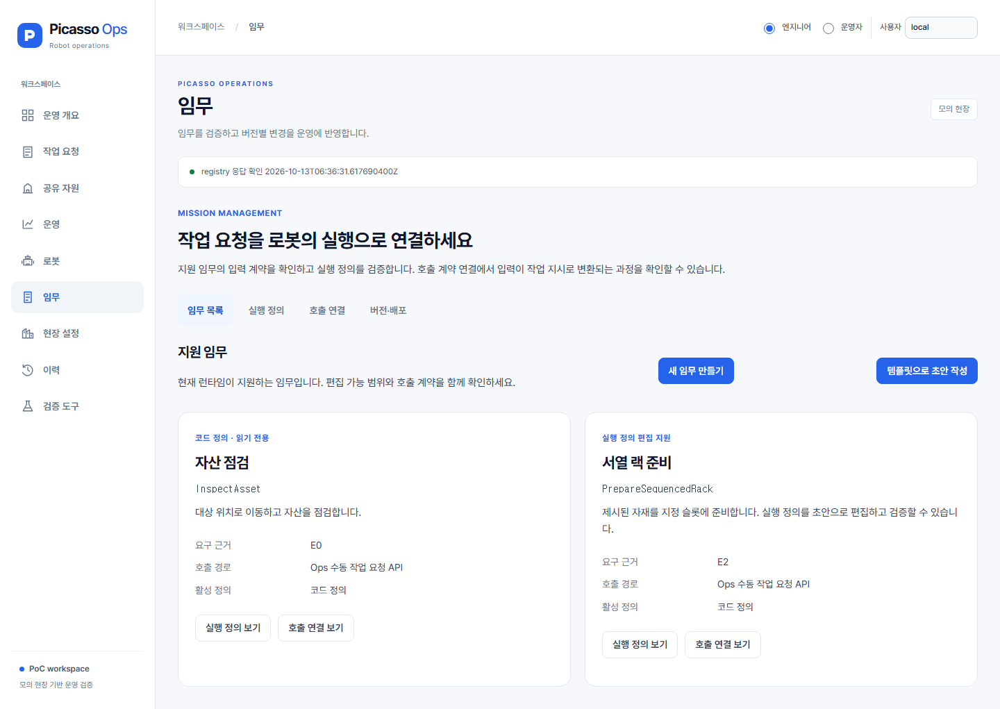

그림 03. 임무 영역의 처음 패널로 머리, 패널 버튼 넷, 지원 임무 카드가 보입니다.

#### 3.6.4 패널 «호출 연결»

이 패널에는 위에 버전별 호출 계약(`MissionInterfaces.tsx`), 아래에 기본 임무 계약의 변환 미리보기(region «호출 계약 연결»)가 있습니다.
호출 계약을 고르면 그 아래에 선택한 호출 계약, 실행 배포, 호출 계약으로 작업 요청이 이어집니다.

##### 버전별 호출 계약

region «버전별 호출 계약» 에 해당합니다.
h2는 «버전별 호출 계약» 입니다.
설명은 «외부 필드를 임무 입력에 연결하고 저장·공개합니다. 현재 호출 경로는 로컬 Ops PoC용입니다.» 입니다.
버튼 «호출 계약 다시 조회» 가 있습니다.
엔지니어에게는 버튼 «호출 계약 만들기» 가 제공되며 열린 동안에는 «작성 폼 접기» 로 바뀝니다.
처리 결과 status «호출 계약 처리 결과» 에는 «${interfaceId} v${version}: 초안 저장됨», 또는 공개 상태 글자를 붙인 «${interfaceId} v${version}: 공개», «…: 공개 중지» 가 표시됩니다.
오류는 alert «${error} · 응답 불명 시 상태를 다시 조회하세요.» 로 표시됩니다.
스크롤 감싸개 «호출 계약 표 스크롤» 안에 표 `table[aria-label=저장된 호출 계약]` 이 있습니다.
표의 열 여섯은 다음과 같습니다.
- 임무(계약 이름)
- 식별자·버전(`${interfaceId}/v${version}`)
- 대상 임무
- 상태(«초안», «공개», «공개 중지»)
- 등록자
- 선택(버튼 «${interfaceId} v${version} 보기»)

목록 상태는 다음 중 하나가 표시됩니다.
- «호출 계약 목록을 아직 읽지 못했습니다.»
- «저장된 호출 계약이 없습니다. 입력 매핑을 검증하고 첫 버전을 만들어 보세요.»

##### 호출 계약 작성

엔지니어가 사용하는 `div[role=region][aria-label=호출 계약 작성]` 입니다.
h3은 «입력 매핑과 새 계약 버전» 입니다.
안내는 «JSON Pointer로 원본 입력 위치를 지정합니다. 예: /order/material. 배열은 전체 목록을 연결합니다. 저장 시 샘플을 실제 임무 검증기로 검사합니다.» 입니다.
fieldset legend «계약 정의» 는 엔지니어가 아니면 비활성화됩니다.
fieldset 항목은 다음과 같습니다.
- «호출 식별자»
- «계약 버전»
- «계약 이름»
- select «대상 임무» («서열 랙 준비», «자산 점검», 그리고 등록한 임무들)
- 대상 필드마다 «${target} 원본 경로»
- textarea «호출 계약 샘플»

버튼은 «매핑 검증·미리보기»(POST `/api/mission-interfaces/preview`)와 «계약 초안 저장» 이 있습니다.
결과는 `pre[aria-label=계약 매핑 미리보기]` 에 표시됩니다.
상태 문장은 다음과 같습니다.
- «입력이 변경되었습니다. 매핑을 다시 검증하세요.»
- «이 정의는 저장되었습니다. 변경하려면 새 버전 번호를 입력하세요.»
- alert «버전은 양의 정수여야 합니다.»

##### 선택한 호출 계약

`div[role=region][aria-label=선택한 호출 계약]` 입니다.
h3은 «${name} · v${version}» 입니다.
화면에 «대상 임무: ${workMasterId}» 가 표시됩니다.
엔지니어에게는 버튼 «새 버전으로 복제» 가 제공됩니다.
문장은 «매핑 정의는 버전별로 고정됩니다. 변경은 새 버전으로 저장하세요. 실행 정의는 ${배포 상태}에 고정됩니다.» 입니다.
여기서 배포 상태는 다음 중 하나입니다.
- «배포 v${n} · 임무 ${missionVersion}»
- «배포 전 · 숫자 임무 버전을 연결하세요»
- «배포 정보 다시 조회 필요»

매핑 정의는 `pre[aria-label=저장된 매핑]` 에 표시됩니다.
엔지니어에게는 칸 «공개 변경 사유»(비면 버튼 비활성)와 버튼 «호출 계약 공개» 또는 «공개 중지» 가 제공됩니다.

##### 실행 배포

`InterfaceDeployment.tsx` 컴포넌트이며, region «실행 배포» 입니다.
h4는 «실행 배포 · v${n}» 이며 배포 전이면 «실행 배포 · 배포 전» 으로 표시됩니다.
화면에 «계약 v${n} · 매핑 v${n} · 임무 ${코드 정의 또는 v${n}}» 이 표시됩니다.
«임무 필수 자원: ${stationId} · 공유 자원 메뉴에서 임무 단위로 등록합니다.» 가 표시되며 없으면 «미지정» 으로 표시됩니다.
적용 범위 문장은 «새 배포는 이후 작업 요청부터 적용됩니다. 기존 작업 요청과 재평가는 기존 배포를 유지합니다. 이전 임무 버전으로 새 배포를 만들면 이후 작업 요청은 예전 임무 버전으로 실행됩니다.» 입니다.
엔지니어에게는 다음 입력 요소가 제공됩니다.
- select «배포할 임무 버전» («코드 정의 고정», 또는 «검증된 임무 버전 선택» 과 «임무 v${n}»)
- 칸 «배포 판단 사유»
- 버튼 «새 실행 배포 적용»

오류는 alert «${error} · 응답 불명 시 계약을 다시 조회하고 배포 이력을 확인하세요.» 와 «호스트 임무 버전을 읽지 못했습니다. 배포 전에 다시 조회하세요.» 로 표시됩니다.
접기 «불변 배포 이력» 에는 줄마다 배포 버전·임무 버전·배포한 이·사유·시각이 표시됩니다.
읽지 못했을 때는 «배포 이력을 아직 읽지 못했습니다.» 가 표시됩니다.

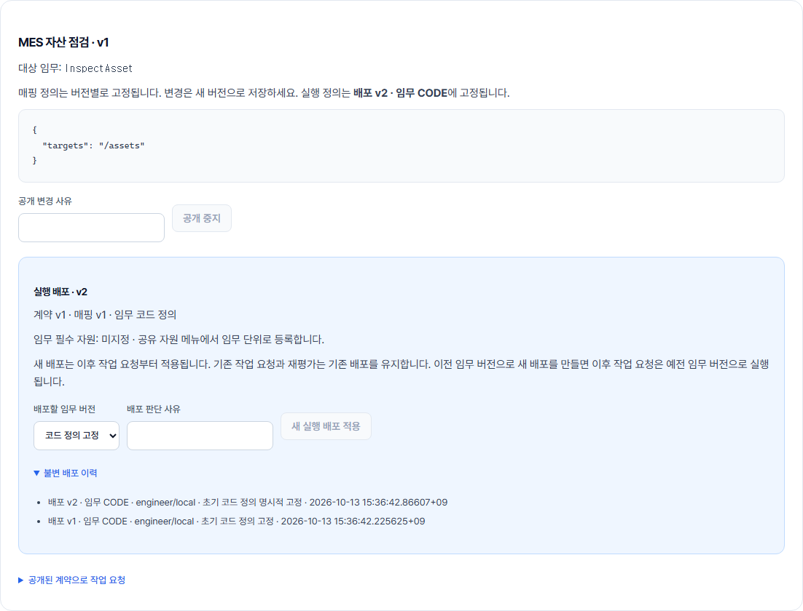

그림 05. 호출 연결 패널에서 공개되고 배포된 호출 계약을 고른 상태로 저장된 호출 계약 표, 선택한 호출 계약, 실행 배포가 보입니다.

##### 호출 계약으로 작업 요청

`MissionInterfaces.tsx` 의 `InterfaceCaller` 컴포넌트입니다. 선택한 호출 계약 아래의 접기 «공개된 계약으로 작업 요청» 에 위치합니다.

경로 표시 «POST /api/mission-interfaces/${interfaceId}/${version}/invoke» 가 나타납니다. 안내 «운영자 호출도 작업 요청으로 영속 기록합니다. 같은 요청 ID는 기존 작업 요청을 반환하며 추가 실행하지 않습니다. 브라우저 보관은 같은 탭의 새로고침까지 유지됩니다.» 가 표시됩니다.

호출 전 자원 안내(`MissionResourceNotice`, §3.4.2 와 같은 네 갈래)와 textarea «계약 호출 입력» 이 있습니다.

실행 전 배정 확인은 region «계약 입력의 배정 가능 미리보기» 안의 h4 «실행 전 배정 확인» 에 위치합니다. 안내 문구로 «실제 입력과 서버에 고정된 배포로 판정합니다. 기체를 예약하지 않으며 제출 시 현재 조건을 다시 평가합니다. 스킬 적합은 스킬 이름 기준이며 전체 실행·안전·품질 검증을 대신하지 않습니다.» 가 표시됩니다. 버튼 «이 입력으로 배정 가능 확인»(POST `…/eligibility`)을 누르면 판정을 요청합니다. 계약이 공개 상태가 아니거나 보관 요청이 있으면 버튼이 비활성화됩니다. 판정 뒤에는 «판정한 임무 ${workMasterId} · 임무 버전 ${missionVersion} · 배포 v${n} · 요구 근거 ${evidence}» 가 표시됩니다. 운영 영역과 같은 아홉 열 표 «기체별 배정 가능»(§3.4.3)이 나타납니다. status 는 다음 셋 중 하나입니다:
- «현재 배정 가능한 기체가 있습니다. 이 입력으로 작업을 요청할 수 있습니다.»
- «검증된 입력을 작업 요청으로 자원 대기열에 넣을 수 있습니다. 기체 배정은 자원과 설비 준비 후 다시 확인합니다.»(필수 자원이 있는 계약)
- «배정 가능한 기체를 확인하지 못했습니다. 불가·모름 사유를 확인한 뒤 다시 판정하세요.»

접기 «판정한 정규화 작업»(`pre[aria-label=계약 배정 정규화 작업]`)을 제공합니다. 입력이나 배포 상태가 변경되면 status «입력 또는 배포 상태가 변경되었습니다. 배정 가능 여부를 다시 확인하세요.» 가 표시됩니다. 판정에 실패하면 alert «배정 판정 실패: ${error} · 새 작업 전 다시 확인하세요.» 가 나타납니다.

체크 «이 입력으로 실제 작업을 지시합니다» 와 버튼 «호출 계약으로 작업 요청» 이 있습니다. 버튼 «호출 계약으로 작업 요청» 은 다음 조건에서 비활성화됩니다:
- 운영자가 아님
- 체크 전임
- 계약이 공개 상태가 아님
- 보관 요청이 있음
- 현재 입력으로 배정 확인을 하지 않음
- 배정 가능한 기체가 없고 필수 자원도 없는 계약임

필수 자원이 있는 계약은 기체가 없어도 자원 대기열로 보낼 수 있습니다. 운영자가 아니면 «실제 호출은 운영자 모드에서 가능합니다.» 가 표시됩니다. 계약이 공개 중이 아니면 «이 계약은 현재 공개되지 않았습니다. 기존 작업 요청 확인은 가능합니다.» 가 표시됩니다.

보관 중일 때 region «계약 작업 요청 추적» 에는 다음 항목이 표시됩니다:
- h4 «계약 작업 요청»
- «요청 ID: ${uuid}»
- «처리 중·응답 불명인 요청은 새 ID로 재제출하지 마세요.»
- 버튼 «동일 계약 작업 요청 확인»
- 버튼 «새 계약 요청 작성»
- 링크 «작업 요청·실행 결과 보기»(`#requests?receipt=…`)
- 접기 «보관된 계약 요청 입력»

결과는 status «계약 호출 결과» 에 표시되며 다음 중 하나로 나타납니다:
- «작업 지시 ${jobOrderId}: ${state} · 작업 요청 저장됨»
- «작업 지시 ${jobOrderId}: ${state} · 기존 작업 요청 확인 · 추가 실행 없음»

서버 detail 과 `pre[aria-label=계약 호출 응답 JSON]` 이 함께 표시됩니다.

오류 문장은 다음과 같습니다:
- «호출 입력은 올바른 JSON이어야 합니다.»
- «호출 입력은 JSON 객체여야 합니다.»
- «현재 입력의 배정 가능 여부를 확인한 뒤 새 작업을 요청하세요.»
- «기존 요청과 입력이 다릅니다. 기존 작업 요청을 확인한 뒤 새 요청을 작성하세요.»
- «${error} · 기존 요청 ID로 작업 요청을 확인하세요. 새 ID로 반복 제출하지 마세요.»
- 보관 복원 실패: «보관된 요청을 읽을 수 없습니다. 재제출 전에 통합 작업 요청에서 기존 실행을 확인하세요.»

버튼 글자는 «호출 계약으로 작업 요청» 이지만 서버가 생성하는 것은 작업 요청입니다. 결과 줄은 해당 작업 요청의 작업 지시 id 로 시작합니다.

##### 호출 계약 연결: 입력 검증·변환 미리보기

`MissionsArea.tsx` 의 `ContractPreview` 컴포넌트이며, region «호출 계약 연결» 에 위치합니다.

h2 «호출 계약 연결», 설명 «버전별 입력 매핑을 저장·공개하고 기존 작업 지시 흐름으로 연결합니다. 아래 기본 임무 계약은 원래 Ops API의 입력 규격입니다.», select «연결할 임무»(지원 임무 이름)가 표시됩니다.

경로 띠 «POST» `/api/job-orders` «운영자 모드에서 제출» 이 나타납니다. 문장 «임무 선택: ${workMasterId} · …» 에는 «등록된 입력 스키마와 변환 규칙을 사용합니다.» 또는 «기본 임무 필드 연결은 코드로 관리합니다.» 가 결합됩니다. 여기에 «미리보기는 요청을 저장하거나 로봇을 실행하지 않습니다.» 가 함께 표시됩니다. 경로 띠의 `/api/job-orders` 는 기존 Ops API 의 입력 규격을 가리킵니다. 화면의 작업 지시 폼은 이 경로가 아니라 `/api/work-requests/manual` 로 전송합니다(§2.4).

스크롤 감싸개 «입력 매핑 표 스크롤» 안에 표 `table[aria-label=입력 필드 매핑]` 이 있습니다. 표의 열 구성은 다음과 같습니다:
- 요청 필드
- 자료형·제약
- 내부 작업 지시

textarea «샘플 요청 JSON» 과 버튼 «입력 검증·변환 미리보기»(진행 중 «검증 중…», POST `/api/job-orders/preview`)가 있습니다. 보내기 전 오류 alert 는 다음과 같습니다:
- «샘플 요청이 올바른 JSON이 아닙니다.»
- «샘플의 workMasterId가 선택한 임무와 일치해야 합니다.»

출력 영역에는 h3 «변환된 작업 지시» 가 있습니다. 처음에는 «샘플 입력을 검증하면 실제 서버의 변환 결과가 여기에 표시됩니다.» 가 표시됩니다. 검증을 통과하면 «입력 검증 통과 · 배정·실행·완료를 의미하지 않습니다.» 와 `pre[aria-label=변환된 작업 지시 JSON]` 이 나타납니다. 입력이 변경되면 status «입력이 변경되었습니다. 다시 검증해 주세요.» 가 표시됩니다.

접기 «결과 계약과 외부 공개 범위» 가 있습니다.

#### 3.6.5 패널 «실행 정의»

InspectAsset 을 고르면 h2 «자산 점검» 과 «InspectAsset은 현재 코드 정의입니다. 이 화면에서는 실행 정의를 편집할 수 없습니다.» 가 표시됩니다. 버튼 «입력 계약 확인» 을 누르면 호출 연결 패널로 이동합니다.

그 밖의 임무는 `MissionDefinitionEditor.tsx` 컴포넌트로 처리하며, 임무를 변경하면 다시 마운트합니다.

region «임무 ${workMasterId}» 에는 h2 임무 id 가 표시됩니다. dl 항목으로 «활성 버전»(«코드 정의» 또는 «버전 ${n}»)과 «활성화»(데이터 버전일 때 누가·언제·사유)가 나타납니다. 한 번도 읽지 못했으면 «모름: 임무 버전을 아직 읽지 못했습니다» 를 보이고, 읽은 뒤 다시 읽기에 실패하면 앞서 읽은 값을 그대로 두고 직전 값임을 표시합니다. GET `/api/missions/{workMasterId}` 를 5초마다 읽습니다.

엔지니어 모드의 region «임무 편집» 에는 h2 «편집» 이 있습니다. 결과 status «임무 조작 결과»(`MissionNotice`)가 표시됩니다. 템플릿 목록 `ul[aria-label=템플릿]` 에는 버튼 «${템플릿 이름} 불러오기» 가 제공됩니다. 템플릿 이름은 다음과 같습니다:
- «데이터 정의 템플릿»
- «랙 도착 대기 템플릿»
- «운영자 보류 대기 템플릿»

화면은 `.split` 구획으로 textarea «임무 정의 JSON» 과 활성 정의 영역으로 분할됩니다. 활성 정의 영역의 문구는 다음과 같습니다:
- «활성 버전 없음 · 검증 후 활성화하세요»
- «활성: 코드 정의»
- «활성: 버전 ${n}»(뒤에 «, 편집기와 같음» 또는 «, 편집기와 다름» 결합)
- «등록된 템플릿으로 첫 초안을 작성하세요.»
- «코드 정의는 정의 JSON 이 없습니다»
- `pre[aria-label=활성 버전 정의]`
- 읽지 못했을 때 «모름: 활성 버전을 아직 읽지 못했습니다»

대상 줄 문구는 다음과 같습니다:
- «저장한 초안이 없습니다. 초안을 저장하면 검증·모의 실행·활성화할 수 있습니다»
- «대상: 초안 ${id}, 마지막 모의 실행 ${판정}»
- «편집기 내용이 초안 ${draftId} 의 내용과 다릅니다. 검증하려면 초안을 다시 저장하십시오»

버튼 «초안 저장», «검증», «모의 실행», 입력 칸 «활성화 사유», 버튼 «활성화» 가 있습니다. «검증», «모의 실행», «활성화» 버튼은 편집기 글자가 저장한 초안과 같을 때만 활성화됩니다. 활성화 사유가 비어 있으면 alert «활성화 사유를 넣으십시오» 가 나타납니다. 호출하는 API 는 다음과 같습니다:
- POST `/api/missions/{wm}/drafts`
- POST `…/drafts/{id}/validate`
- POST `…/mock-run`
- POST `…/activate`

조작 대상 what 의 값은 다음과 같습니다:
- «초안 저장»
- «초안 ${draftId} 검증»
- «초안 ${draftId} 모의 실행»
- «초안 ${draftId} 활성화»

운영자 모드의 region «임무 편집» 에는 «임무 편집은 엔지니어 모드에서 합니다» 와 활성 정의만 표시됩니다.

편집기는 `<textarea>` 로 구성되어 문법 강조나 JSON 검사가 없습니다. 옳고 그름은 실행 호스트의 검증이 판정합니다.

결과 갈래(`MissionNotice.tsx`, status «임무 조작 결과»)는 다음 표와 같습니다.

| 경우 | 글자 |
|---|---|
| 시운전 완료 기체 모름 | «${what}: 모름. ${detail}. 판정하지 않았습니다» |
| 사전 거부 | «${what}: 막힘(${풀이})» 과 detail |
| 비정상 | «${what}: 결과 모름(${cause}). 초안·버전 목록을 다시 읽어 확인하십시오» |
| 응답 없음 셋 | «${what}: 응답은 없었으나 다시 읽어 보니 반영됨. 초안·버전 목록에서 보십시오», «${what}: 응답 없음. 다시 읽어 보니 반영 안 됨. 다시 하려면 새로 요청하십시오», «${what}: 반영되었을 수 있음. 다시 읽지도 못해 확인하지 못했습니다. 초안·버전 목록에서 확인하십시오» |
| 호스트 거부 | «${what}: 실행 호스트가 거부함(${풀이})» 과 detail |
| 거부(REFUSED) | «${what}: 거부됨» 과 `FindingCard` 여러 장(바로 가기 없음) |
| 저장 | «${what}: 초안 ${id} 저장됨» |
| 검증 통과 | «${what}: 통과» |
| 모의 실행 | «${what}: ${판정}» 과 모의 실행 보고 |
| 모의 실행 없이 활성화 | «${what}: 막힘. 이 초안에 통과한 모의 실행이 없습니다. 모의 실행을 먼저 하십시오» |
| 활성화 | «${what}: 버전 ${n} 활성화됨. 다음 작업 지시부터 이 버전을 씁니다» |

모의 실행 보고(`MockRunReport.tsx`)의 첫 줄은 «모의 실행 ${id}: ${판정}» 입니다. dl 에는 다음 항목이 표시됩니다:
- «표본 작업 지시»(없으면 «없음», 설비를 쓰는 표본이면 설비 사용과 id 가 함께 보임)
- «물리 상태»(없으면 «실행이 서지 않음»)
- «가상 경과»(초)

단위 표 «모의 실행 ${id} 단위» 가 제공되며 열은 다음과 같습니다:
- 단위
- 경로(«설비 대기» 또는 «기체»)
- 스킬
- 상태
- 근거
- 실패 분류

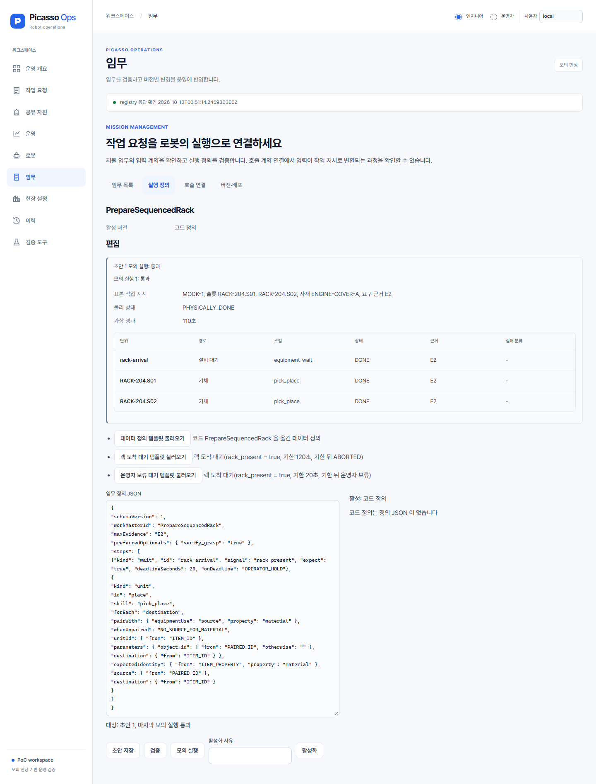

그림 04. 실행 정의 패널에서 초안의 모의 실행이 통과한 결과 알림과 모의 실행 보고(표본 작업 지시, 단위 표)가 표시됩니다.

#### 3.6.6 패널 «버전·배포»

region «공개와 배포 상태» 에는 h2 «버전과 적용 범위» 가 있습니다. 안내 문구로 «아래 이력은 선택한 임무의 실행 정의 활성화 이력입니다. 활성화한 정의는 다음 작업 지시부터 사용하며, 실행 중인 작업은 원래 버전을 유지합니다.» 가 표시됩니다. 이어서 «호출 연결에서 검증된 임무 버전을 배포하고 계약을 공개합니다. 활성화와 외부 API 공개는 별도 절차입니다.» 가 표시됩니다.

그 아래에 region «임무 ${workMasterId}» 가 있습니다. region «버전 이력» 에는 표 «임무 버전 이력» 이 있습니다. 표 «임무 버전 이력» 의 열 구성은 다음과 같습니다:
- 버전(활성이면 « (활성)» 표시)
- 초안
- 활성화한 사람
- 사유
- 활성화 시각

활성화 이력이 비어 있으면 «활성화한 버전이 없습니다. 코드 정의로 돕니다» 가 표시됩니다.

region «초안» 에는 표 «임무 초안 목록» 이 있습니다. 표 «임무 초안 목록» 의 열 구성은 다음과 같습니다:
- 초안
- 저장한 사람
- 저장 시각
- 마지막 모의 실행
- 조작(엔지니어 모드일 때 버튼 «초안 ${id} 열기» 제공)

저장한 초안이 없으면 «저장한 초안이 없습니다» 가 표시됩니다.

버튼 «초안 ${id} 열기» 를 누르면 실행 정의 패널로 이동합니다. 이 패널에서는 편집 구역을 감춥니다.

실행 정의를 활성화하는 것과 호출 계약을 공개·배포하는 것은 별도 절차입니다. 활성화한 버전은 다음 작업 지시부터 사용되며, 실행 목록과 인시던트의 «임무 버전» 칸에 표시됩니다.

### 3.7 현장 설정 (`#site`)

| 항목 | 내용 |
|---|---|
| 목적 | 현장 설정 버전(연결 기준 시간과 미들웨어 시간값 넷)과 변경 이력을 보이고 엔지니어가 새 버전을 기록합니다. 실행 호스트가 그 버전을 적용했는지 보입니다. |
| 누가 | 변경은 엔지니어 모드에서 하고 조회는 두 모드에서 합니다. |
| 진입 | 메뉴 7번입니다. |
| 컴포넌트 | `SiteArea.tsx` |
| API | GET `/api/site-settings`, PUT `/api/site-settings` |

`SiteArea.tsx` 컴포넌트에는 region «현장 설정» 하나가 있습니다. 운영자 모드에는 폼 자리에 «현장 설정 변경은 엔지니어 모드에서 합니다» 문장을 표시합니다. 데이터는 5초 주기의 다섯 조회 GET `/api/site-settings` 로 읽습니다. 변경은 기준 버전, 값 다섯, 사유를 실어 PUT `/api/site-settings` 로 보냅니다.

화면 배치는 위에서 아래로 다음 순서를 따릅니다:
1. 마지막 조작 알림(`OutcomeNotice`)
2. 직전 값 문장
3. dl «현재 버전», «연결 기준 시간»(«${n}초»), «허용 범위»(«${min}~${max}초»)
4. 실행 호스트 반영 줄
5. 묶음 구역 둘
6. 변경 폼 또는 모드 문장
7. h3 «버전 이력»
8. 표

실행 호스트 반영 줄에는 다음 문구 중 하나를 표시합니다:
- «실행 호스트 반영: 모름»
- «실행 호스트 반영: 미적용»
- «실행 호스트 반영: 버전 ${n}»

실행 호스트 상태에 따라 다음 줄이 덧붙습니다:
- «실행 호스트 읽기 실패: ${readError}»
- «실행 호스트가 적용하지 않은 버전 ${v}(범위 밖): ${사유}»

묶음 구역 둘의 구성은 다음과 같습니다:
- region «결과 판정 값»: «앞 폭을 늘리면 옛 신호가 완료 근거로 들어옵니다. 뒤 폭이나 inDoubtGrace 를 줄이면 UNVERIFIED 와 운영자 대기가 늘어납니다» 문장과 dl «근거 윈도우 앞 폭», «근거 윈도우 뒤 폭», «inDoubtGrace» 를 표시합니다.
- region «정체 표시»: «stallWindow 는 정체를 사람에게 보이는 시점만 바꿉니다. 실패 판정이나 자동 조치는 바뀌지 않습니다» 문장과 dl «stallWindow» 를 표시합니다.

엔지니어 모드의 form «현장 설정 변경» 은 다음 항목으로 구성합니다:
- «기준 버전 ${n}»
- 칸 «연결 기준 시간(초)»
- fieldset «결과 판정 값»(«근거 윈도우 앞 폭(초)», «근거 윈도우 뒤 폭(초)», «inDoubtGrace(초)»)
- fieldset «정체 표시»(«stallWindow(초)»)
- 칸마다 «허용 범위 ${min}~${max}초»
- 칸 «변경 사유»
- 버튼 «변경»

보내기 전 검사 alert 는 다음과 같습니다:
- 칸마다 «${주어} ${min}~${max}초의 정수여야 합니다»
- 사유가 비면 «변경 사유를 넣으십시오»

바뀐 칸이 없으면 what 은 «현장 설정 같은 값으로 새 버전 기록» 이 됩니다. 기준 버전이 낡으면 종류 «현장 설정 버전 충돌» 거부 카드가 나타납니다.

범위의 주인은 picasso 이고 화면은 운영 서비스가 실어 준 값을 보입니다. 저장소 `README.md` 에 따른 허용 범위는 다음과 같습니다:

| 항목 | 허용 범위 |
|---|---|
| 연결 기준 시간 | 60~3600초 |
| 근거 윈도우 앞 폭 | 5~120초 |
| 근거 윈도우 뒤 폭 | 5~120초 |
| inDoubtGrace | 10~600초 |
| stallWindow | 30~3600초 |

표 «현장 설정 버전 이력» 은 «표 가로 스크롤» 감싸개 안에 있습니다. 최신 버전부터 표시하며 열 열 개는 다음과 같습니다:
- 버전
- 연결 기준 시간
- 사용자
- 모드(«엔지니어»·«운영자»)
- 사유
- 기록 시각
- 근거 윈도우 앞 폭
- 근거 윈도우 뒤 폭
- inDoubtGrace
- stallWindow

현장 설정을 아직 읽지 못했을 때는 «모름: 현장 설정을 아직 읽지 못했습니다» 를 표시하고 폼도 나타나지 않습니다. 직전 값을 표시할 때는 «직전 값입니다» 문장을 씁니다.

바뀐 연결 기준 시간은 다음 기체 목록 읽기부터 로봇 영역의 «연결» 칸과 막힘에 쓰입니다. 기체 상세의 «연결 판정 기준» 과 막힘 카드 «근거 버전» 에 버전이 보입니다. 시간값은 인시던트 상세의 «현장 설정 버전», «시간값» 에 실립니다. 장애 주입은 이 영역에 없고 검증 도구에 있습니다.

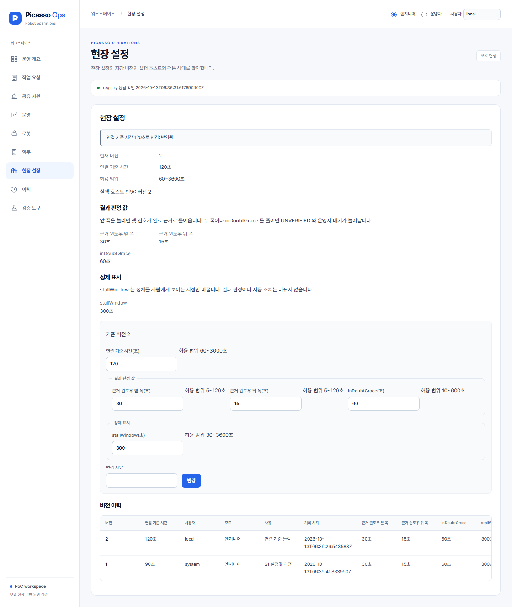

그림 15. 현장 설정 영역의 현재 버전, 실행 호스트 반영, 변경 폼, 버전 이력 표를 보입니다.

### 3.8 이력 (`#history`)

| 항목 | 내용 |
|---|---|
| 목적 | 화면과 운영 서비스를 거친 조작 기록(행위자, 대상, 사유, 결과)을 봅니다. |
| 누가 | 두 모드에서 조회하며 읽기 전용입니다. |
| 진입 | 메뉴 8번입니다. |
| 컴포넌트 | `HistoryArea.tsx` |
| API | GET `/api/operations` |

`HistoryArea.tsx` 컴포넌트는 `section[aria-label=조작 이력]` 과 h2 «조작 기록» 을 포함합니다. 화면과 운영 서비스를 거친 조작 기록의 행위자, 대상, 사유, 결과를 봅니다. 두 모드 모두 읽기 전용이며 정렬, 필터, 쪽 나눔은 없습니다. 데이터는 5초 주기의 다섯 조회 GET `/api/operations` 로 가져옵니다.

표는 이름이 없으며 «표 가로 스크롤» 감싸개 안에 있습니다. 열 구성은 다음과 같습니다:
- 시각
- 행위자: «엔지니어» 또는 «운영자» 와 사용자 이름을 «/» 로 잇습니다(예: 운영자/kim).
- 대상: 서버의 대상 문자열을 코드 꼴 그대로 표시합니다.
- 사유
- 결과: 코드 값(예: SUCCEEDED)으로 표시합니다.

대상 칸에는 기체·어댑터·프로파일·현장 설정·임무 조작뿐 아니라 작업 요청, 호출 계약, 실행 배포, 스테이션, 임무 자원, 현장 확인, 실행 취소(대상 = 실행 id, `op` `CANCEL_EXECUTION`), 결함 수용(대상 = 실행 id, `op` `RELEASE_FAULT_BLOCK`), 기체 빈손 확인(대상 = `${robotId}/${markerId}`, `op` `CONFIRM_ROBOT_EMPTY`) 같은 새 조작도 서버가 적은 대상 문자열로 쌓입니다.

상태 문구는 다음과 같습니다:
- «모름: 조작 기록을 아직 읽지 못했습니다»
- «직전 값입니다»
- «조작 기록이 없습니다»

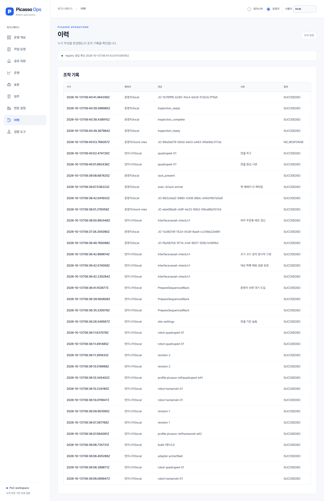

그림 16. 흐름을 돈 뒤 쌓인 조작 기록 표를 보입니다.

### 3.9 검증 도구 (`#validation`)

| 항목 | 내용 |
|---|---|
| 목적 | 모의 현장 시나리오에서 두 작업 요청의 계약·배포·완료 근거를 비교하고 기체에 장애를 넣어 예외 대응을 확인합니다. |
| 누가 | 비교는 두 모드(GET 만 쓰는 읽기 전용)에서 하고 장애 주입은 엔지니어 모드에서 합니다. |
| 진입 | 메뉴 9번입니다. |
| 컴포넌트 | `ManufacturingValidation.tsx`, `FaultPanel.tsx` |
| API | GET `/api/work-requests`, GET `/api/work-requests/{receiptId}`, POST `/api/faults` |

화면 위에는 region «제조 시나리오 검증» 을 배치하고 아래에는 region «장애 주입» 을 배치합니다.

#### 3.9.1 제조 시나리오 검증

`ManufacturingValidation.tsx` 의 region «제조 시나리오 검증» 구역입니다. h2 «호출 계약과 실행 근거 비교» 와 설명 «같은 임무가 다른 로봇에 배정되었는지, 완료 근거가 어떻게 달라졌는지 작업 요청 기록으로 확인합니다.» 가 있습니다.

단계 넷(`ol.validation-journey`)과 각 링크는 다음과 같습니다:
1. «공통 임무»: «두 기종이 지원하는 스테이션 검사 계약을 고정합니다.» 문장과 링크 «임무·호출 계약»(`#missions`)이 있습니다.
2. «케이퍼빌리티 기반 배정»: «두 검사를 연속 호출해 가용 기체에 배정합니다. 집기 미지원 기체의 배제 사유도 확인합니다.» 문장과 링크 «배정·실행 확인»(`#operations`)이 있습니다.
3. «예외와 재작업»: «모의 랙 도착 신호가 누락되면 보류 사유를 확인하고 운영자가 근거를 남겨 재작업합니다.» 문장과 링크 «보류·인시던트 판단»(`#operations`)이 있습니다.
4. «상위 결과»: «원래 작업 요청과 작업 ID를 유지하며 저장 결과를 확인합니다.» 문장과 링크 «작업 요청·결과 추적»(`#requests`)이 있습니다.

구역에 «참조 시뮬레이터 시나리오입니다. E0 검사와 설비 관측 E2 공급은 요구 근거가 다른 임무이며, 기종 자체가 근거 등급을 결정하지 않습니다.» 안내 문구가 있습니다.

검색 form «비교할 작업 요청 검색» 의 구성은 다음과 같습니다:
- 칸 «비교할 외부 주문 검색»
- 버튼 «비교 작업 요청 검색»
- 링크 «전체 작업 요청에서 ID 확인»
- 안내 «검색 결과의 최근 20건에서 선택하거나 전체 작업 요청의 ID를 입력하세요.»

검색 시 GET `/api/work-requests?search=&offset=0&limit=20` 을 호출합니다. 실패 alert 뒤에는 « · 목록은 직전 검색 값입니다.» 가 붙습니다.

비교 form «두 작업 요청 비교» 의 구성은 다음과 같습니다:
- 칸 «작업 요청 A ID»
- 칸 «작업 요청 B ID»(검색 결과 datalist «${외부 주문} · ${state}»)
- 버튼 «두 작업 요청 비교하기»(진행 중 «비교 조회 중»)

비교 시 GET `/api/work-requests/{receiptId}` 를 두 번 호출합니다. 오류 발생 시 alert 로 «${error} · 비교 판정을 표시하지 않습니다.» 를 표시합니다(예: «서로 다른 두 작업 요청을 선택하세요.», «작업 요청 상세 식별자가 일치하지 않습니다.»).

비교 결과(`div[aria-label=작업 요청 비교 결과]`)는 다음과 같이 표시합니다:
- status: 다음 세 문구 중 하나 뒤에 « 완료 여부는 각 저장 결과에서 확인하세요.» 가 붙습니다.
  - «동일 계약·동일 실행 배포입니다.»
  - «계약 또는 실행 배포가 다릅니다.»
  - «계약·실행 배포 정보를 모두 확인할 수 없습니다.»
- 표 «계약·배포 비교»(«계약 비교 표 스크롤» 감싸개): 열은 비교 항목, 작업 요청 A, 작업 요청 B 이고 행은 호출 계약, 계약 버전, 임무, 고정 임무 버전, 실행 배포 버전 입니다. 값이 없으면 «확인 안 됨» 으로 표시합니다.

근거 카드 둘 `article`(접근 이름 «작업 요청 A 근거», «작업 요청 B 근거»)의 구성은 다음과 같습니다:
- h3 «A · ${외부 주문}»
- «작업 요청 상태 ${state}»(상태 코드 그대로)
- «현재 호스트 조회 조회됨» 또는 «현재 호스트 조회 모름»
- 저장 결과가 있는 경우: «저장 결과 v${n} · ${at}», 저장 결과 요약(`StoredResultSummary`, §3.2.5), 접기 «저장 결과 원문»
- 저장 결과가 없는 경우: «저장 결과가 아직 없습니다. 호스트 수락을 완료로 판정하지 않습니다.»
- 링크 «이 작업 요청의 결과·확인 이력»

결과 영역 끝에는 «비교 버튼을 누른 시점의 조회입니다. 현장 상태가 달라지면 다시 조회하세요.» 문장이 있습니다.

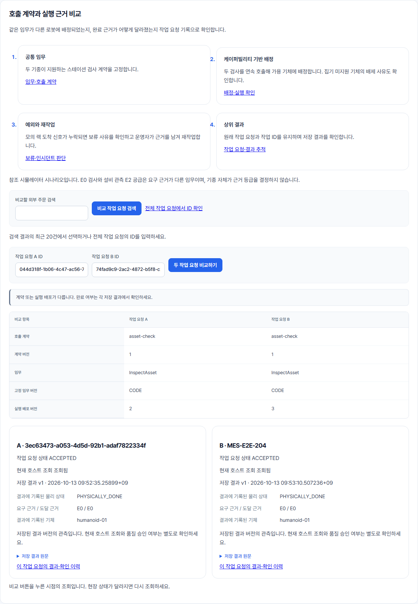

그림 18. 두 작업 요청을 비교한 결과와 비교 판정, 계약·배포 비교 표, A·B 근거 카드를 보입니다.

#### 3.9.2 장애 주입

`FaultPanel.tsx` 의 region «장애 주입» 구역입니다. 안내 문구로 «기체 하나에 장애를 넣습니다. 받아들임은 현장이 장애를 넣었다는 뜻이고, 그 효과는 운영 영역의 실행 목록과 인시던트, 로봇 영역의 기체 목록에서 확인합니다» 를 표시합니다.

운영자 모드에서는 «장애 주입은 엔지니어 모드에서 합니다» 문구가 표시되고 버튼이 없습니다. 기체 목록을 읽지 못하면 «모름: 기체 목록을 아직 읽지 못했습니다» 를 표시합니다. 퇴역 아닌 기체가 없으면 «장애를 넣을 기체가 없습니다» 를 표시합니다.

엔지니어 모드의 form «장애 주입 폼» 구성은 다음과 같습니다:
- select «기체»(퇴역 아닌 기체)
- select «장애 종류»(«스킬 실패(진행 중 태스크)», «연결 상태»)
- 장애 종류가 연결 상태면 select «연결 상태»(«OFFLINE», «CONNECTION_BROKEN», «ONLINE(복구)»)
- 칸 «장애 주입 사유»
- 버튼 «장애 넣기»

사유가 비어 있으면 alert «장애 주입 사유를 넣으십시오» 가 나타납니다. POST `/api/faults` 로 요청을 보내며 조작 뒤 다시 읽지 않습니다.

결과(status «장애 주입 결과»)는 다음 중 하나를 표시합니다:
- «보내지 않음(${풀이}). ${detail}»
- «결과 모름(${cause}). 실행 목록과 기체 목록에서 확인하십시오»
- «받아들임(태스크 ${taskId}, ${taskState})»(이미 서 있었으면 «. 같은 결함이 이미 서 있었습니다» 가 붙습니다)
- «받아들임(연결 상태 ${state})»
- «받아들임(이미 ${state} 상태라 바뀐 것 없음)»
- «현장이 거부함(${풀이}). ${detail}»
- «응답 없음. 넣었는지 모릅니다. 실행 목록과 기체 목록에서 확인하십시오»

장애 주입 효과는 운영 영역의 실행 목록과 인시던트(§3.4.4, §3.4.5), 로봇 영역의 기체 목록 «연결» 칸(§3.5.3)에서 봅니다.

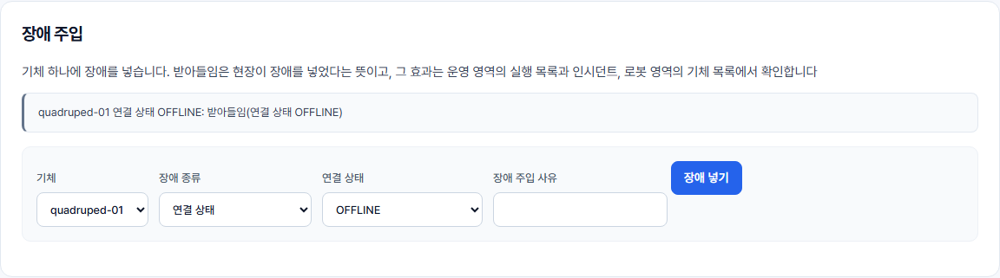

그림 17. 검증 도구의 장애 주입 구역과 엔지니어 모드의 결과 알림을 보입니다.

## 4. 화면을 바꿀 때 지킬 것

리터치는 끝났고 지금 UI 가 최종입니다. 이 장은 옛 설계서의 4장(디자이너 리터치 지침)을 대신해 화면을 고칠 때 무엇은 자유롭고 무엇은 시험과 함께 바꿔야 하는지 적습니다.

시험 구성은 다음과 같습니다.
- vitest 25개 파일(시험 240, `ui/src/**/*.test.tsx`)
- Playwright `ui/e2e/lifecycle.spec.ts`(설정 `playwright.config.ts`)
- Playwright `ui/e2e/station.spec.ts`(설정 `playwright.station.config.ts`)

시험은 `data-testid` 를 쓰지 않습니다. 요소를 찾을 때 다음 기준을 씁니다.
- 역할
- 접근 이름
- 라벨
- 글자
- CSS 클래스

### 4.1 시험과 상관없이 바꿀 수 있는 것

다음 시각 요소는 `styles.css` 의 `:root` 토큰과 규칙으로 바꿀 수 있습니다. 시험은 보지 않습니다.
- 색
- 글꼴
- 크기
- 여백
- 테두리
- 모서리
- 그림자

단 다음 상태는 서로 달라 보여야 합니다.
- 모름
- 직전 값
- 보류
- 사람의 판단
- 재기동 복원
- 재기동 중복

다음 항목도 바꿀 수 있습니다.
- 아이콘(`App.tsx` 의 `AREA_ICONS`)
- 파비콘
- 브랜드 자리
- `<title>`

구역 안 요소의 배치와 폭, 반응형 기준(`@media`)을 바꿀 수 있습니다. 단 4.2 의 순서 제약은 지킵니다.

장식 글자를 더할 수 있습니다. 단 메뉴 버튼이나 이름으로 찾는 요소 안에 글자를 더하면 접근 이름이 바뀝니다.

### 4.2 시험과 함께 바꿔야 하는 것

| 항목 | 지킬 것 | 근거 시험 |
|---|---|---|
| 메뉴 | `nav[aria-label=영역]` 버튼 글자 배열이 정확히 [«운영 개요», «작업 요청», «공유 자원», «운영», «로봇», «임무», «현장 설정», «이력», «검증 도구»] 여야 합니다. 버튼 안에 글자를 더하면 깨집니다. | `App.test.tsx` |
| 구역과 역할 이름 | region, table, form, article, status, list, group, navigation 의 접근 이름(4.3)을 지켜야 합니다. | 영역별 vitest, `lifecycle.spec.ts`, `station.spec.ts` |
| 라벨 | 모든 입력의 `<label>` 글자(4.3)를 지켜야 합니다. | 영역별 vitest, `lifecycle.spec.ts`, `station.spec.ts` |
| 표 열 순서 | 시험이 칸 순서나 행 전체 글자로 보는 표입니다. 다음 표들의 열 순서를 지켜야 합니다. - 기체별 배정 가능(아홉 열, 8번째 «배정 가능») - 실행 목록(2번째 작업 지시 id) - 인시던트 목록(8~11번째) - 송신 기록 목록(10번째 처분) - 셀 대역 신호 - 현장 설정 버전 이력 - 리비전 목록 - 임무 버전 이력 - 모의 실행 단위 표 - 미해소 잔여 파지(일곱 열, 행 전체 글자) | `OperationsArea.test.tsx`, `IncidentSection.test.tsx`, `JobResponseLog.test.tsx`, `ExecutionControls.test.tsx`, `lifecycle.spec.ts` |
| dt 와 dd | 시험 도우미가 `dt` 글자로 찾고 바로 다음 형제 `dd` 를 봅니다. dl 을 다른 꼴로 바꾸면 도우미도 고쳐야 합니다. | `RobotsArea.test.tsx`, `SiteArea.test.tsx`, `CommissioningCards.test.tsx`, `IncidentSection.test.tsx`, `MissionsArea.test.tsx`, `OperationsArea.test.tsx`, `FollowupWorkspace.test.tsx`, `lifecycle.spec.ts` |
| CSS 클래스 | `held`(보류 행), `selected`(고른 행), `duplicate`(재기동 중복 행), `asserted`(사람의 판단) 클래스를 지켜야 합니다. | `IncidentSection.test.tsx`, `OperationsArea.test.tsx`, `JobResponseLog.test.tsx` |
| 순서 | region «재기동 복원 보고» 는 표 «실행 목록» 앞에 둡니다. | `ExecutionRestore.test.tsx` |
| 모드 가르기 | §1.3 의 세 방식은 시험이 각각 다르게 확인합니다. 감추는 곳은 버튼이 없음을, 비활성인 곳은 `toBeDisabled` 를 봅니다. 방식을 바꾸면 시험도 바꿉니다. | `FaultPanel.test.tsx`, `MissionInterfaces.test.tsx`, `ManualJobOrder.test.tsx`, `FollowupWorkspace.test.tsx`, `ExecutionControls.test.tsx`, `lifecycle.spec.ts` |
| 상태 문장 | «모름: …», «직전 값입니다 …», «… 없습니다» 와 새 영역의 상태 문장은 글자가 시험 대상입니다. | 영역별 vitest |
| 코드 값 칸 | §2.7.3 끝의 코드 값 칸은 풀지 않습니다. 시험이 그 코드 글자에 기댑니다. | 영역별 vitest, `lifecycle.spec.ts` |
| 화면 밖 안내 | 회색 `.offscreen` 문장(화면 밖 작업, 명칭 티칭, 장소 이름, 셀 대역)은 화면이 대신하지 않는 일을 알립니다. 시험이 일부를 정규식으로 봅니다. | `RobotsArea.test.tsx`, `CommissioningCards.test.tsx` |
| 알림 역할 | 결과 알림은 `role="status"`, 입력 오류와 띠 모름은 `role="alert"` 를 씁니다. | 영역별 vitest |
| 스크린숏 촬영 | `ui/screens/capture.spec.ts` 와 `lifecycle.spec.ts`·`station.spec.ts` 의 부수 촬영도 같은 이름으로 요소를 찾습니다. | `ui/screens/capture.spec.ts`, `lifecycle.spec.ts`, `station.spec.ts` |

### 4.3 시험이 기대는 이름과 글자

대괄호 안은 시험 파일 이름에서 `.test.tsx`, `.spec.ts` 를 뺀 것입니다.

다음은 region 과 navigation 역할에 기대는 이름입니다.

| 구분 | 글자 | 시험 파일 |
|---|---|---|
| region | «운영 개요» | `lifecycle.spec.ts` |
| region | «결과 자동 수집» | `FollowupWorkspace.test.tsx`, `lifecycle.spec.ts` |
| region | «상위 작업 요청» | `lifecycle.spec.ts` |
| region | «외부 결과 수신 확인» | `lifecycle.spec.ts` |
| region | «저장 결과의 완료 근거» | `WorkRequests.test.tsx`, `lifecycle.spec.ts` |
| region | «거부 사유» | `WorkRequests.test.tsx` |
| region | «기체별 출발 결품» | `WorkRequests.test.tsx` |
| region | «출발 미관측»·«출발 자리 확인 이력» | `WorkRequests.test.tsx` |
| region | «상위 시스템이 대신 보낸 작업 요청»·«상위 시스템이 대신한 앞선 작업 요청» | `WorkRequests.test.tsx` |
| region | «현장 확인 기록»·«현장 확인 이력» | `lifecycle.spec.ts` |
| region | «공유 스테이션 운영»·«임무 필수 자원» | `station.spec.ts` |
| region | «작업 지시»·«수동 작업 요청 추적» | `lifecycle.spec.ts` |
| region | «실행» | `ExecutionRestore.test.tsx`, `OperationsArea.test.tsx` |
| region | «재기동 복원 보고» | `ExecutionRestore.test.tsx` |
| region | «작업 허가 대기» | `PermitBlockNotice.test.tsx` |
| region | «잔여 파지 확인» | `ExecutionControls.test.tsx`, `lifecycle.spec.ts` |
| region | «인시던트»·«이전 인스턴스»·«관측» | `IncidentSection.test.tsx` |
| region | «인시던트 상세»·«사람의 판단» | `IncidentSection.test.tsx`, `lifecycle.spec.ts` |
| region | «셀 대역» | `OperationsArea.test.tsx` |
| region | «작업 응답 송신 기록» | `JobResponseLog.test.tsx`, `lifecycle.spec.ts` |
| region | «기체 목록» | `CommissioningCards.test.tsx`, `lifecycle.spec.ts` |
| region | «로봇 도입 준비» | `OnboardingGuide.test.tsx`, `lifecycle.spec.ts` |
| region | «어댑터»·«프로파일» | `OnboardingGuide.test.tsx` 등, `lifecycle.spec.ts` |
| region | «바인딩»·«사이트 명칭»·«시운전» | `CommissioningCards.test.tsx` |
| region | «${robotId} 상세» | `RobotsArea.test.tsx`, `SiteArea.test.tsx`, `CommissioningCards.test.tsx`, `lifecycle.spec.ts` |
| region | «임무 PrepareSequencedRack» | `App.test.tsx`, `MissionsArea.test.tsx` |
| region | «임무 편집»·«새 임무 생성»·«버전별 호출 계약»·«호출 계약 작성»·«계약 입력의 배정 가능 미리보기» | `lifecycle.spec.ts` |
| region | «선택한 호출 계약» | `MissionInterfaces.test.tsx`, `lifecycle.spec.ts` |
| region | «실행 배포» | `FollowupWorkspace.test.tsx`, `lifecycle.spec.ts` |
| region | «공개와 배포 상태» | `MissionWorkspace.test.tsx` |
| region | «현장 설정» | `FaultPanel.test.tsx`, `SiteArea.test.tsx`, `lifecycle.spec.ts` |
| region | «결과 판정 값»·«정체 표시» | `SiteArea.test.tsx` |
| region | «장애 주입» | `FaultPanel.test.tsx` |
| region | «제조 시나리오 검증» | `lifecycle.spec.ts` |
| navigation | «영역» | `App.test.tsx`, `OnboardingGuide.test.tsx`, `lifecycle.spec.ts`, `station.spec.ts` |
| navigation | «임무 관리» | `MissionWorkspace.test.tsx`, `lifecycle.spec.ts` |

다음은 table, article, list 역할에 기대는 이름입니다.

| 구분 | 글자 | 시험 파일 |
|---|---|---|
| table | «기체별 배정 가능» | `MissionInterfaces.test.tsx`, `OperationsArea.test.tsx`, `lifecycle.spec.ts` |
| table | «실행 목록» | `ExecutionRestore.test.tsx`, `OperationsArea.test.tsx`, `ExecutionControls.test.tsx`, `lifecycle.spec.ts` |
| table | «미해소 잔여 파지» | `ExecutionControls.test.tsx`, `lifecycle.spec.ts` |
| table | «인시던트 목록»·«이전 인스턴스 인시던트 목록»·«근거 윈도우» | `IncidentSection.test.tsx` |
| table | «셀 대역 신호»·«셀 대역 자리» | `OperationsArea.test.tsx` |
| table | «송신 기록 목록» | `JobResponseLog.test.tsx`, `lifecycle.spec.ts` |
| table | «스테이션 점유»(`StationWorkspace.test.tsx`도 봄)·«스테이션 작업» | `station.spec.ts` |
| table | «인스턴스 목록»·«제품·빌드 목록» | `AdaptersSection.test.tsx` |
| table | «리비전 목록» | `ProfilesSection.test.tsx`, `lifecycle.spec.ts` |
| table | «임무 버전 이력»·«임무 초안 목록» | `MissionsArea.test.tsx` |
| table | «입력 필드 매핑» | `MissionWorkspace.test.tsx` |
| table | «현장 설정 버전 이력» | `SiteArea.test.tsx`, `lifecycle.spec.ts` |
| article | «작업 요청 상세» | `ManualJobOrder.test.tsx`, `WorkRequests.test.tsx`, `lifecycle.spec.ts` |
| article | «스테이션 작업 근거» | `StationWorkspace.test.tsx`, `station.spec.ts` |
| article | «작업 요청 A 근거»·«작업 요청 B 근거» | `ManufacturingValidation.test.tsx`, `lifecycle.spec.ts` |
| list | «기체별 미배정 사유», «실행 호스트가 후보에서 뺀 기체» | `OperationsArea.test.tsx`, `JobOrderNotice.test.tsx` |
| list | «리빌드한 실행», «미룬 실행», «포기한 실행» | `ExecutionRestore.test.tsx` |

다음은 form 과 status 역할에 기대는 이름입니다.

| 구분 | 글자 | 시험 파일 |
|---|---|---|
| form | «기체 선언», «리비전 제출», «바인딩», «빌드 선언», «제품 선언», «인스턴스 등록», «운영자 판단», «작업 지시 폼», «장애 주입 폼», «퇴역», «현장 설정 변경», «실행 취소», «결함 수용», «기체 빈손 확인» | 영역별 vitest |
| status | «제출 결과», «판단 결과», «신호 조작 결과», «임무 조작 결과», «장애 주입 결과», «계약 호출 결과», «호출 계약 처리 결과», «실행 취소 결과», «결함 수용 결과», «빈손 확인 결과» | 영역별 vitest |

다음은 버튼과 링크에 기대는 글자입니다. 버튼 이름은 101가지가 시험에 나옵니다.

| 구분 | 글자 | 시험 파일 |
|---|---|---|
| 버튼 | «작업 요청 내기» | `ManualJobOrder.test.tsx`, `OperationsArea.test.tsx`, `lifecycle.spec.ts` |
| 버튼 | «동일 작업 요청 확인», «새 작업 작성», «작업 요청·실행 결과 보기» | `ManualJobOrder.test.tsx`, `lifecycle.spec.ts` |
| 버튼 | «호출 계약으로 작업 요청»·«이 입력으로 배정 가능 확인»·«동일 계약 작업 요청 확인» | `MissionInterfaces.test.tsx`, `lifecycle.spec.ts` |
| 버튼 | «미배정 재평가» | `FollowupWorkspace.test.tsx`, `MissionResourceSettings.test.tsx` |
| 버튼 | «현장 확인 기록 저장» | `RequestReview.test.tsx`, `lifecycle.spec.ts` |
| 버튼 | «출발 자리 확인 기록» | `WorkRequests.test.tsx` |
| 버튼 | «스테이션 등록»·«스테이션 작업 요청» | `StationWorkspace.test.tsx`, `station.spec.ts` |
| 버튼 | «현장 확인 후 자원 해제»·«현장 확인 후 격리 해제»·«점유 작업 보기» | `StationWorkspace.test.tsx` |
| 버튼 | «필수 자원 등록» | `MissionResourceSettings.test.tsx`, `station.spec.ts` |
| 버튼 | «로봇 추가»·«운영에서 배정 조건 확인» | `OnboardingGuide.test.tsx`, `lifecycle.spec.ts` |
| 버튼 | «작업 요청 다시 조회» | `WorkRequests.test.tsx`, `lifecycle.spec.ts` |
| 버튼 | «개요 다시 조회» | `FollowupWorkspace.test.tsx` |
| 버튼 | «rack_present 켜기»·«rack_present 끄기» | `OperationsArea.test.tsx`, `lifecycle.spec.ts` |
| 버튼 | «${id} 상세 보기» | `IncidentSection.test.tsx` |
| 버튼 | «현장 확인 후 실행 취소»·«현장 확인 후 결함 수용»·«기체 빈손 확인» | `ExecutionControls.test.tsx` |
| 버튼 | «${externalOrderId} 작업 요청 보기» | `WorkRequests.test.tsx`, `lifecycle.spec.ts` |
| 버튼 | 하위 탭과 패널 버튼 «기체»·«도입 준비»·«어댑터 관리»·«프로파일 관리»·«실행 정의»·«호출 연결»·«버전·배포» | `lifecycle.spec.ts` 등 |
| 링크 | 지표 카드 «총 작업 요청»·«작업 요청 거부» | `lifecycle.spec.ts` |
| 링크 | «총 작업 요청 5»·«미배정 2»·«제출 확인 필요 2»·«외부 결과 수신 미확인 3» 꼴 정규식 | `FollowupWorkspace.test.tsx` |
| 링크 | «판정 근거 JSON» | `StationWorkspace.test.tsx` |
| 링크 | «공유 자원에서 관측·복구» | `MissionResourceSettings.test.tsx` |

다음은 입력 라벨에 기대는 글자입니다. 라벨은 75가지가 시험에 나옵니다.

| 구분 | 글자 | 시험 파일 |
|---|---|---|
| 라벨 | «외부 주문·출처·내부 ID 검색», «작업 요청 상태» | `WorkRequests.test.tsx` |
| 라벨 | «현장 관측»·«확인 근거·담당자·인계 내용» | `RequestReview.test.tsx`, `lifecycle.spec.ts` |
| 라벨 | «확인한 자재»·«확인 근거·담당자» | `WorkRequests.test.tsx` |
| 라벨 | «재평가 판단 사유» | `FollowupWorkspace.test.tsx` |
| 라벨 | «대상 호출 계약»·«사용할 스테이션»·«스테이션 ID»·«스테이션 이름» | `StationWorkspace.test.tsx`, `station.spec.ts` |
| 라벨 | «준비 조건이 충족되면 실제 로봇 작업을 지시합니다» | `StationWorkspace.test.tsx`, `station.spec.ts` |
| 라벨 | «현장 작업과 자원 해제 가능 여부를 확인했습니다»·«운영자 판단 근거» | `StationWorkspace.test.tsx` |
| 라벨 | «작업 번호 송신 신호»·«작업 번호 반환 신호»·«설비·로봇 상태와 격리 해제 가능 여부를 확인했습니다» | `StationWorkspace.test.tsx` |
| 라벨 | «이 입력으로 실제 작업을 지시합니다» | `MissionInterfaces.test.tsx`, `lifecycle.spec.ts` |
| 라벨 | «작업 요청 A ID»·«작업 요청 B ID» | `ManufacturingValidation.test.tsx`, `lifecycle.spec.ts` |
| 라벨 | «연결 기준 시간(초)»·«stallWindow(초)»·«변경 사유» | `SiteArea.test.tsx`, `lifecycle.spec.ts` |
| 라벨 | «판단 사유» | `IncidentSection.test.tsx`, `lifecycle.spec.ts` |
| 라벨 | «취소할 실행»·«취소 사유»·«기체·설비 상태를 확인했고 이 실행을 끝냅니다»·«빈손 확인 근거»·«기체 손에 남은 물체가 없음을 현장에서 직접 확인했습니다» | `ExecutionControls.test.tsx` |
| 라벨 | «사용자» | `App.test.tsx` |

다음은 같은 글자가 여러 번 나와 시험이 하나를 고를 수 없던 자리에 붙인 구별용 접근 이름입니다.

| 구분 | 글자 | 시험 파일 |
|---|---|---|
| 구별용 접근 이름 | «작업 요청 목록 이전 페이지»·«작업 요청 목록 다음 페이지»(버튼 글자 «이전»·«다음») | `WorkRequests.test.tsx` |
| 구별용 접근 이름 | «외부 결과 필터»(select) | 시험 없음 |
| 구별용 접근 이름 | 표 스크롤 감싸개의 이름들(§2.9) | 시험 없음 |
| 구별용 접근 이름 | 지표 카드 «총 작업 요청»(같은 영역의 링크 «전체 작업 요청» 과 겹치지 않게 PR #23 에서 바꿈) | `lifecycle.spec.ts` |

공유 자원 화면에서 시험이 이름이 아니라 글자로 보는 항목은 다음과 같습니다. 이 글자들은 `labels.ts`의 `STATION_TEXT`와 서버 문구에서 옵니다.

| 구분 | 글자 | 시험 파일 |
|---|---|---|
| note(이름 없음) | «설비가 비어 있고 이전 작업 로봇이 멈췄는지 현장에서 확인하세요. 설비 완료 신호가 꺼진 것을 확인한 뒤 판단하세요.» | `StationWorkspace.test.tsx` |
| 접근 설명(송신 칸) | «작업 번호 일치를 검증하는 신호로, 설비는 시작 시 받은 번호를 유지했다가 완료 신호와 함께 반환해야 합니다. 연결하지 않으면 현장 확인 후 작업 해제 시 스테이션이 격리됩니다.» | `StationWorkspace.test.tsx` |
| 표 행 글자 | «작업번호 검증 inspection_job / inspection_job_done»·«격리 상태» | `StationWorkspace.test.tsx` |
| 문장 | «자원을 해제해도 이전 작업은 멈추지 않으며 해당 스테이션은 격리됩니다.» | `StationWorkspace.test.tsx` |
| alert | «작업 번호 송신·반환 신호는 둘 다 연결하거나 둘 다 비워야 합니다.» | `StationWorkspace.test.tsx` |

운영 화면의 실행 취소·결함 수용·잔여 파지에서 시험이 글자로 보는 항목(인시던트 상세의 note 만 `IncidentSection.test.tsx`, 나머지는 `ExecutionControls.test.tsx`, 글자는 `labels.ts` 의 `EXECUTION_CONTROL_TEXT`·`CANCEL_RESULT_LABEL`·`RELEASE_RESULT_LABEL`·`KIND_LABEL`):

| 종류 | 문구 | 시험 파일 |
|---|---|---|
| note(이름 없음) | «이 확인은 물리 확인입니다. 로봇 손과 그리퍼에 물체가 남지 않았는지 현장에서 직접 보고 확인하세요. 화면이나 로봇 보고만으로 확인하지 마세요.» | `ExecutionControls.test.tsx` |
| 폼 글자 | «부분 완료(PARTIAL) 실행은 취소하기 전까지 기체를 쥐고 있어 그 기체에 새 작업이 배정되지 않습니다.» | `ExecutionControls.test.tsx` |
| 실행 목록 표 글자 정규식 | «취소 요청: kim, 결품» | `ExecutionControls.test.tsx` |
| status | «exec-1(JO-1) 실행 취소: 취소를 걸었습니다. 실행 호스트의 다음 pump 에서 중단(ABORTED)으로 종결합니다» | `ExecutionControls.test.tsx` |
| status 안 | «실행 호스트가 재기동해 인스턴스가 다름» | `ExecutionControls.test.tsx` |
| status 안 | «이미 해소한 잔여 파지 표시» | `ExecutionControls.test.tsx` |
| status 안 | «빈손 확인이 기록되었습니다. 그 기체는 다음 배정 판정부터 다시 판정됩니다» | `ExecutionControls.test.tsx`, `lifecycle.spec.ts` |
| 문장 | «실행 취소는 운영자 모드에서 합니다» | `ExecutionControls.test.tsx` |
| 문장 | «결함 수용은 운영자 모드에서 합니다» | `ExecutionControls.test.tsx` |
| 폼 글자 | «수용은 결함을 지우지 않으며, 이 결함들이 다음 단위를 막지 않게 하고 다음 로봇 단위를 냅니다. 기체 상태를 현장에서 확인한 뒤 결정하세요.»·«작업 허가 대기는 수용으로 풀리지 않습니다.» | `ExecutionControls.test.tsx` |
| group·dl | «수용할 결함»·«수용할 결함 1» | `ExecutionControls.test.tsx` |
| status | «exec-2(JO-2) 결함 수용: 수용했습니다. 실행 호스트의 다음 pump 에서 다음 단위를 냅니다» 와 결과·응답 없음 글자 전부(`RELEASE_RESULT_LABEL`, `releaseApplied`·`releaseNotApplied`·`releaseUnconfirmed`) | `ExecutionControls.test.tsx` |
| status 안 | «요청 id 재사용»·«수용 본문 오류» | `ExecutionControls.test.tsx` |
| 실행 목록 표 글자 | «결함 차단 2건»·«(결함 수용: park, 첫 재측위)» | `ExecutionControls.test.tsx` |
| note | «이 실행은 지금도 결함으로 막혀 있습니다. 수용은 운영 영역의 실행 구역에서 합니다.» | `IncidentSection.test.tsx` |
| 문장 | «기체 빈손 확인은 운영자 모드에서 합니다» | `ExecutionControls.test.tsx` |
| 문장 | «미해소 잔여 파지 표시가 없습니다» | `ExecutionControls.test.tsx`, `lifecycle.spec.ts` |
| 문장 | «이름 없음» | `ExecutionControls.test.tsx` |
| 정규식 | «^모름: 잔여 파지 표시를 아직 읽지 못했습니다 \(실행 호스트가 답하지 않는다» | `ExecutionControls.test.tsx` |

운영 › 실행과 작업 요청 상세의 작업 허가 대기에서 시험이 글자로 보는 항목(전부 `PermitBlockNotice.test.tsx`, 글자는 `labels.ts` 의 `PERMIT_BLOCK_TEXT`·`WORK_PERMIT_LABEL`·`WITHHELD_ISSUE_LABEL`·`PERMIT_CAUSE_LABEL`):

| 종류 | 문구 | 시험 파일 |
|---|---|---|
| 문장 | «운영자 판단이나 결함 해제로 풀리지 않습니다. 아래 풀릴 근거가 채워지면 다음 pump 에 명령을 냅니다.» | `PermitBlockNotice.test.tsx` |
| 문장 | «작업 허가는 안전 신호를 비춘 정보이며 기체를 세우는 것은 안전 계통입니다. 이미 나간 명령과 도는 단위의 취소는 이 대기와 상관없이 그대로입니다. 다만 미확정 단위의 취소는 재조회가 필요하여 허가가 돌아온 뒤에 나갑니다.» | `PermitBlockNotice.test.tsx` |
| 굵은 글자 | «기체 humanoid-01: 차단»·«기체 humanoid-01: 모름(차단)»(허가 글자 `PERMITTED` «허가», `INHIBITED` «차단», `UNKNOWN` «모름(차단)») | `PermitBlockNotice.test.tsx` |
| dd | «단위 출발»·«개정 갱신»(`WITHHELD_ISSUE_LABEL`: `START` «단위 출발», `REVISION_UPDATE` «개정 갱신», `IN_DOUBT_LOOKUP` «미확정 조회») | `PermitBlockNotice.test.tsx` |
| 정규식 | «원천 보고», «까닭 허가 원천 없음 · 막는 주체 없음»(`PERMIT_CAUSE_LABEL`: `REPORTED` «원천 보고», `EXPIRED` «관측 만료», `SESSION_CHANGED` «원천 세션 바뀜», `SCOPE_UNKNOWN` «대상 기체 모름», `NOT_COVERED` «허가 원천 없음», `PORT_FAILED` «허가를 읽지 못함») | `PermitBlockNotice.test.tsx` |
| 정규식 | «막는 주체 guard_closed=false», «풀릴 근거 안전 계통이 guard_closed 을 true 으로 되돌릴 때» | `PermitBlockNotice.test.tsx` |

### 4.4 해시 경로

영역 해시는 다음과 같습니다.
- `#overview`
- `#requests`
- `#stations`
- `#operations`
- `#robots`
- `#missions`
- `#site`
- `#history`
- `#validation`

지표 카드와 링크는 다음 경로를 씁니다.
- `#requests?state=UNASSIGNED`
- `#requests?state=NEEDS_CONFIRMATION`
- `#requests?state=REJECTED`
- `#requests?result=unacknowledged`
- `#requests?receipt=${receiptId}`

기체 상세 앵커는 `#robot-detail` 입니다.

`lifecycle.spec.ts` 가 `#requests?…receipt=` 꼴 URL 을 확인하고, 시험과 촬영 도우미가 사이드바 메뉴 이름으로 영역을 옮깁니다. 해시나 쿼리 이름을 바꾸면 이 링크들과 시험을 함께 바꿉니다.

## 5. 그림 목록

대표 스크린숏 21장은 `img/` 에 있습니다. 파일마다 영역, 구역, 모드, 상태, 만든 방법은 `img/INDEX.md` 에 있습니다.
